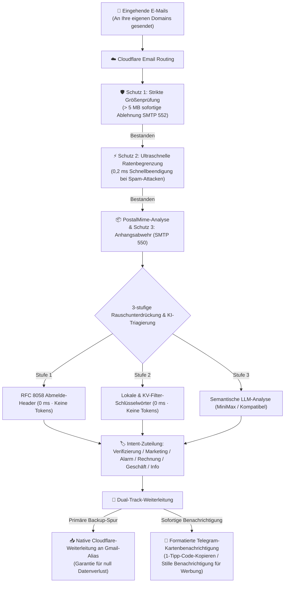

<div align="center">

# 📬 cf-mail2tg-aibot

**Produktionsreifer, kostenloser, selbst gehosteter E-Mail-zu-Telegram KI-Bot basierend auf Cloudflare Workers & LLM**  
*Production-grade, zero-cost, self-hosted Email to Telegram AI Bot powered by Cloudflare Workers & LLM.*

[](LICENSE)
[](https://workers.cloudflare.com/)
[](https://core.telegram.org/bots/api)
[](https://www.typescriptlang.org/)
[](https://vitest.dev/)
[](#-5--internationalisierung-i18n-in-8-sprachen--sofortiger-wechsel)
[](#-null-kosten--kostenlose-kontingent-garantie)

<p align="center">
  <a href="./README.md">English</a> •
  <a href="./README.zh-CN.md">简体中文</a> •
  <a href="./README.zh-TW.md">繁體中文</a> •
  <a href="./README.ja-JP.md">日本語</a> •
  <a href="./README.ru-RU.md">Русский</a> •
  <a href="./README.es-ES.md">Español</a> •
  <a href="./README.fr-FR.md">Français</a> •
  <b>Deutsch</b>
</p>

<p align="center">
  <a href="#-schnellstart-in-3-schritten">Schnellstart</a> •
  <a href="#-warum-cf-mail2tg-aibot-vergleichsmatrix">Vergleichsmatrix</a> •
  <a href="#️-systemarchitektur">Architektur</a> •
  <a href="#-hauptmerkmale">Hauptmerkmale</a> •
  <a href="#-interaktive-telegram-befehle">Bot-Befehle</a> •
  <a href="#-häufig-gestellte-fragen-faq">FAQ</a>
</p>

</div>

---

## 📖 Projektübersicht

**`cf-mail2tg-aibot`** ist ein selbst gehostetes E-Mail-Gateway, das speziell für **Indie Hacker, internationale Teams und Webmaster mit mehreren Domains** entwickelt wurde.

Durch den Einsatz von Cloudflare Workers Edge Computing und dem kostenlosen Cloudflare Email Routing **analysiert das Gateway eingehende E-Mails tiefgehend, filtert Spam, führt semantische Intent-Klassifizierungen mittels LLM durch und liefert ansprechende Benachrichtigungskarten in Sekundenschnelle an Telegram**. Gleichzeitig stellt die verlustfreie Dual-Track-Architektur (Zero-Drop) sicher, dass die Original-E-Mails zuverlässig an Ihr persönliches Gmail-Postfach weitergeleitet werden. Sparen Sie teure monatliche Gebühren für geschäftliche E-Mail-Postfächer (6–18 $ pro Benutzer/Monat) über mehrere Domains hinweg!

---

## 🚀 Schnellstart (in 3 Schritten)

### 1. Telegram-Zugangsdaten abrufen
- [@BotFather](https://t.me/BotFather) ➔ `/newbot` ➔ `TELEGRAM_BOT_TOKEN` kopieren.
- [@userinfobot](https://t.me/userinfobot) ➔ numerische ID als `TELEGRAM_ADMIN_CHAT_ID` kopieren.

### 2. Cloudflare-Zieladresse bestätigen
- Im Cloudflare Dashboard: **Email** ➔ **Email Routing** ➔ **Destination addresses** ➔ Persönliche E-Mail (z. B. `you@gmail.com`) hinzufügen und verifizieren.

### 3. Bereitstellung und Aktivierung
```bash
# Repository klonen & Abhängigkeiten installieren
git clone https://github.com/your-username/cf-mail2tg-aibot.git && cd cf-mail2tg-aibot
npm install

# KV-Namespace erstellen und ausgegebene ID in wrangler.jsonc (kv_namespaces[0].id) eintragen
npx wrangler kv namespace create MAIL_ROUTES_KV

# Wichtigste Secrets konfigurieren
npx wrangler secret put TELEGRAM_BOT_TOKEN
npx wrangler secret put TELEGRAM_ADMIN_CHAT_ID
npx wrangler secret put TELEGRAM_WEBHOOK_SECRET  # Empfohlen

# Im Cloudflare-Edge bereitstellen
npm run deploy
```

- **Webhook aktivieren**: Im Browser `https://<ihr-worker>.<subdomain>.workers.dev/setup-webhook?secret=<IHR_GEHEIMNIS>` aufrufen (`{"ok":true}` bestätigt den Erfolg).
- **E-Mails weiterleiten**: Im Cloudflare Dashboard unter **Email Routing** ➔ **Routing rules** eine Catch-all-Regel anlegen: Aktion **Send to Worker** ➔ `cf-mail2tg-aibot` auswählen.
- **Konfiguration mobil abschließen**: Senden Sie dem Bot in Telegram `/setup`, um Zielpostfach und LLM-Schlüssel in 1 Minute interaktiv einzurichten – ganz ohne Terminal!

---

## ⚡ Warum cf-mail2tg-aibot? (Vergleichsmatrix)

| Dimension | Gewöhnliche Open-Source-Skripte | Kommerzielle Business-Mails (Google / Lark) | **cf-mail2tg-aibot (Dieses Projekt)** |
| :--- | :--- | :--- | :--- |
| **Monatliche Kosten** | Kostenlos | 6 $ ~ 18 $ / Benutzer / Monat (bei vielen Domains sehr teuer) | **0 $ (Läuft dauerhaft im kostenlosen Cloudflare-Tarif)** |
| **Verlustschutz** | ❌ E-Mails gehen bei Telegram-Störungen verloren | ✅ Zuverlässig | **✅ Zero-Drop Dual-Track (Bedingungslose Weiterleitung an Gmail)** |
| **Anhangs- & Größenschutz**| ❌ Absturz bei Überschreitung des 128-MB-Worker-Speichers | Teure Speichererweiterungen erforderlich | **✅ 5-MB-Hard-Cap + SMTP 550 Zero-Attachment-Schutz** |
| **Schutz vor E-Mail-Bomben**| ❌ Anfällig für Spam-Attacken, die zu TG-429-Sperren führen | Erfordert komplexe Enterprise-WAF-Regeln | **✅ 0,2-ms-Sliding-Window-Schnellabschaltung (spart 98 % CPU)** |
| **Absichtsklassifizierung**| ❌ Keine, ständige Störung durch Werbemails | Einfache Regeln mit häufigen Fehlalarmen | **✅ LLM-Klassifizierung in 6 Intents + lautlose Zustellung für Werbung** |
| **Code-Extraktion** | ❌ Mühsames manuelles Suchen und Kopieren im Volltext | ❌ Keine native Extraktion | **✅ Oben fixierter `<code>`-Block, Kopieren mit 1 Fingertipp** |
| **Wartung & Konfiguration**| ❌ Code muss für jede Regeländerung neu gebaut werden | Umständliche manuelle Web-Dashboards | **✅ Direkte Telegram-Nachrichtenantworten für Hot-Updates** |

---

## 🏗️ Systemarchitektur



---

## 🌟 Hauptmerkmale

### 1. 🔄 Verlustfreie Dual-Track-Pipeline (Zero-Drop)
- **Backup-Spur**: Sobald die E-Mail im Worker eingeht, leitet die native Cloudflare-Weiterleitung sie sofort an Ihr Zielpostfach weiter. Unterstützt die Zuordnung zu dedizierten Gmail-Aliassen (z. B. `ihrname+support@gmail.com`). Selbst bei Ausfällen von Telegram **geht keine Original-E-Mail verloren**.
- **Benachrichtigungsspur**: Bereinigt HTML-Tags, korrigiert Quoted-Printable-Zeichensätze und generiert eine übersichtliche Telegram-Nachrichtenkarte.
- **Single-Track-Modus**: Wenn keine Backup-E-Mail konfiguriert ist, schaltet das Gateway fehlerfrei in den reinen Telegram-Benachrichtigungsmodus um.

### 2. 🤖 Semantische LLM-Triagierung & 1-Tipp-Code-Extraktion
- **6 Standardisierte Kategorien**: `🔐 Verifizierung`, `📢 Marketing`, `🚨 Sicherheitsalarm`, `💰 Rechnung & Zahlung`, `💬 Geschäftlich`, `🔔 Systembenachrichtigung`.
- **Code mit 1 Tipp kopieren**: Eine Kombination aus regulären Ausdrücken und KI extrahiert Bestätigungscodes und hebt sie in einem separaten `<code>`-Block hervor – **auf dem Smartphone genügt ein einzelner Fingertipp zum Kopieren**.
- **Lautlose Zustellung für Werbung**: Werbe- und Marketing-E-Mails werden automatisch mit `disable_notification: true` zugestellt (**ohne Ton oder Vibration**), um Benachrichtigungsstress zu vermeiden.
- **Ausfallsicherer Schutzschalter**: Falls das Kontingent der LLM-API erschöpft ist oder Timeouts auftreten, stellt das System sicher, dass wichtige E-Mails mit Ton und dem Hinweis `⚠️ LLM API Offline (Alert Sound Preserved)` zugestellt werden.

### 3. 🛡️ 4-stufige Edge-Armor-Verteidigung
- **Zero-Attachment-Richtlinie**: E-Mails mit Binärdateianhängen werden direkt am Edge per SMTP 550 abgewiesen. Das schützt Ihren Gmail-Speicher und schließt Malware-Risiken aus.
- **Größenbegrenzung (Size Cap)**: E-Mails über 5 MB werden sofort mit SMTP 552 abgewiesen, um OOM-Abstürze und CPU-Zeitüberschreitungen zu verhindern.
- **Pre-Parse-Ratenbegrenzung**: Überprüft das gleitende Zeitfenster des Absenders vor dem Entpacken; blockierter Spam wird innerhalb von **0,2 ms** beendet, was 98 % CPU-Ressourcen spart.
- **Telegram-429-Schutzschalter**: Bei Überschreitung von Telegram-Ratenbegrenzungen wird automatisch eine 30-sekündige Abkühlphase aktiviert, um Stauungen zu verhindern.

### 4. 🎛️ Interaktives Telegram-Bedienfeld auf dem Smartphone
- **Einrichtungsassistent (`/setup`)**: Ein benutzerfreundlicher 1-Minuten-Assistent für Mobilgeräte zur Verknüpfung Ihrer Weiterleitungsadresse und des LLM-Schlüssels (unterstützt `skip` und `/cancel`).
- **Statusübersicht (`/config`)**: Zeigt den Systemstatus mit **Sicherheitsmaskierung vertraulicher Schlüssel** an (z. B. `min***a8f9`).
- **Schlüsselverwaltung per Chat (`/setkey`)**: Senden Sie `/setkey minimax <Schlüssel>` oder `/setkey forward <E-Mail>` im privaten Chat, um Schlüssel direkt in Cloudflare KV zu speichern – ganz ohne Terminal.
- **Zurücksetzen dynamischer Werte (`/resetkey`)**: Löscht KV-Überschreibungen und stellt die ursprünglichen Umgebungsvariablen wieder her.
- **Schlüsselwort-Verwaltung (`/keywords`)**: Gibt die aktive Liste der Marketing-Filterwörter in einem kopierbaren Codeblock aus.
- **Aktualisierung durch Antworten**: Antworten Sie (Reply) direkt auf die Schlüsselwortnachricht des Bots mit Ihrer überarbeiteten Liste, um eine sofortige Aktualisierung in Cloudflare KV durchzuführen.
- **Routing-Regeln (`/routes`, `/add`, `/del`)**: Verwalten Sie Weiterleitungsregeln flexibel per Chat mit interaktiven Bestätigungsschaltflächen.

### 5. 🌐 Internationalisierung (i18n) in 8 Sprachen & Sofortiger Wechsel
- **8 Unterstützte Sprachen**: 🇨🇳 Vereinfachtes Chinesisch (`zh-CN`), 🇺🇸 Englisch (`en-US`), 🇭🇰 Traditionelles Chinesisch (`zh-TW`), 🇯🇵 Japanisch (`ja-JP`), 🇷🇺 Russisch (`ru-RU`), 🇪🇸 Spanisch (`es-ES`), 🇫🇷 Französisch (`fr-FR`), 🇩🇪 Deutsch (`de-DE`).
- **Vollständige Lokalisierung**: E-Mail-Karten, Sicherheitshinweise, Assistenten, Einstellungen und Telegram-Befehlsmenüs sind lückenlos übersetzt.
- **Schnellwechsel (`/lang`)**: Öffnet eine 4x2-Tastaturmatrix mit aktiver Sprachmarkierung `✓` oder akzeptiert Sprachcodes direkt (z. B. `/lang de`, `/lang en`).
- **4-Stufige Auflösung**: `Dynamische KV-Konfiguration` > `Umgebungsvariable (DEFAULT_LANGUAGE)` > `Telegram-Client-Sprache` > `Standardwert (zh-CN)`.
- **Submillisekunden-Reaktionszeit**: Statische TypeScript-Wörterbücher mit Reaktionszeiten unter 0,1 ms ohne zusätzlichen Speicherverbrauch.

---

## 📱 Interaktive Telegram-Befehle

Tippen Sie auf die Schaltfläche **[Menu]** unten links im Telegram-Chat oder senden Sie einen der folgenden Befehle:

| Befehl | Parameter | Beschreibung |
| :--- | :--- | :--- |
| `/lang` | `[Sprachcode]` | Anzeigesprache wechseln (über 4x2-Tastatur oder Direktbefehl wie `/lang de`) |
| `/setup` | - | Interaktiven 1-Minuten-Konfigurationsassistenten starten |
| `/cancel` | - | Laufenden Assistenten oder Dialog abbrechen und Status zurücksetzen |
| `/config` | - | Gateway-Status und maskierte Anmeldedaten anzeigen |
| `/setkey` | `<minimax\|forward> <Wert>` | LLM-Schlüssel oder Weiterleitungsadresse direkt per Chat in KV speichern |
| `/resetkey` | `<minimax\|forward>` | KV-Überschreibungen löschen und ursprüngliche Variablen wiederherstellen |
| `/keywords` | - | Liste der aktiven Marketing-Filterwörter kopierbar anzeigen |
| `/addkeywords` | `<Wort1>\n<Wort2>` | Filterwörter sicher hinzufügen, ohne bestehende Begriffe zu überschreiben |
| `/resetkeywords` | - | Filterwörter auf den Systemstandard zurücksetzen |
| `/routes` | - | Aktive Adress- und Weiterleitungsregeln einsehen |
| `/add` | `<Tag> <Präfix> [Ziel]` | Neue Weiterleitungsregel anlegen (z. B. `/add Support help user@domain.com`) |
| `/del` | `<Präfix>` | Bestehende Regel mit interaktiver Bestätigung entfernen |
| `/help` | - | Bedienungsanleitung und Gateway-Status aufrufen |

---

## 💰 Null Kosten & Kostenlose Kontingent-Garantie

Dieses Projekt ist gezielt für den **Cloudflare Workers Free Tier** optimiert:
- **CPU-Laufzeit**: Die durchschnittliche Bearbeitungszeit pro E-Mail liegt bei ca. 0,5 ms – weit unter dem Limit von 10 ms;
- **Speichersicherheit**: Die vollständige Abwehr von Anhängen und das 5-MB-Limit verhindern eine Überschreitung des 128-MB-Speichers;
- **KV-Speicher**: Eingehende E-Mails erzeugen lediglich minimale Lesezugriffe im Cache. Der Verbrauch liegt bei unter 0,1 % des täglichen Freikontingents (100.000 Lese-, 1.000 Schreibzugriffe);
- **Sichere Kostenisolierung**: Für kostenlose Cloudflare-Konten ist keine Kreditkarte erforderlich; bei unerwarteten Lastspitzen greift eine HTTP-503-Blockade **ohne jegliches Risiko von Nachberechnungen**.

---

## ❓ Häufig Gestellte Fragen (FAQ)

<details>
<summary><b>Q: Kann ich den Bot auch ohne Weiterleitungs-E-Mail (FORWARD_TO_EMAIL) ausschließlich für Telegram nutzen?</b></summary>
Ja, absolut! Wenn <code>FORWARD_TO_EMAIL</code> nicht angegeben wird, arbeitet das Gateway automatisch im Single-Track-Modus und sendet Benachrichtigungen zuverlässig nur an Telegram.
</details>

<details>
<summary><b>Q: Warum steht auf manchen Karten „Fehlgeschlagen (Verdacht auf gefälschten Absender SPF/DKIM)“?</b></summary>
Dies ist ein routinemäßiger Sicherheitshinweis. Manche automatischen Absender oder unzureichend konfigurierte Server bestehen die SPF/DKIM-Prüfung nicht. Das Gateway warnt vor Phishing und schärft die Ratenbegrenzung für diesen Absender.
</details>

<details>
<summary><b>Q: Kann das Gateway auch ohne LLM-API-Schlüssel betrieben werden?</b></summary>
Ja! Ohne <code>MINIMAX_API_KEY</code> aktiviert das System automatisch seine <b>leistungsfähige Regex-Engine und die lokalen RFC-Filterregeln</b>, wodurch Codes und Werbemails kostenfrei erkannt werden.
</details>

<details>
<summary><b>Q: Können mehrere Domains über einen einzigen Worker verwaltet werden?</b></summary>
Ja! Im kostenlosen Cloudflare-Konto können beliebig viele Domains eingerichtet werden. Verknüpfen Sie die Catch-all-Regel jeder Domain einfach mit demselben <code>cf-mail2tg-aibot</code>-Worker. Das Gateway isoliert die eingehenden Domains automatisch.
</details>

---

## 📄 Lizenz

Dieses Projekt ist unter der [MIT License](LICENSE) lizenziert. Sie können es frei forken, modifizieren und für private oder gewerbliche Zwecke nutzen.
