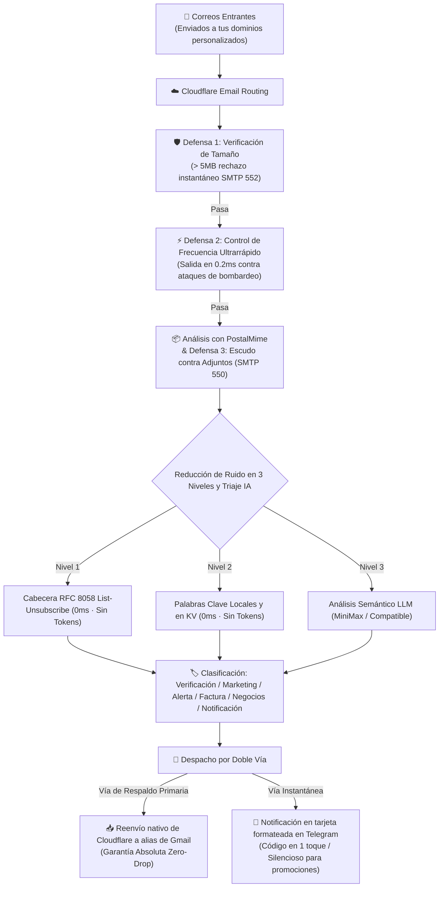

<div align="center">

# 📬 cf-mail2tg-aibot

**Bot de IA para reenvío de correo a Telegram de nivel de producción, coste cero y autoalojado sobre Cloudflare Workers & LLM**  
*Production-grade, zero-cost, self-hosted Email to Telegram AI Bot powered by Cloudflare Workers & LLM.*

[](LICENSE)
[](https://workers.cloudflare.com/)
[](https://core.telegram.org/bots/api)
[](https://www.typescriptlang.org/)
[](https://vitest.dev/)
[](#-5--internacionalización-i18n-en-8-idiomas-y-cambio-inmediato)
[](#-coste-cero-y-garantía-de-cuota-gratuita)

<p align="center">
  <a href="./README.md">English</a> •
  <a href="./README.zh-CN.md">简体中文</a> •
  <a href="./README.zh-TW.md">繁體中文</a> •
  <a href="./README.ja-JP.md">日本語</a> •
  <a href="./README.ru-RU.md">Русский</a> •
  <b>Español</b> •
  <a href="./README.fr-FR.md">Français</a> •
  <a href="./README.de-DE.md">Deutsch</a>
</p>

<p align="center">
  <a href="#-inicio-rápido-en-3-pasos">Inicio Rápido</a> •
  <a href="#-por-qué-elegir-cf-mail2tg-aibot-matriz-comparativa">Comparativa</a> •
  <a href="#️-arquitectura-del-sistema">Arquitectura</a> •
  <a href="#-características-principales">Características</a> •
  <a href="#-comandos-interactivos-de-telegram">Comandos</a> •
  <a href="#-preguntas-frecuentes-faq">FAQ</a>
</p>

</div>

---

## 📖 Visión General del Proyecto

**`cf-mail2tg-aibot`** es una pasarela de correo electrónico autoalojada concebida especialmente para **Indie Hackers, equipos internacionales y administradores de múltiples dominios**.

Aprovechando el edge computing de Cloudflare Workers y el servicio gratuito Email Routing, **analiza en profundidad los correos entrantes, filtra el spam, clasifica su intención semántica con LLM y entrega tarjetas elegantes y enriquecidas a Telegram en cuestión de segundos**. Al mismo tiempo, su arquitectura de doble vía (Zero-Drop) reenvía el correo original intacto a tu buzón personal de respaldo (por ejemplo, alias de Gmail). Olvídate de pagar caras suscripciones de correo corporativo ($6–$18 por usuario al mes) en múltiples dominios.

---

## 🚀 Inicio Rápido (en 3 Pasos)

### 1. Obtener Credenciales de Telegram
- Abre [@BotFather](https://t.me/BotFather) ➔ `/newbot` ➔ copia el `TELEGRAM_BOT_TOKEN`.
- Abre [@userinfobot](https://t.me/userinfobot) ➔ copia tu ID numérico como `TELEGRAM_ADMIN_CHAT_ID`.

### 2. Verificar Buzón de Destino en Cloudflare
- En Cloudflare Dashboard: **Email** ➔ **Email Routing** ➔ **Destination addresses** ➔ Añade y verifica tu buzón personal (p. ej. `you@gmail.com`).

### 3. Despliegue y Activación
```bash
# Clonar repositorio e instalar dependencias
git clone https://github.com/your-username/cf-mail2tg-aibot.git && cd cf-mail2tg-aibot
npm install

# Crear namespace KV y copiar el ID resultante en wrangler.jsonc (kv_namespaces[0].id)
npx wrangler kv namespace create MAIL_ROUTES_KV

# Configurar credenciales principales
npx wrangler secret put TELEGRAM_BOT_TOKEN
npx wrangler secret put TELEGRAM_ADMIN_CHAT_ID
npx wrangler secret put TELEGRAM_WEBHOOK_SECRET  # Recomendado

# Desplegar en la red perimetral
npm run deploy
```

- **Activar Webhook**: Abre en el navegador `https://<tu-worker>.<subdominio>.workers.dev/setup-webhook?secret=<TU_SECRETO>` (verás `{"ok":true}`).
- **Enrutar Correos**: En Cloudflare **Email Routing** ➔ **Routing rules** ➔ Añade regla Catch-all: **Send to Worker** ➔ Selecciona `cf-mail2tg-aibot`.
- **Configuración Final desde el Móvil**: Envía `/setup` al bot en Telegram para enlazar tu buzón de respaldo y clave LLM en 1 minuto. ¡Sin tocar el terminal!

---

## ⚡ ¿Por qué elegir cf-mail2tg-aibot? (Matriz Comparativa)

| Dimensión | Scripts Abiertos Comunes | Correo Corporativo (Google Workspace, etc.) | **cf-mail2tg-aibot (Este Proyecto)** |
| :--- | :--- | :--- | :--- |
| **Coste Mensual** | Gratis | $6 ~ $18 / usuario / mes (muy caro con varios dominios) | **$0 (Funciona permanentemente en el plan gratuito de Cloudflare)** |
| **Garantía Anti-Pérdidas** | ❌ Pérdida de correos ante límites o caídas de Telegram | ✅ Entrega normal | **✅ Doble Vía Zero-Drop (Reenvío directo incondicional a Gmail)** |
| **Defensa contra Adjuntos** | ❌ Saturación de memoria (128MB) o espacio de almacenamiento | Requiere paquetes de expansión de pago | **✅ Límite duro de 5MB + Escudo SMTP 550 Zero-Attachment** |
| **Control de Frecuencia** | ❌ Vulnerable a ataques de spam que causan baneos TG 429 | Requiere configurar reglas WAF empresariales | **✅ Salida rápida en 0.2ms con ventana deslizante (ahorro de 98% CPU)** |
| **Clasificación de Intención**| ❌ No disponible; constante molestia por spam | Reglas básicas propensas a falsos positivos | **✅ Clasificación LLM de 6 intenciones + push silencioso para marketing**|
| **Extracción de Códigos** | ❌ Búsqueda y copia manual en cuerpos de texto largos | ❌ Sin extracción nativa | **✅ Bloque `<code>` fijado arriba, copia en 1 toque en móvil** |
| **Mantenimiento y Ajustes** | ❌ Recompilación y despliegue para cada cambio de regla | Ajustes individuales en paneles web | **✅ Respuesta directa a mensajes en Telegram para recarga en caliente**|

---

## 🏗️ Arquitectura del Sistema



---

## 🌟 Características Principales

### 1. 🔄 Tubería de Doble Vía "Zero-Drop" (Cero Pérdidas)
- **Vía de Respaldo**: En el momento en que el correo llega al Worker, se activa el motor nativo de Cloudflare para entregarlo a tu bandeja de respaldo. Admite segmentación por perfiles hacia alias de Gmail (p. ej., `tunombre+support@gmail.com`). Incluso ante problemas con Telegram, **el correo original nunca se perderá**.
- **Vía de Notificación**: Limpia etiquetas HTML, normaliza codificaciones Quoted-Printable y genera una tarjeta con formato impecable en Telegram.
- **Modo de Vía Única**: Si no configuras un correo de respaldo, la pasarela opera sin errores en modo exclusivo de notificaciones por Telegram.

### 2. 🤖 Triaje Semántico LLM y Extracción de Códigos en 1 Toque
- **6 Categorías Estandarizadas**: `🔐 Verificación`, `📢 Marketing`, `🚨 Alerta de Seguridad`, `💰 Facturación`, `💬 Negocios`, `🔔 Notificación`.
- **Copia de Códigos en 1 Toque**: Motor de expresiones regulares combinado con IA para extraer códigos de autenticación en un bloque `<code>` destacado: **tócalo una vez en el móvil para copiarlo**.
- **Entrega Silenciosa para Marketing**: La publicidad y promociones SaaS se envían automáticamente con `disable_notification: true` para **notificación silenciosa (sin sonido ni vibración)**, reduciendo la fatiga digital.
- **Interruptor de Fallo Seguro**: Si los créditos de la API LLM se agotan o hay un tiempo de espera excedido, el sistema mantiene el sonido de alerta indicando `⚠️ LLM API Offline (Alert Sound Preserved)`, garantizando que no se pierdan mensajes críticos.

### 3. 🛡️ Defensa Edge Armor en 4 Capas
- **Política Zero-Attachment**: Bloqueo directo de correos con archivos binarios adjuntos en el borde mediante SMTP 550, protegiendo tu almacenamiento de Gmail e impidiendo malware.
- **Límite de Tamaño Fijo (Size Cap)**: Los correos que superan 5MB se rechazan con SMTP 552 en el borde, evitando caídas OOM y consumo excesivo de CPU.
- **Control de Frecuencia Pre-Parse**: Comprueba la ventana deslizante antes de descomprimir el mensaje; el spam bloqueado se descarta en **0.2ms**, ahorrando el 98% de CPU.
- **Disyuntor Telegram 429**: Ante límites de frecuencia de Telegram, entra automáticamente en un periodo de enfriamiento de 30 segundos para evitar acumulaciones.

### 4. 🎛️ Panel de Control Interactivo y Gestión de Claves en Telegram
- **Asistente de Configuración (`/setup`)**: Guía interactiva paso a paso de 1 minuto para asociar tu buzón de respaldo y clave LLM desde el móvil (admite `skip` y `/cancel`).
- **Estado General (`/config`)**: Consulta el estado de la pasarela con **enmascaramiento de seguridad en claves confidenciales** (p. ej., `min***a8f9`).
- **Actualización de Claves en Caliente (`/setkey`)**: Envía `/setkey minimax <Clave>` o `/setkey forward <Email>` en chat privado para guardar y activar cambios en Cloudflare KV al instante.
- **Restablecimiento Dinámico (`/resetkey`)**: Elimina las modificaciones en KV y vuelve a los valores predeterminados de las variables de entorno.
- **Gestión de Palabras Clave (`/keywords`)**: Muestra todas las palabras clave de filtro en un bloque de código listo para copiar.
- **Actualización por Respuesta**: Responde al mensaje de palabras clave del bot con tu lista editada para sincronizarla en caliente con Cloudflare KV.
- **Reglas de Enrutamiento (`/routes`, `/add`, `/del`)**: Inspecciona y administra reglas de alias con botones interactivos de confirmación.

### 5. 🌐 Internacionalización (i18n) en 8 Idiomas y Cambio Inmediato
- **8 Idiomas Compatibles**: 🇨🇳 Chino Simplificado (`zh-CN`), 🇺🇸 Inglés (`en-US`), 🇭🇰 Chino Tradicional (`zh-TW`), 🇯🇵 Japonés (`ja-JP`), 🇷🇺 Ruso (`ru-RU`), 🇪🇸 Español (`es-ES`), 🇫🇷 Francés (`fr-FR`), 🇩🇪 Alemán (`de-DE`).
- **Localización Completa**: Tarjetas de notificación, módulos de verificación, avisos de seguridad, asistentes de configuración y menús nativos traducidos en su totalidad.
- **Cambio Inmediato (`/lang`)**: Muestra una cuadrícula táctil 4x2 con indicador `✓` del idioma activo o acepta argumentos directos (como `/lang es`, `/lang en`).
- **Resolución en 4 Niveles**: `Configuración dinámica en KV` > `Variable de entorno (DEFAULT_LANGUAGE)` > `Idioma del cliente de Telegram` > `Por defecto (zh-CN)`.
- **Rendimiento Submilimétrico**: Árboles de diccionarios tipados en TypeScript con tiempo de resolución menor a 0.1ms sin impacto en memoria.

---

## 📱 Comandos Interactivos de Telegram

Pulsa el botón **[Menu]** abajo a la izquierda en el chat o envía los siguientes comandos:

| Comando | Parámetros | Descripción |
| :--- | :--- | :--- |
| `/lang` | `[código]` | Cambia el idioma mediante teclado interactivo 4x2 o código directo (p. ej. `/lang es`) |
| `/setup` | - | Inicia el asistente interactivo de configuración paso a paso en 1 minuto |
| `/cancel` | - | Cancela el asistente o la conversación activa y restablece el estado |
| `/config` | - | Consulta el estado general de la pasarela y las credenciales enmascaradas |
| `/setkey` | `<minimax\|forward> <valor>` | Actualiza la clave LLM o el buzón de reenvío directamente en KV desde el móvil |
| `/resetkey` | `<minimax\|forward>` | Elimina la sustitución dinámica en KV y restaura las variables de entorno |
| `/keywords` | - | Muestra todas las palabras clave de filtro en un bloque de código para copiar |
| `/addkeywords` | `<palabra1>\n<palabra2>` | Añade palabras clave de filtro de forma segura sin sobrescribir |
| `/resetkeywords` | - | Restablece las palabras clave a la configuración básica por defecto |
| `/routes` | - | Consulta las reglas de perfiles y rutas personalizadas en KV |
| `/add` | `<etiqueta> <prefijo> [destino]` | Añade una regla de desvío (p. ej. `/add Comercial help user@domain.com`) |
| `/del` | `<prefijo>` | Elimina una regla con confirmación interactiva |
| `/help` | - | Muestra el panel de ayuda y estado de la pasarela |

---

## 💰 Coste Cero y Garantía de Cuota Gratuita

Este proyecto está especialmente optimizado para el **Plan Gratuito de Cloudflare Workers**:
- **Consumo de CPU**: Cada correo tarda en promedio ~0.5ms en procesarse, muy por debajo del límite de 10ms;
- **Seguridad de Memoria**: La protección contra adjuntos y el límite de 5MB impiden superar los 128MB de memoria perimetral;
- **Almacenamiento KV**: El tráfico ordinario solo genera lecturas en caché muy ligeras. Consume menos del 0.1% de la cuota diaria (100.000 lecturas y 1.000 escrituras);
- **Aislamiento de Facturación**: Las cuentas gratuitas de Cloudflare no requieren tarjeta de crédito y bloquean picos imprevistos mediante HTTP 503 **sin posibilidad de generar facturas**.

---

## ❓ Preguntas Frecuentes (FAQ)

<details>
<summary><b>Q: ¿Puedo usarlo únicamente como bot de Telegram sin buzón de respaldo (FORWARD_TO_EMAIL)?</b></summary>
¡Por supuesto! Si omites <code>FORWARD_TO_EMAIL</code>, la pasarela entra automáticamente en modo de vía única, enviando tarjetas a Telegram en tiempo real sin fallos.
</details>

<details>
<summary><b>Q: ¿Por qué en algunas tarjetas aparece "Fallido (Posible origen falso de SPF/DKIM)"?</b></summary>
Es una advertencia de seguridad rutinaria. Indica que el servidor emisor no superó la verificación SPF/DKIM. El bot alerta sobre posible phishing y restringe preventivamente la cuota del remitente.
</details>

<details>
<summary><b>Q: ¿Se puede utilizar el bot sin una clave de API LLM?</b></summary>
¡Sí! Si no configuras <code>MINIMAX_API_KEY</code>, el sistema activa su <b>motor de expresiones regulares y su biblioteca de reglas RFC locales</b>, detectando códigos y correos promocionales habituales sin ningún coste.
</details>

<details>
<summary><b>Q: ¿Puedo gestionar múltiples dominios con un solo Worker?</b></summary>
¡Sí! El plan gratuito de Cloudflare permite agregar múltiples dominios. Configura la regla Catch-all de cada uno apuntando al mismo Worker <code>cf-mail2tg-aibot</code>; el sistema aislará la recepción de cada dominio automáticamente.
</details>

---

## 📄 Licencia

Este proyecto está distribuido bajo la licencia [MIT License](LICENSE). Puedes bifurcarlo, modificarlo o usarlo libremente para proyectos personales o de equipo.
