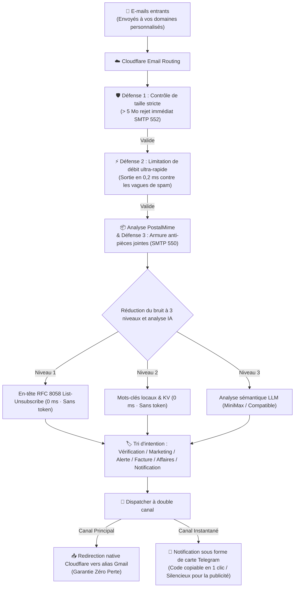

<div align="center">

# 📬 cf-mail2tg-aibot

**Bot IA auto-hébergé de transfert d'e-mails vers Telegram, gratuit et prêt pour la production, propulsé par Cloudflare Workers & LLM**  
*Production-grade, zero-cost, self-hosted Email to Telegram AI Bot powered by Cloudflare Workers & LLM.*

[](LICENSE)
[](https://workers.cloudflare.com/)
[](https://core.telegram.org/bots/api)
[](https://www.typescriptlang.org/)
[](https://vitest.dev/)
[](#-5--internationalisation-i18n-en-10-langues-et-changement-instantané)
[](#-coût-zéro-et-garantie-de-quota-gratuit)
[](https://deploy.workers.cloudflare.com/?url=https://github.com/Sacilave/cf-mail2tg-aibot)

<p align="center">
  <a href="./README.md">English</a> •
  <a href="./README.zh-CN.md">简体中文</a> •
  <a href="./README.zh-TW.md">繁體中文</a> •
  <a href="./README.ja-JP.md">日本語</a> •
  <a href="./README.ko-KR.md">한국어</a> •
  <a href="./README.pt-BR.md">Português</a> •
  <a href="./README.ru-RU.md">Русский</a> •
  <a href="./README.es-ES.md">Español</a> •
  <b>Français</b> •
  <a href="./README.de-DE.md">Deutsch</a>
</p>

<p align="center">
  <a href="#-captures-décran">Captures</a> •
  <a href="#-déploiement-rapide-en-1-clic-en-2-minutes-zéro-cli--interface-web">Déploiement en 1 clic</a> •
  <a href="#-démarrage-rapide-en-3-étapes">Déploiement CLI</a> •
  <a href="#-pourquoi-cf-mail2tg-aibot-matrice-comparative">Comparatif</a> •
  <a href="#️-architecture-système">Architecture</a> •
  <a href="#-fonctionnalités-clés">Fonctionnalités</a> •
  <a href="#-commandes-interactives-telegram">Commandes</a> •
  <a href="#-foire-aux-questions-faq">FAQ</a>
</p>

</div>

---

## 📖 Présentation du Projet

**`cf-mail2tg-aibot`** est une passerelle de messagerie auto-hébergée conçue pour les **Indie Hackers, les équipes internationales et les propriétaires de domaines multiples**.

En tirant parti de l'edge computing de Cloudflare Workers et du service gratuit Email Routing, la passerelle **analyse en profondeur les e-mails entrants, filtre le spam, effectue une classification sémantique par LLM et diffuse des cartes Telegram élégantes et lisibles en quelques secondes**. En parallèle, son architecture à double canal (Zero-Drop) garantit la réexpédition intégrale de l'e-mail original vers votre boîte Gmail personnelle. Dites adieu aux abonnements professionnels coûteux (6 à 18 $ par utilisateur et par mois) sur plusieurs domaines !

---

## 📸 Captures d’écran

Toutes les captures ci-dessous proviennent d’une instance réelle en production. Les champs sensibles (adresses e-mail, codes de vérification, numéros de facture) sont remplacés par des valeurs factices.

### 🎛️ Panneau de contrôle du bot

| | |
| :---: | :---: |
| <br><sub>Accueil de la passerelle — état en ligne, moteur IA et transfert de sauvegarde en un coup d’œil</sub> | <br><sub>Réglages — fournisseurs IA, personas de routage, anti-spam et langue dans un seul panneau</sub> |

### 📬 Notifications e-mail en action

| | |
| :---: | :---: |
| <br><sub>Codes de vérification — extraits et épinglés en haut, touchez pour copier</sub> | <br><sub>Alertes de sécurité — hameçonnage signalé avec échec SPF/DKIM</sub> |
| <br><sub>Facturation — factures analysées avec le détail des pièces jointes</sub> | <br><sub>Demandes commerciales — priorisées par le triage IA</sub> |

<p align="center">
  <br>
  <sub>Marketing — promotions mises en sourdine automatiquement par les règles anti-spam</sub>
</p>

---

## ⚡ Déploiement Rapide en 1 Clic en 2 Minutes (Zéro CLI / Interface Web)

> **💡 Conçu pour les Débutants et Non-Développeurs** : Aucun besoin d'installer Node.js, Git ou d'utiliser le terminal. Déployez votre propre passerelle e-mail vers Telegram directement depuis votre navigateur en 3 étapes simples !

<p align="center">
  <a href="https://deploy.workers.cloudflare.com/?url=https://github.com/Sacilave/cf-mail2tg-aibot">
    
  </a>
</p>

### Étape 1 : Obtenir les identifiants Telegram (1 min)
1. Ouvrez [@BotFather](https://t.me/BotFather) sur Telegram, envoyez `/newbot`, nommez votre bot et copiez le **`HTTP API Token`** (`TELEGRAM_BOT_TOKEN`) ;
2. Ouvrez [@userinfobot](https://t.me/userinfobot) pour récupérer votre identifiant numérique (`TELEGRAM_ADMIN_CHAT_ID` — garantit que vous êtes le seul administrateur).

### Étape 2 : Déploiement web en un clic via Cloudflare (30 s)
1. Cliquez sur le bouton **`[Deploy to Cloudflare Workers]`** ci-dessus (ou [ouvrez le déploiement web direct](https://deploy.workers.cloudflare.com/?url=https://github.com/Sacilave/cf-mail2tg-aibot)) ;
2. Connectez-vous à votre compte Cloudflare et autorisez l'accès à GitHub ;
3. Cloudflare crée automatiquement un nouvel espace de stockage KV (`MAIL_ROUTES_KV`) et configure les variables d'environnement. Saisissez vos identifiants :
   - `TELEGRAM_BOT_TOKEN` : Le jeton de votre bot (Étape 1)
   - `TELEGRAM_ADMIN_CHAT_ID` : Votre identifiant numérique de chat (Étape 1)
4. Cliquez sur **Save and Deploy**. En ~10 secondes, votre Worker est en ligne ! Notez l'adresse URL attribuée (ex. `https://cf-mail2tg-aibot.xxx.workers.dev`).

### Étape 3 : Router les e-mails vers le Worker (30 s)
1. Dans le tableau de bord Cloudflare, accédez à votre domaine ➔ **Email** ➔ **Email Routing** ;
2. Si ce n'est pas déjà fait, activez le routage d'e-mails en un clic (les enregistrements DNS MX requis sont ajoutés automatiquement) ;
3. Allez dans l'onglet **Routing rules** ➔ cliquez sur **Add rule** (ou configurez la règle Catch-all) :
   - **Type** : Sélectionnez **Catch-all rule** ;
   - **Action** : Sélectionnez **Send to Worker** ;
   - **Destination** : Choisissez **`cf-mail2tg-aibot`** et enregistrez ;
4. **Activation et test** :
   - Ouvrez une fois dans votre navigateur `https://<VOTRE_URL_WORKER>/setup-webhook` pour enregistrer le webhook Telegram ;
   - Sur Telegram, envoyez `/start` ou `/setup` à votre bot pour finaliser l'adresse de secours et le moteur IA directement depuis votre téléphone !

---

> 💻 **Note Développeurs** : Si vous préférez un déploiement via le terminal ou souhaitez modifier le code, consultez le [Démarrage Rapide CLI (en 3 étapes)](#-démarrage-rapide-en-3-étapes).

---

## 🚀 Démarrage Rapide (en 3 Étapes) [Déploiement CLI]

**Prérequis :**
- Un compte Cloudflare gratuit et un domaine ajouté à Cloudflare (le routage e-mail s’active par domaine ; l’Étape 3 l’activera pour le vôtre).
- Node.js 22 ou ultérieur et Git installés sur votre ordinateur (la première commande wrangler de l’Étape 3 ouvrira un navigateur pour vous connecter à Cloudflare).

### 1. Obtenir les Identifiants Telegram
- Contactez [@BotFather](https://t.me/BotFather) ➔ `/newbot` ➔ copiez le `TELEGRAM_BOT_TOKEN`.
- Contactez [@userinfobot](https://t.me/userinfobot) ➔ copiez votre identifiant numérique sous `TELEGRAM_ADMIN_CHAT_ID`.
- Exécutez `openssl rand -hex 32` ➔ copiez le résultat sous `TELEGRAM_WEBHOOK_SECRET` (facultatif mais recommandé ; sous Windows, utilisez Git Bash).

### 2. Valider l'Adresse de Destination Cloudflare
- Dans Cloudflare Dashboard : **Email** ➔ **Email Routing** ➔ **Destination addresses** ➔ Ajoutez et validez votre e-mail personnel (ex. `you@gmail.com`).

### 3. Déploiement et Activation
```bash
# Cloner le dépôt et installer les dépendances
git clone https://github.com/Sacilave/cf-mail2tg-aibot.git && cd cf-mail2tg-aibot
npm install

# Créer l'espace KV et reporter l'ID dans wrangler.jsonc (kv_namespaces[0].id)
npx wrangler kv namespace create MAIL_ROUTES_KV

# Configurer les identifiants requis
npx wrangler secret put TELEGRAM_BOT_TOKEN
npx wrangler secret put TELEGRAM_ADMIN_CHAT_ID
npx wrangler secret put TELEGRAM_WEBHOOK_SECRET  # Recommandé (la valeur de l’Étape 1)

# Déployer sur le réseau Cloudflare
npm run deploy
```

- **Activer le Webhook** : Ouvrez dans votre navigateur `https://<votre-worker>.<sous-domaine>.workers.dev/setup-webhook?secret=<VOTRE_SECRET>` (affiche `{"ok":true}` ; `<VOTRE_SECRET>` doit être exactement le `TELEGRAM_WEBHOOK_SECRET` de l’Étape 1, et l’URL du Worker figure dans la sortie de `npm run deploy`).
- **Routage des E-mails** : Dans Cloudflare Dashboard, sélectionnez votre domaine ➔ **Email** ➔ **Email Routing** ➔ activez-le (les enregistrements MX requis sont ajoutés automatiquement) ➔ **Routing rules** ➔ Ajoutez une règle Catch-all : **Send to Worker** ➔ Sélectionnez `cf-mail2tg-aibot`.
- **Finaliser sur Mobile** : Envoyez `/setup` au bot sur Telegram pour relier votre boîte de secours (celle validée à l’Étape 2) et votre clé LLM en 1 minute, sans réouvrir le terminal !

#### 🤖 En option : Déploiement Continu (Vibe Coding / GitHub Actions)
Si vous forkez ce dépôt pour un développement personnalisé (vibe coding) et souhaitez que les commits sur `main` se déploient automatiquement sur Cloudflare :
1. Renommez [`.github/workflows/deploy.yml.example`](.github/workflows/deploy.yml.example) en `.github/workflows/deploy.yml`.
2. Dans votre dépôt GitHub : **Settings** ➔ **Secrets and variables** ➔ **Actions** ➔ Ajoutez le secret `CLOUDFLARE_API_TOKEN` (pour l’obtenir : Cloudflare Dashboard ➔ My Profile ➔ API Tokens ➔ créez un jeton avec le modèle « Edit Cloudflare Workers »).
3. C'est prêt ! Chaque push sur `main` exécutera les tests et déploiera automatiquement sur Cloudflare Workers.
*(Remarque : en tant que modèle public, le déploiement automatique est désactivé par défaut pour éviter les échecs CI avant la configuration du secret.)*

---

## ⚡ Pourquoi cf-mail2tg-aibot ? (Matrice Comparative)

| Critère | Scripts open source basiques | Messagerie d'entreprise (Google / Feishu) | **cf-mail2tg-aibot (Ce projet)** |
| :--- | :--- | :--- | :--- |
| **Coût Mensuel** | Gratuit | 6 $ ~ 18 $ / utilisateur / mois (très cher avec plusieurs domaines) | **0 $ (Fonctionne en continu sur le quota gratuit de Cloudflare)** |
| **Garantie Anti-Perte**| ❌ Perte d'e-mails en cas de coupure de l'API Telegram | ✅ Réception normale | **✅ Double canal Zero-Drop (Redirection inconditionnelle vers Gmail)** |
| **Défense Anti-Pièces Jointes** | ❌ Dépassement fréquent de la limite de 128 Mo de mémoire du Worker | Extensions de stockage payantes requises | **✅ Plafond strict de 5 Mo + Armure anti-fichiers SMTP 550** |
| **Protection Anti-Bombardement**| ❌ Vulnérable aux attaques de spam entraînant un ban TG 429 | Nécessite des règles WAF d'entreprise complexes | **✅ Sortie rapide en 0,2 ms via fenêtre glissante (économie de 98 % CPU)** |
| **Tri Intelligent des E-mails** | ❌ Aucun, notifications incessantes pour tout le spam | Règles élémentaires avec faux positifs réguliers | **✅ Tri sémantique LLM en 6 catégories + push silencieux pour le marketing** |
| **Extraction de Code** | ❌ Recherche et copie manuelles dans de longs textes | ❌ Pas d'extraction intégrée | **✅ Bloc `<code>` épinglé en haut, copie en 1 clic sur mobile** |
| **Gestion & Exploitation** | ❌ Recompilation et redéploiement à chaque modification | Configuration manuelle sur console web | **✅ Réponse directe aux messages sur Telegram pour rechargement à chaud** |

---

## 🏗️ Architecture Système



---

## 🌟 Fonctionnalités Clés

### 1. 🔄 Pipeline à Double Canal « Zero-Drop » (Zéro Perte)
- **Canal de Secours** : Dès l'arrivée du message dans le Worker, le moteur natif de Cloudflare le transfère vers votre boîte de réception de secours. Compatible avec les alias Gmail par profil de service (ex. : `votrenom+support@gmail.com`). Même en cas d'indisponibilité de Telegram, **aucun e-mail n'est jamais égaré**.
- **Canal de Notification** : Nettoyage en profondeur des balises HTML, conversion des encodages Quoted-Printable et génération d'une carte Telegram claire et élégante.
- **Mode Canal Unique** : Si aucune adresse e-mail de secours n'est configurée, la passerelle fonctionne sans erreur en mode exclusif de notifications Telegram.

### 2. 🤖 Classification Sémantique LLM & Extraction de Code en 1 Clic
- **6 Catégories d'Intention Standardisées** : `🔐 Vérification`, `📢 Marketing`, `🚨 Alerte de Sécurité`, `💰 Facturation`, `💬 Affaires`, `🔔 Notification`.
- **Copie en 1 Clic** : Combinaison d'expressions régulières et de l'IA pour extraire les codes de validation dans un bloc `<code>` visible en haut de carte : **un simple clic sur mobile suffit pour copier**.
- **Mode Silencieux pour le Marketing** : Les publicités et e-mails de démarchage SaaS sont transmis avec le paramètre `disable_notification: true` pour une **réception silencieuse (sans sonnerie ni vibration)**, préservant votre sérénité.
- **Disjoncteur de Tolérance aux Pannes** : Si votre quota d'API LLM expire ou met trop de temps à répondre, le système conserve l'alerte sonore avec la mention `⚠️ LLM API Offline (Alert Sound Preserved)`, vous assurant de ne manquer aucun message prioritaire.

### 3. 🛡️ Défense en Profondeur Edge Armor en 4 Niveaux
- **Politique Zéro Pièce Jointe (Zero-Attachment Policy)** : Rejet direct à la périphérie des e-mails contenant des fichiers binaires via le code SMTP 550, protégeant l'espace Gmail et évitant tout logiciel malveillant.
- **Plafond de Taille Réseau (Size Cap)** : Les e-mails excédant 5 Mo sont immédiatement rejetés avec SMTP 552, évitant les crashs OOM et les dépassements de CPU.
- **Limitation de Débit Pré-Analyse** : Vérification de la fenêtre glissante de l'expéditeur avant même l'extraction du message ; les spams limités sont évacués en **0,2 ms**, économisant 98 % des cycles CPU.
- **Disjoncteur Telegram 429** : Mise en pause automatique de 30 secondes en cas de dépassement de débit côté API Telegram pour prévenir l'accumulation de requêtes.

### 4. 🎛️ Panneau de Contrôle Interactif et Clés Directement sur Telegram
- **Assistant d'Installation (`/setup`)** : Parcours guidé interactif en 1 minute adapté aux smartphones pour lier votre boîte de transfert et vos identifiants d'API (avec prise en charge de `skip` et `/cancel`).
- **Consultation de l'État (`/status` ou `/config`)** : Aperçu global de la passerelle avec **masquage sécurisé des clés d'accès** (ex. : `min***a8f9`).
- **Mise à Jour à Chaud (`/setkey`)** : Envoyez `/setkey minimax <Clé>` ou `/setkey forward <Email>` en message privé pour enregistrer et appliquer immédiatement les changements dans Cloudflare KV sans toucher au terminal.
- **Réinitialisation Dynamique (`/resetkey`)** : Supprimez les surcharges dans KV pour revenir instantanément aux variables d'environnement d'origine.
- **Gestion des Mots-Clés (`/keywords`)** : Affichez l'intégralité des filtres anti-spam dans un bloc prêt à être copié sur téléphone.
- **Modification par Réponse Directe** : Répondez (Reply) directement au message de mots-clés du bot pour charger la liste mise à jour dans Cloudflare KV.
- **Règles de Routage (`/routes`, `/add`, `/del`)** : Consultez et configurez facilement vos profils d'adresses avec validation par boutons interactifs.

### 5. 🌐 Internationalisation (i18n) en 10 Langues et Changement Instantané
- **10 Langues Prises en Charge** : 🇨🇳 Chinois Simplifié (`zh-CN`), 🇺🇸 Anglais (`en-US`), 🇭🇰 Chinois Traditionnel (`zh-TW`), 🇯🇵 Japonais (`ja-JP`), 🇰🇷 Coréen (`ko-KR`), 🇧🇷 Portugais (`pt-BR`), 🇷🇺 Russe (`ru-RU`), 🇪🇸 Espagnol (`es-ES`), 🇫🇷 Français (`fr-FR`), 🇩🇪 Allemand (`de-DE`).
- **Localisation Complète** : Cartes de notification, cartes d'alerte, assistants, tableaux de bord et commandes du menu Telegram entièrement traduits.
- **Changement Immédiat (`/lang`)** : Affichez un menu tactile 5x2 avec indicateur `✓` de la langue active, ou fournissez un code directement (ex. : `/lang ko`, `/lang pt`, `/lang fr`).
- **Résolution en 4 Étapes** : `Configuration dynamique Cloudflare KV` > `Variable d'environnement (DEFAULT_LANGUAGE)` > `Langue du client Telegram` > `Valeur par défaut (zh-CN)`.
- **Performances Submilliseconde** : Arbres de dictionnaires TypeScript typés statiquement pour un temps de réponse < 0,1 ms sans consommation mémoire superflue.

---

## 📱 Commandes Interactives Telegram

Appuyez sur le bouton **[Menu]** en bas à gauche de la conversation Telegram ou envoyez l'une des commandes suivantes :

| Commande | Paramètres | Description |
| :--- | :--- | :--- |
| `/lang` | `[code]` | Changer la langue d'affichage via le clavier interactif 5x2 ou en paramètre direct (ex. `/lang ko`, `/lang pt`, `/lang fr`) |
| `/setup` | - | Lancer l'assistant interactif de configuration pas-à-pas en 1 minute |
| `/cancel` | - | Quitter l'assistant ou la session active et réinitialiser l'état |
| `/status` | - | **📊 État du Système** : Consulter l'état de la passerelle et les identifiants masqués (alias `/config`) |
| `/settings` | - | **⚙️ Panneau de Paramètres** : Grille 2x4 pour gérer toutes les configurations (alias `/menu`) |
| `/setkey` | `<minimax\|forward> <valeur>` | Mettre à jour une clé d'API ou l'e-mail de secours avec sauvegarde directe en KV |
| `/resetkey` | `<minimax\|forward>` | Effacer les surcharges KV et rétablir les valeurs par défaut des variables |
| `/keywords` | - | Afficher la liste complète des mots-clés de filtrage prêts à être copiés |
| `/addkeywords` | `<mot1>\n<mot2>` | Ajouter des mots-clés de filtrage sans écraser la liste existante |
| `/resetkeywords` | - | Rétablir la liste standard des mots-clés d'origine |
| `/routes` | - | Afficher les règles de routage d'adresses et les profils actifs |
| `/add` | `<étiquette> <préfixe> [dest]` | Ajouter une règle de routage (ex. `/add Support help user@domain.com`) |
| `/del` | `<préfixe>` | Supprimer une règle avec confirmation interactive |
| `/help` | - | Afficher le manuel d'utilisation et l'état des services |

---

## 💰 Coût Zéro et Garantie de Quota Gratuit

Ce projet est spécialement conçu pour l'offre **Cloudflare Workers Free Tier** :
- **Temps de calcul CPU** : Le traitement moyen par e-mail prend environ 0,5 ms, très inférieur à la limite de 10 ms offerte ;
- **Contrôle de la Mémoire** : La politique zéro pièce jointe et le plafond de 5 Mo évitent tout débordement des 128 Mo de mémoire vive ;
- **Stockage KV** : Les réceptions quotidiennes exploitent un cache ultra-léger en lecture. L'ensemble consomme moins de 0,1 % du quota gratuit (100 000 lectures et 1 000 écritures par jour) ;
- **Protection Contre la Facturation** : Les comptes gratuits Cloudflare n'exigent aucune carte bancaire ; tout pic anormal est simplement rejeté avec une erreur HTTP 503, **garantissant l'absence totale de facturation inattendue**.

---

## ❓ Foire Aux Questions (FAQ)

<details>
<summary><b>Q : Puis-je utiliser ce bot uniquement pour Telegram sans adresse de secours (FORWARD_TO_EMAIL) ?</b></summary>
Tout à fait ! Lorsque <code>FORWARD_TO_EMAIL</code> est omis, la passerelle passe en mode canal unique et envoie les cartes de notification directement à Telegram sans aucune erreur.
</details>

<details>
<summary><b>Q : Pourquoi certaines cartes affichent-elles « Échec (Origine possiblement falsifiée SPF/DKIM) » ?</b></summary>
Il s'agit d'un message d'alerte de sécurité normal. Certains serveurs d'envoi automatisés ou mal configurés ne valident pas les enregistrements SPF/DKIM. Le bot signale le risque de phishing et applique une limitation de débit plus stricte à cet expéditeur.
</details>

<details>
<summary><b>Q : Est-il possible d'utiliser le bot sans clé d'API LLM ?</b></summary>
Oui ! Aucune clé n’est nécessaire : la passerelle utilise par défaut <b>Cloudflare Workers AI</b> préconfiguré — 100 % gratuit et sans clé d’API. Si le LLM est momentanément injoignable, le <b>moteur d'expressions régulières et la base locale de règles RFC</b> continuent de détecter codes de validation et e-mails marketing sans frais, et vous pouvez lier une clé DeepSeek / OpenAI à tout moment via <code>/setup</code>.
</details>

<details>
<summary><b>Q : Puis-je utiliser un seul Worker pour plusieurs domaines personnalisés ?</b></summary>
Oui ! L'offre gratuite de Cloudflare vous permet d'ajouter plusieurs domaines. Faites pointer la règle Catch-all de chaque domaine vers le même Worker <code>cf-mail2tg-aibot</code> ; la passerelle différenciera chaque domaine automatiquement.
</details>

---

## 📄 Licence

Ce projet est publié sous licence [MIT License](LICENSE). Vous êtes libre de le dupliquer (fork), de le modifier et de l'utiliser pour vos besoins personnels ou professionnels.
