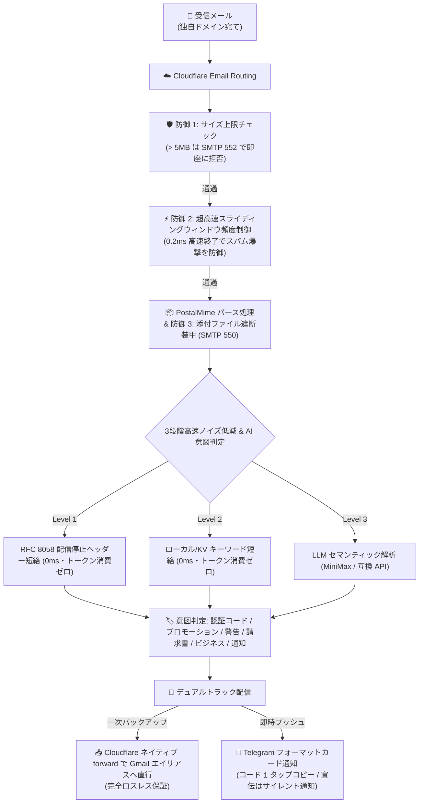

<div align="center">

# 📬 cf-mail2tg-aibot

**Cloudflare Workers & LLM を活用した本番品質・完全無料・セルフホスト型 メール転送 Telegram AI Bot**  
*Production-grade, zero-cost, self-hosted Email to Telegram AI Bot powered by Cloudflare Workers & LLM.*

[](LICENSE)
[](https://workers.cloudflare.com/)
[](https://core.telegram.org/bots/api)
[](https://www.typescriptlang.org/)
[](https://vitest.dev/)
[](#-5--10の主要言語に対応した国際化--ワンタップ切替)
[](#-完全無料--無料枠保証)

<p align="center">
  <a href="./README.md">English</a> •
  <a href="./README.zh-CN.md">简体中文</a> •
  <a href="./README.zh-TW.md">繁體中文</a> •
  <b>日本語</b> •
  <a href="./README.ko-KR.md">한국어</a> •
  <a href="./README.pt-BR.md">Português</a> •
  <a href="./README.ru-RU.md">Русский</a> •
  <a href="./README.es-ES.md">Español</a> •
  <a href="./README.fr-FR.md">Français</a> •
  <a href="./README.de-DE.md">Deutsch</a>
</p>

<p align="center">
  <a href="#-スクリーンショット">スクリーンショット</a> •
  <a href="#-クイックスタート-3ステップ">クイックスタート</a> •
  <a href="#-なぜ-cf-mail2tg-aibot-なのか-比較表">比較表</a> •
  <a href="#️-システム構成">システム構成</a> •
  <a href="#-主な機能">主な機能</a> •
  <a href="#-telegram-コマンド一覧">コマンド一覧</a> •
  <a href="#-よくある質問-faq">FAQ</a>
</p>

</div>

---

## 📖 プロジェクト概要

**`cf-mail2tg-aibot`** は、**個人開発者（Indie Hackers）、グローバル展開チーム、複数ドメインの管理者**のために設計されたセルフホスト型メールゲートウェイです。

Cloudflare Workers のエッジコンピューティングと無料の Email Routing を活用し、独自ドメイン宛てのメールを**ディープパース、LLM による意図判定・スパム除去を行った上で Telegram Bot へ数秒でリッチカード通知**します。同時に、Zero-Drop のデュアルトラック設計により、未圧縮の元メールを個人用 Gmail エイリアスへ無損失で自動転送します。月額 6〜18 ドルの高額なビジネスメール契約から解放され、快適な即時通知ライフを実現します。

---

## 📸 スクリーンショット

以下はすべて実際に稼働中のインスタンスのスクリーンショットです。メールアドレス、認証コード、請求書番号などの機微な項目はすべてプレースホルダーに置き換えています。

### 🎛️ Bot コントロールパネル

| | |
| :---: | :---: |
| <br><sub>ゲートウェイ ホーム — オンライン状態、AI エンジン、バックアップ転送を一目で確認</sub> | <br><sub>設定 — AI プロバイダー、ルーティング、スパム対策、言語を一つのパネルで管理</sub> |

### 📬 メール通知の実例

| | |
| :---: | :---: |
| <br><sub>認証コード — 自動抽出して最上部に固定、タップでコピー</sub> | <br><sub>セキュリティ アラート — SPF/DKIM 失敗でフィッシングを警告</sub> |
| <br><sub>請求 — 請求書を解析し、添付ファイル情報も表示</sub> | <br><sub>ビジネス問い合わせ — AI トリアージで優先処理に分類</sub> |

<p align="center">
  <br>
  <sub>マーケティング — プロモーションはスパムルールで自動ミュート</sub>
</p>

---

## 🚀 クイックスタート (3ステップ)

**前提条件：**
- 無料の Cloudflare アカウントと、Cloudflare に追加済みのドメイン（Email Routing はドメインごとに有効化します。ステップ 3 で設定）。
- パソコンに Node.js 22 以降と Git がインストール済みであること（ステップ 3 の最初の wrangler コマンドでブラウザが開き、Cloudflare へのログインを求められます）。

### 1. Telegram 認証情報の取得
- [@BotFather](https://t.me/BotFather) ➔ `/newbot` で `TELEGRAM_BOT_TOKEN` を取得。
- [@userinfobot](https://t.me/userinfobot) ➔ 自身の数値 ID を `TELEGRAM_ADMIN_CHAT_ID` として取得。
- `openssl rand -hex 32` を実行 ➔ 出力を `TELEGRAM_WEBHOOK_SECRET` として取得（任意ですが推奨。Windows では Git Bash で実行）。

### 2. Cloudflare 転送先メールアドレスの認証
- Cloudflare ダッシュボード：**Email** ➔ **Email Routing** ➔ **Destination addresses** ➔ 個人メール（例: `you@gmail.com`）を追加して認証。

### 3. デプロイと有効化
```bash
# クローンと依存パッケージのインストール
git clone https://github.com/Sacilave/cf-mail2tg-aibot.git && cd cf-mail2tg-aibot
npm install

# KV ネームスペースを作成し、出力された ID を wrangler.jsonc (kv_namespaces[0].id) に入力
npx wrangler kv namespace create MAIL_ROUTES_KV

# 主要シークレットの設定
npx wrangler secret put TELEGRAM_BOT_TOKEN
npx wrangler secret put TELEGRAM_ADMIN_CHAT_ID
npx wrangler secret put TELEGRAM_WEBHOOK_SECRET  # 推奨（ステップ1で生成した値）

# デプロイ
npm run deploy
```

- **Webhook の有効化**：ブラウザで `https://<Worker名>.<サブドメイン>.workers.dev/setup-webhook?secret=<シークレットキー>` を開く（`{"ok":true}` で登録完了。`<シークレットキー>` はステップ 1 の `TELEGRAM_WEBHOOK_SECRET` と完全一致が必要。Worker の URL は `npm run deploy` の出力に表示）。
- **ルーティング設定**：Cloudflare ダッシュボードで自分のドメインを選択 ➔ **Email** ➔ **Email Routing** ➔ 有効化（必要な MX レコードは自動追加されます）➔ **Routing rules** で Catch-all ルールを追加：アクション **Send to Worker** ➔ `cf-mail2tg-aibot` を選択。
- **スマホで仕上げ設定**：Telegram で Bot に `/setup` を送信し、1分でバックアップ先 Gmail（ステップ 2 で認証したアドレス）と LLM キーを対話設定。PC 操作は不要です！

#### 🤖 オプション: 自動継続的デプロイ (Vibe Coding / GitHub Actions)
本リポジトリを Fork してカスタマイズ開発（Vibe Coding）を行い、`main` ブランチへのプッシュ時に Cloudflare へ自動デプロイしたい場合：
1. [`.github/workflows/deploy.yml.example`](.github/workflows/deploy.yml.example) を `.github/workflows/deploy.yml` に名前変更します。
2. GitHub リポジトリの **Settings** ➔ **Secrets and variables** ➔ **Actions** で `CLOUDFLARE_API_TOKEN` を追加します（取得方法：Cloudflare ダッシュボード ➔ My Profile ➔ API Tokens ➔ 「Edit Cloudflare Workers」テンプレートでトークンを作成）。
3. これで完了です！`main` へのプッシュ（または Actions タブからの手動実行）のたびに自動テストが実行され、自動デプロイされます。
*(注: オープンテンプレートとして、シークレット未設定による CI エラーの赤バツを防ぐため、デフォルトでは自動デプロイを無効にしています。)*

---

## ⚡ なぜ cf-mail2tg-aibot なのか？ (比較表)

| 評価項目 | 一般的なオープンソース簡易スクリプト | 有料ビジネスメール (Google Workspace など) | **cf-mail2tg-aibot (本プロジェクト)** |
| :--- | :--- | :--- | :--- |
| **月額費用** | 無料 | $6 〜 $18 / ユーザー / 月 (複数ドメイン時は高額) | **$0 (Cloudflare 無料枠のみで永久稼働)** |
| **メールロスト対策** | ❌ Telegram API 制限や障害時に即座にロスト | ✅ 正常受信 | **✅ Zero-Drop デュアルトラック (Gmail へ無条件直接転送)** |
| **大容量/添付ファイル防御** | ❌ 128MB メモリ制限で Worker がクラッシュ | 有料ストレージ追加購入が必要 | **✅ 5MB 上限遮断 + SMTP 550 完全添付ファイル防御** |
| **フラッド攻撃対策** | ❌ スパム爆撃で Bot が TG 429 BAN される危険性 | 独自 WAF ルール構築が必要 | **✅ 0.2ms スライディングウィンドウ高速短絡 (CPU 98% 節約)** |
| **メール意図の自動分類** | ❌ なし、すべての宣伝メールで通知が鳴る | 簡易ルールベース、誤判定多め | **✅ LLM 意図判定 6 分類 + 宣伝メールの自動サイレント通知** |
| **認証コード抽出** | ❌ 長文メールから手動で探してコピー | ❌ ネイティブ抽出なし | **✅ 専用 `<code>` ブロック先頭配置、スマホ 1 タップで即コピー** |
| **運用保守・設定** | ❌ ルール変更のたびにコード再ビルド＆デプロイ | Web 管理画面で個別設定 | **✅ スマホの Telegram メッセージ返信で即時ホットリロード** |

---

## 🏗️ システム構成



---

## 🌟 主な機能

### 1. 🔄 Zero-Drop デュアルトラックパイプライン (完全ロスレス保証)
- **バックアップトラック**：メールが Worker に到達した瞬間、Cloudflare ネイティブ転送で個人メールへ直行転送。プロダクト別の Gmail エイリアス（例: `yourname+support@gmail.com`）へルーティング可能。Telegram 側の障害時でも、**生メールは一切ロストしません**。
- **通知トラック**：HTML タグのクリーンアップ、Quoted-Printable や文字コードの自動正規化を行い、美しく見やすい Telegram カードとしてお届けします。
- **シングルトラックモード**：バックアップ先メールアドレスを設定しない場合、完全 Telegram 通知専用モードとしてエラーなく動作します。

### 2. 🤖 LLM 意図判定 & 認証コードの 1 タップ抽出
- **6 つの標準化された意図タグ**：`🔐 認証コード`、`📢 プロモーション`、`🚨 セキュリティ警告`、`💰 請求書・決済`、`💬 一般・ビジネス`、`🔔 システム通知`。
- **認証コード 1 タップコピー**：高精度な正規表現エンジンと LLM 抽出を組み合わせ、カードの最上部に独立した `<code>` ブロックで配置。スマホで**1 タップするだけでクリップボードにコピー**できます。
- **プロモーションメールのサイレント通知**：広告や宣伝メールは自動的に `disable_notification: true` を付与して**無音通知（バイブ・通知音なし）**で送信。通知ストレスを解消します。
- **サーキットブレーカー保護**：万が一 LLM API の残高不足やタイムアウトが発生しても、「まず通知音を鳴らす」安全策を維持。カードに `⚠️ LLM API Offline (Alert Sound Preserved)` と明記し、重要メールの見落としを防ぎます。

### 3. 🛡️ 4 重のエッジ防御アーキテクチャ (Edge Armor)
- **ゼロ添付ファイルポリシー (Zero-Attachment Policy)**：ファイル添付メールをエッジで SMTP 550 拒否。マルウェアの脅威や大容量ファイルによる Gmail 容量圧迫を根本から遮断します。
- **サイズ上限遮断 (Size Cap)**：5MB を超えるメールは SMTP 552 で即座に拒否し、Worker の OOM クラッシュや CPU 時間超過を防止します。
- **高速短絡レートリミット (Pre-Parse Rate Check)**：メール本文を展開する前に送信元のスライディングウィンドウを検査。流量制限対象のスパムは **0.2ms 以内に終了**し、CPU コストを 98% 削減します。
- **Telegram 429 回路遮断器**：Telegram API の頻度制限（429）を検知した場合、自動的に 30 秒間のクールダウン状態に移行し、リクエストの滞留を防ぎます。

### 4. 🎛️ スマホの Telegram 上で完結する対話型コントロールパネル
- **初期設定ウィザード (`/setup`)**：スマホで 1 分で完了するステップ・バイ・ステップのガイド。案内通りにバックアップ先メールや LLM Key を入力可能。`skip` でスキップ、`/cancel` でいつでも終了できます。
- **稼働確認 (`/status` または `/config`)**：ゲートウェイの稼働状態を表示。**機密キーは自動でマスキング処理**（例: `min***a8f9`）され、覗き見を防止します。
- **PC 不要のキー更新 (`/setkey`)**：Telegram のプライベートチャットで `/setkey minimax <新Key>` や `/setkey forward <新メールアドレス>` を送信するだけで、Cloudflare KV へ即座に保存・反映されます。
- **設定リセット (`/resetkey`)**：KV の動的オーバーライドをクリアし、環境変数の初期値へワンタップで復元します。
- **キーワード一覧表示 (`/keywords`)**：有効なプロモーション除外キーワードを `<pre><code>` 形式で出力し、スマホで一括コピー可能。
- **返信による即時更新**：Bot のキーワード一覧メッセージに「返信 (Reply)」して新しい単語リストを送信するだけで、自動で全量ホットリロードされます。
- **ルーティング管理 (`/routes`, `/add`, `/del`)**：ドメイン別のエイリアス振り分けルールをスマホから柔軟に追加・削除可能（削除時は確認ボタン付き）。

### 5. 🌐 10の主要言語に対応した国際化 & ワンタップ切替
- **対応言語（全 10 言語）**：🇨🇳 簡体字中国語 (`zh-CN`)、🇺🇸 英語 (`en-US`)、🇭🇰 繁体字中国語 (`zh-TW`)、🇯🇵 日本語 (`ja-JP`)、🇰🇷 韓国語 (`ko-KR`)、🇧🇷 ポルトガル語 (`pt-BR`)、🇷🇺 ロシア語 (`ru-RU`)、🇪🇸 スペイン語 (`es-ES`)、🇫🇷 フランス語 (`fr-FR`)、🇩🇪 ドイツ語 (`de-DE`)。
- **全機能の完全ローカライズ**：メール通知カード、認証コード枠、エラー警告、初期設定ウィザード、コントロールパネル、Telegram 公式メニューコマンドのすべてが多言語対応。
- **ワンタップ言語切替 (`/lang`)**：`/lang` コマンドで 5x2 インラインキーボードを表示して切り替え可能（現在の言語には `✓` が表示）。引数による直接指定（例: `/lang ko`、`/lang pt`、`/lang ja`）にも対応。
- **4段階の優先順位解決**：`Cloudflare KV 動的設定` > `環境変数 (DEFAULT_LANGUAGE)` > `Telegram クライアント言語設定` > `デフォルトフォールバック (zh-CN)`。
- **サブミリ秒・ゼロメモリ消費**：純粋な TypeScript 型付き辞書ツリーにより、0.1ms 未満の超高速処理を実現。

---

## 📱 Telegram コマンド一覧

Telegram チャット画面左下の **[Menu]** ボタンをタップするか、以下のコマンドを送信してください：

| コマンド | パラメータ | 機能概要 |
| :--- | :--- | :--- |
| `/lang` | `[言語コード]` | 表示言語を切り替え（5x2 インラインキーボードまたは直接引数 `/lang ko`、`/lang pt` で指定） |
| `/setup` | - | 対話型初期設定ウィザードを開始（1分で主要設定を完了） |
| `/cancel` | - | 進行中のウィザードや対話を中止し、初期状態にリセット |
| `/status` | - | **📊 稼働状況**：ゲートウェイの稼働状態とマスキングされた設定値を確認（`/config` 別名対応） |
| `/settings` | - | **⚙️ 設定パネル**：2x4 インラインボタンで全設定を一括管理（`/menu` 別名対応） |
| `/setkey` | `<minimax\|forward> <値>` | スマホから LLM Key や転送先メールを KV に直接保存・即時反映 |
| `/resetkey` | `<minimax\|forward>` | KV の動的設定を消去し、環境変数の初期値へ復元 |
| `/keywords` | - | 有効なプロモーション除外キーワードをコピー用コードブロックで表示 |
| `/addkeywords` | `<単語1>\n<単語2>` | 既存の辞書を消去することなく安全に追加（重複自動除外） |
| `/resetkeywords` | - | キーワード辞書をシステム標準の初期状態にリセット |
| `/routes` | - | 有効なペルソナルールおよび KV カスタム振り分け設定を表示 |
| `/add` | `<タグ> <プレフィックス> [転送先]` | 新規エイリアスルールを追加（例: `/add 商用サポート help user@domain.com`） |
| `/del` | `<プレフィックス>` | 指定したルールの削除（確認ダイアログ付き） |
| `/help` | - | ゲートウェイのマニュアルとコマンド一覧を表示 |

---

## 💰 完全無料 & 無料枠保証

本プロジェクトは **Cloudflare Workers の無料プラン (Free Tier)** に最適化されています：
- **CPU 実行時間**：メール 1 通あたりの平均処理時間は約 0.5ms で、無料枠の 10ms 制限を大幅に下回ります；
- **メモリ安全性**：完全な添付ファイル防御と 5MB 上限により、128MB のメモリ制限超過を未然に防止します；
- **KV ストレージ**：通常のメール受信では軽量なキャッシュ読み取りのみが発生します。1 日の無料枠（100,000 回読み取り、1,000 回書き込み）の 0.1% 未満しか消費しません；
- **安心の課金遮断**：Cloudflare 無料アカウントにはクレジットカード登録が不要です。想定外のアクセス急増時にも HTTP 503 遮断が行われるため、**予期せぬ請求が発生することは一切ありません**。

---

## ❓ よくある質問 (FAQ)

<details>
<summary><b>Q: バックアップ用メール (FORWARD_TO_EMAIL) を設定せず、Telegram Bot 単体として使用できますか？</b></summary>
はい、全く問題ありません！<code>FORWARD_TO_EMAIL</code> を設定しない場合、ゲートウェイは自動的にシングルトラックモードで動作し、Telegram への通知のみをスムーズに行います。
</details>

<details>
<summary><b>Q: 通知カードに「未通過 (なりすましの疑い)」と表示されるのはなぜですか？</b></summary>
これはセキュリティ警告表示です。一部の自動送信メールや正しく設定されていない送信元サーバーからのメールが SPF/DKIM 検証を通過しなかった場合に表示され、フィッシング詐欺への注意喚起とレート制限の厳格化を行います。
</details>

<details>
<summary><b>Q: LLM の API キーを設定しなくても利用できますか？</b></summary>
はい、利用可能です！キー自体が不要です：ゲートウェイは初期設定の <b>Cloudflare Workers AI</b> で動作し、100% 無料・API キー不要です。LLM に接続できない場合でも、内蔵の<b>高速正規表現スニッフィングエンジンとローカル RFC ルール</b>が認証コードの抽出や代表的な宣伝メールの判定を行います。DeepSeek / OpenAI などに切り替えたい場合は <code>/setup</code> でいつでもキーを登録できます。
</details>

<details>
<summary><b>Q: 1つの Worker で複数の独自ドメインを管理できますか？</b></summary>
はい、可能です！Cloudflare 無料プランでは複数ドメインを追加できます。各ドメインの Email Routing Catch-all を同じ <code>cf-mail2tg-aibot</code> Worker に向けるだけで、ゲートウェイが受信先ドメインを自動判別して隔離処理を行います。
</details>

---

## 📄 ライセンス

本プロジェクトは [MIT License](LICENSE) のもとで公開されています。個人・商用を問わずご自由に Fork、改変、自前ホストしてご利用いただけます。
