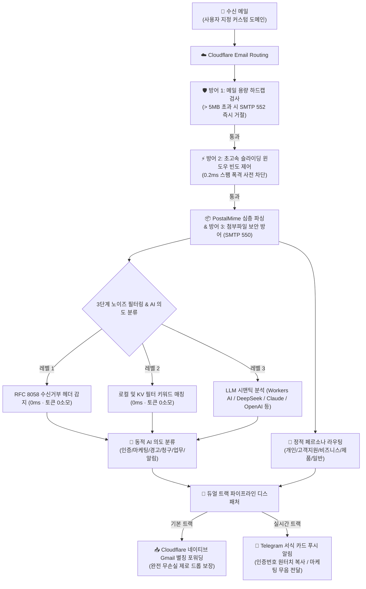

<div align="center">

# 📬 cf-mail2tg-aibot

**Cloudflare Workers & LLM 기반의 프로덕션급, 완전 무료, 셀프 호스팅 이메일-Telegram AI 봇**  
*Cloudflare Workers 기반의 엔터프라이즈급 지능형 수신 게이트웨이 및 원터치 인증번호 추출*

[](LICENSE)
[](https://workers.cloudflare.com/)
[](https://core.telegram.org/bots/api)
[](https://www.typescriptlang.org/)
[](https://vitest.dev/)
[](#-6--10개-주요-언어-다국어-지원-및-즉시-전환)
[](#-완전-무료--무료-할당량-보장)

<p align="center">
  <a href="./README.md">English</a> •
  <a href="./README.zh-CN.md">简体中文</a> •
  <a href="./README.zh-TW.md">繁體中文</a> •
  <a href="./README.ja-JP.md">日本語</a> •
  <b>한국어</b> •
  <a href="./README.pt-BR.md">Português</a> •
  <a href="./README.ru-RU.md">Русский</a> •
  <a href="./README.es-ES.md">Español</a> •
  <a href="./README.fr-FR.md">Français</a> •
  <a href="./README.de-DE.md">Deutsch</a>
</p>

<p align="center">
  <a href="#-스크린샷">스크린샷</a> •
  <a href="#-빠른-시작-방법-a와-b-중-하나만-선택">빠른 시작 (택1)</a> •
  <a href="#-왜-cf-mail2tg-aibot인가-비교-매트릭스">비교 매트릭스</a> •
  <a href="#️-시스템-아키텍처">시스템 아키텍처</a> •
  <a href="#-핵심-기능">핵심 기능</a> •
  <a href="#-telegram-대화형-명령어">명령어 안내</a> •
  <a href="#-자주-묻는-질문-faq">자주 묻는 질문</a>
</p>

</div>

---

## 📖 프로젝트 개요

**`cf-mail2tg-aibot`**는 **인디 해커, 글로벌 개발팀, 다중 도메인을 운영하는 웹마스터**를 위해 특별히 설계된 셀프 호스팅 이메일 게이트웨이입니다.

Cloudflare Workers의 에지 컴퓨팅과 무료 Email Routing을 활용하여, **수신된 이메일을 심층 파싱하고, 스팸/노이즈를 차단하며, LLM 기반의 시맨틱 의도 분류를 거쳐 미려한 카드 형태로 수 초 내에 Telegram에 전달**합니다. 이와 동시에 무손실(Zero-Drop) 듀얼 트랙 파이프라인을 통해 원본 이메일을 개인 백업 사서함(예: Gmail 별칭)으로 직접 전달합니다. 다중 도메인으로 인해 발생하는 비싼 비즈니스 메일 구독료(유저당 월 $6~$18)를 없애고, 가볍고 유지비가 전혀 없는 실시간 이메일 수신 환경을 구축하세요.

---

## 📸 스크린샷

아래는 모두 실제 운영 중인 인스턴스의 스크린샷입니다. 이메일 주소, 인증 코드, 인보이스 번호 등 민감한 항목은 모두 자리 표시자로 교체했습니다.

### 🎛️ 봇 제어 패널

| | |
| :---: | :---: |
| <br><sub>게이트웨이 홈 — 온라인 상태, AI 엔진, 백업 포워딩을 한눈에</sub> | <br><sub>설정 — AI 제공업체, 라우팅 페르소나, 안티스팸, 언어를 한 패널에서 관리</sub> |

### 📬 이메일 알림 실제 화면

| | |
| :---: | :---: |
| <br><sub>인증 코드 — 자동 추출해 상단에 고정, 탭하면 복사</sub> | <br><sub>보안 알림 — SPF/DKIM 실패로 피싱 경고</sub> |
| <br><sub>청구 — 인보이스를 파싱하고 첨부 파일 정보까지 표시</sub> | <br><sub>비즈니스 문의 — AI 분류로 우선 처리 지정</sub> |

<p align="center">
  <br>
  <sub>마케팅 — 프로모션은 스팸 규칙으로 자동 음소거</sub>
</p>

---

## 🚀 빠른 시작 (방법 A와 B 중 하나만 선택)

> 📌 **【중요: 둘 중 하나만 선택하세요】**：아래의 두 가지 배포 방식 중 **하나만 선택하여 진행**하시면 됩니다 (둘 다 진행할 필요가 없습니다)!
> - **🟢 방법 A (적극 권장 / 비개발자 맞춤)**：**웹 원클릭 초고속 배포** — Node.js/Git 설치 불필요, 터미널 명령어 없이 브라우저에서 3단계 만에 2분 만에 완료;
> - **🔵 방법 B (개발자 전용)**：**로컬 CLI 터미널 배포** — Node.js 22+ 및 터미널 환경 필요, 2차 개발 및 로컬 디버깅에 적합.

---

### 🟢 방법 A: 2분 초고속 원클릭 배포 (권장 / Zero CLI / 웹 UI)

> **💡 비개발자를 위한 맞춤 설계**: PC에 Node.js나 Git을 설치하거나 터미널 명령어를 입력할 필요가 전혀 없습니다. Cloudflare 공식 웹 대시보드에서 클릭 몇 번으로 즉시 완벽한 이메일 게이트웨이를 구축할 수 있습니다!

<p align="center">
  <a href="https://deploy.workers.cloudflare.com/?url=https://github.com/Sacilave/cf-mail2tg-aibot">
    
  </a>
</p>

#### 1단계: Telegram 봇 토큰 및 Chat ID 발급 (1분)
1. Telegram에서 [@BotFather](https://t.me/BotFather)에게 `/newbot` 명령어를 전송하고 안내에 따라 봇을 생성한 후 발급된 **`HTTP API Token`** (`TELEGRAM_BOT_TOKEN`)을 복사합니다.
2. [@userinfobot](https://t.me/userinfobot)에게 메시지를 보내 본인의 고유 숫자 ID (`TELEGRAM_ADMIN_CHAT_ID`)를 확인합니다 (관리자 본인만 봇을 제어하도록 보호).

#### 2단계: 위 버튼을 클릭하여 웹에서 원클릭 배포 (30초)
1. 상단의 **`[Deploy to Cloudflare Workers]`** 버튼을 클릭합니다 (또는 [웹 배포 페이지 바로가기](https://deploy.workers.cloudflare.com/?url=https://github.com/Sacilave/cf-mail2tg-aibot));
2. Cloudflare 계정으로 로그인하고 GitHub 권한 연동을 승인합니다;
3. Cloudflare가 신규 KV 스토리지(`MAIL_ROUTES_KV`)와 기본 환경변수를 자동으로 생성합니다. 배포 화면에 1단계에서 발급받은 값을 입력합니다:
   - `TELEGRAM_BOT_TOKEN`: 봇 API 토큰
   - `TELEGRAM_ADMIN_CHAT_ID`: 텔레그램 숫자 Chat ID
4. **Save and Deploy**를 클릭하면 약 10초 만에 배포가 완료됩니다! 배포 후 발급된 Worker 접속 주소(예: `https://cf-mail2tg-aibot.xxx.workers.dev`)를 확인합니다.

#### 3단계: 도메인 Email Routing에 Worker 연결 (30초)
1. Cloudflare 대시보드에서 보유 도메인 선택 ➔ **Email** ➔ **Email Routing**으로 이동합니다;
2. 아직 활성화되지 않았다면 원클릭 활성화를 진행합니다 (필요한 DNS MX 레코드가 자동 등록됩니다);
3. **Routing rules** 탭에서 **Add rule** 클릭 (또는 Catch-all 규칙 수정):
   - **Type**: **Catch-all rule** 선택;
   - **Action**: **Send to Worker** 선택;
   - **Destination**: 배포된 **`cf-mail2tg-aibot`** 선택 후 저장;
4. **웹훅 활성화 및 테스트**:
   - 웹 브라우저에서 `https://<Worker주소>/setup-webhook`에 1회 접속하여 Telegram 웹훅을 등록합니다;
   - Telegram에서 봇에게 `/start` 또는 `/setup`을 전송하면 모바일에서 즉시 백업 이메일 및 AI 엔진 설정을 완료할 수 있습니다!

---

### 🔵 방법 B: 로컬 CLI 터미널 배포 (개발자 전용)

**사전 준비:**
- 무료 Cloudflare 계정과 Cloudflare에 추가된 도메인 (Email Routing은 도메인별로 활성화되며, 3단계에서 설정합니다).
- 컴퓨터에 Node.js 22 이상과 Git 설치 (3단계의 첫 wrangler 명령 실행 시 브라우저가 열려 Cloudflare 로그인을 요청합니다).

### 1. Telegram 자격 증명 발급
- [@BotFather](https://t.me/BotFather)에게 대화 시작 ➔ `/newbot` 입력 ➔ 발급된 `TELEGRAM_BOT_TOKEN` 복사.
- [@userinfobot](https://t.me/userinfobot)에게 대화 시작 ➔ 사용자 ID 숫자를 복사하여 `TELEGRAM_ADMIN_CHAT_ID`로 보관.
- 터미널에서 `openssl rand -hex 32` 실행 ➔ 출력값을 복사하여 `TELEGRAM_WEBHOOK_SECRET`로 보관 (선택 사항이지만 권장; Windows에서는 Git Bash에서 실행).

### 2. Cloudflare 목적지 주소 인증
- Cloudflare 대시보드 접속: **Email** ➔ **Email Routing** ➔ **Destination addresses** ➔ 개인 이메일(예: `you@gmail.com`) 추가 후 인증 메일 확인.

### 3. 배포 및 활성화
```bash
# 저장소 클론 및 패키지 설치
git clone https://github.com/Sacilave/cf-mail2tg-aibot.git && cd cf-mail2tg-aibot
npm install

# KV 네임스페이스 생성 후 출력된 ID를 wrangler.jsonc의 kv_namespaces[0].id에 입력
npx wrangler kv namespace create MAIL_ROUTES_KV

# 필수 비밀값 설정
npx wrangler secret put TELEGRAM_BOT_TOKEN
npx wrangler secret put TELEGRAM_ADMIN_CHAT_ID
npx wrangler secret put TELEGRAM_WEBHOOK_SECRET  # 강력 권장 (1단계에서 만든 값)

# Cloudflare 에지로 배포
npm run deploy
```

- **웹훅 등록 활성화**: 브라우저에서 `https://<your-worker>.<subdomain>.workers.dev/setup-webhook?secret=<YOUR_SECRET>` 접속 (`{"ok":true}` 반환 확인. `<YOUR_SECRET>`은 1단계의 `TELEGRAM_WEBHOOK_SECRET`와 정확히 일치해야 하며, Worker URL은 `npm run deploy` 출력에서 확인).
- **이메일 라우팅 연결**: Cloudflare 대시보드에서 내 도메인 선택 ➔ **Email** ➔ **Email Routing** ➔ 활성화 (필요한 MX 레코드가 자동 추가됩니다) ➔ **Routing rules** ➔ Catch-all 규칙 추가: **Send to Worker** ➔ `cf-mail2tg-aibot` 선택.
- **모바일에서 간편 마무리**: Telegram에서 봇에게 `/setup`을 전송하여 백업 Gmail(2단계에서 인증한 주소여야 합니다)과 LLM 키를 1분 만에 등록하세요 (터미널 재접속 불필요!).

#### 🤖 선택 사항: 지속적 배포 (CI/CD · GitHub Actions)
직접 포크하거나 클론하여 커스텀 개발을 진행할 때, `main` 브랜치 푸시 시 자동 배포를 원하시면:
1. [`.github/workflows/deploy.yml.example`](.github/workflows/deploy.yml.example)을 `.github/workflows/deploy.yml`로 변경합니다.
2. GitHub 저장소의 **Settings** ➔ **Secrets and variables** ➔ **Actions**에 `CLOUDFLARE_API_TOKEN` 시크릿을 추가합니다 (발급 방법: Cloudflare 대시보드 ➔ My Profile ➔ API Tokens ➔ 'Edit Cloudflare Workers' 템플릿으로 토큰 생성).
3. 이후 `main`에 코드를 푸시할 때마다 자동 테스트가 실행되고 Cloudflare Workers로 자동 배포됩니다.

---

## ⚡ 왜 cf-mail2tg-aibot인가? (비교 매트릭스)

| 비교 항목 | 일반 오픈소스 스크립트 | 유료 비즈니스 메일 (Google / Naver Works) | **cf-mail2tg-aibot (본 프로젝트)** |
| :--- | :--- | :--- | :--- |
| **월간 비용** | 무료 | 유저당 월 $6 ~ $18 (도메인 추가 시 기하급수적 증가) | **$0 (Cloudflare 무료 플랜으로 영구 구동)** |
| **무손실 전달** | ❌ Telegram API 병목 또는 네트워크 순단 시 유실 | ✅ 안정적 | **✅ Zero-Drop 듀얼 트랙 (네이티브 전달로 100% 무손실 보장)** |
| **첨부파일 방어** | ❌ 128MB 메모리 초과로 워커 크래시 발생 | 스토리지 추가 구매 필요 | **✅ 5MB 하드캡 + SMTP 550 제로 첨부파일 차단** |
| **스팸 폭격 방어** | ❌ 스팸 폭탄에 노출되어 TG 429 밴 유발 | 엔터프라이즈 WAF 규칙 직접 구성 필요 | **✅ 0.2ms 사전 슬라이딩 윈도우 빈도 제어로 CPU 98% 절감** |
| **의도 자동 분류** | ❌ 지원 안 함 (스팸 메일도 무차별 푸시) | 단순 휴리스틱 분류, 잦은 오탐 | **✅ LLM 6대 의도 분류 + 마케팅 메일 무음 푸시** |
| **인증번호 추출** | ❌ 본문 전체에서 수동 검색 및 복사 필요 | ❌ 자체 추출 미지원 | **✅ 최상단 `<code>` 블록 배치, 모바일에서 원터치 복사** |
| **운영 및 설정** | ❌ 규칙 변경 시마다 코드 수정 및 재배포 필요 | 복잡한 웹 콘솔 수동 설정 | **✅ Telegram 메시지 답장만으로 실시간 핫 리로드 완료** |

---

## 🏗️ 시스템 아키텍처



---

## 🌟 핵심 기능

### 1. 🔄 Zero-Drop 듀얼 트랙 무손실 파이프라인
- **기본 트랙 (무손실 백업)**: 이메일이 워커에 도달하는 즉시 Cloudflare 네이티브 엔진을 통해 백업 사서함으로 전달됩니다. 도메인 페르소나에 따라 Gmail 별칭(예: `yourname+support@gmail.com`)으로 자동 라우팅을 지원합니다. Telegram 서버에 장애가 발생하더라도 **원본 이메일은 절대 유실되지 않습니다**.
- **실시간 트랙 (스마트 카드 알림)**: HTML 태그를 정제하고, Quoted-Printable 인코딩을 복원하여 가독성이 뛰어난 마크다운 카드로 Telegram에 즉시 전송합니다.
- **단일 트랙 모드**: 백업 이메일이 설정되어 있지 않은 경우, 오류 없이 순수 Telegram 알림 단일 모드로 부드럽게 동작합니다.

### 2. 🤖 멀티 LLM 공급업체 지원 & 원터치 인증번호 복사
- **완전 무료 에지 네이티브 AI**: **Cloudflare Workers AI**(`@cf/meta/llama-3.1-8b-instruct`)가 기본 내장되어 있어 **API 키 없이 100% 무료**로 구동됩니다. **DeepSeek**(초저비용·고지능), **Groq**(초고속 LPU 추론), **OpenAI**, **Google Gemini**, **Anthropic Claude**, **OpenRouter** 및 사용자 지정 OpenAI 호환 프록시를 완벽히 지원합니다.
- **6대 표준 의도 분류**: `🔐 인증`, `📢 마케팅`, `🚨 보안 경고`, `💰 청구/결제`, `💬 업무`, `🔔 알림`.
- **원터치 인증번호 복사**: 고정밀 정규식 탐지 엔진과 LLM 파싱을 결합하여 로그인 및 가입용 인증번호를 감지하고 최상단 `<code>` 블록에 단독 배치합니다. 스마트폰에서 **터치 한 번으로 즉시 복사**할 수 있습니다.
- **다국어 네이티브 스팸 키워드 사전 & 무음 전달**:
  - 시스템 언어를 지원 언어로 전환하면 지역별 비즈니스 메일 관례에 맞는 **원어민 수준의 지능형 마케팅 키워드**가 KV에 안전하게 자동 추가됩니다.
  - RFC 8058 수신거부 헤더 또는 키워드가 매칭되면 `disable_notification: true`로 **소리와 진동 없는 무음 알림**으로 조용히 전송됩니다.
- **Cloudflare 무료 할당량 보호**:
  - **사전 숏서킷**: 수신거부 헤더나 필터 키워드와 매칭된 메일은 AI 호출을 전면 생략하여 토큰 소모를 0으로 만듭니다.
  - **스마트 본문 요약**: LLM으로 전송되는 텍스트 길이를 800자로 엄격히 제한하여 지연 시간과 토큰 소모를 최소화합니다.
  - **메모리 캐시 & 쓰기 중복 제거**: 60초 메모리 캐시 및 해시 비교를 통해 KV 중복 쓰기를 건너뛰어 무료 할당량을 안전하게 보호합니다.

### 3. 🏷️ 2단계 태깅 아키텍처: 동적 AI 의도 + 수동 페르소나 라우팅
`cf-mail2tg-aibot`는 "메일의 실제 성격(의도)"과 "어느 사업/제품으로 온 것인가(페르소나)"를 명확히 분리합니다:

```
수신 이메일
├── 🤖 동적 AI 의도 태그 (본문 시맨틱 분석)
│   ├── 🔐 인증 (인증번호 추출, 고정폭 강조 표시, 우선순위 알림)
│   ├── 📢 마케팅 (RFC 수신거부/키워드 감지 -> 무음 푸시)
│   ├── 🚨 보안 경고 (계정 이상, 서버 모니터링, 긴급 알림)
│   ├── 💰 청구/결제 (인보이스, 결제 영수증, 정기 결제 갱신)
│   ├── 💬 업무 (비즈니스 협력, 클라이언트 문의, 개인 서신)
│   └── 🔔 알림 (GitHub 업데이트, 시스템 요약 알림)
│
└── 📂 수동 페르소나 라우팅 태그 (비즈니스 도메인)
    ├── 개인 (Personal) -> admin/me/hi 접두사 자동 매칭 (Gmail 별칭 +personal)
    ├── 고객지원 (Support) -> support/help/service 접두사 자동 매칭 (Gmail 별칭 +support)
    ├── 비즈니스 (Business) -> sales/billing/bd 접두사 자동 매칭 (Gmail 별칭 +business)
    ├── 제품 (Product) -> product/feedback/app 접두사 자동 매칭 (Gmail 별칭 +product)
    ├── 일반 (General) -> 기본 폴백
    └── ➕ 커스텀 카테고리 태그 -> 재무, 모니터링 등 자유로운 태그 생성 및 원터치 지정
```

### 4. 🛡️ 4단계 에지 방어 장갑 (Edge Armor)
- **Zero-Attachment Policy**: 첨부파일이 포함된 메일을 에지에서 SMTP 550으로 즉시 거절하여 Gmail 스토리지 소모와 악성코드 감염 위험을 원천 차단합니다.
- **5MB 용량 제한 하드캡**: 5MB를 초과하는 대용량 메일은 SMTP 552로 에지에서 즉각 튕겨내 워커 OOM 크래시와 CPU 고갈을 방지합니다.
- **사전 슬라이딩 윈도우 빈도 제어**: 메일 본문을 파싱하기 전에 발신자 빈도를 먼저 검사합니다. 스팸 폭격은 **0.2ms** 내에 종료되어 CPU를 98% 절감합니다.
- **Telegram 429 서킷 브레이커**: Telegram Bot API 429 Too Many Requests 발생 시 자동으로 30초 쿨다운에 들어가 요청 누적과 봇 밴을 방지합니다.

### 5. 🎛️ 모바일 Telegram 제어 센터
- **대화형 설정 마법사 (`/setup`)**: 1분 만에 백업 사서함과 AI 키를 등록하는 친절한 2단계 가이드.
- **실시간 상태 확인 (`/status` 또는 `/config`)**: 마스킹된 보안 키와 함께 전체 게이트웨이 구성을 한눈에 점검.
- **모바일 핫 업데이트 (`/setkey`)**: 채팅창에서 `/setkey minimax <키>` 또는 `/setkey forward <이메일>`을 전송하여 즉시 반영.
- **키워드 목록 수정 (`/keywords`)**: 봇이 보낸 키워드 목록 메시지에 직접 답장하여 실시간으로 편집 및 핫 리로드.
- **라우팅 규칙 관리 (`/routes`, `/add`, `/del`)**: 인라인 버튼과 대화상자를 통해 규칙 추가/삭제/확인 가능.

### 6. 🌐 10개 주요 언어 다국어 지원 및 즉시 전환
- **10개 언어 완벽 지원**: 🇨🇳 简体中文 (`zh-CN`), 🇺🇸 English (`en-US`), 🇭🇰 繁體中文 (`zh-TW`), 🇯🇵 日本語 (`ja-JP`), 🇰🇷 한국어 (`ko-KR`), 🇧🇷 Português (`pt-BR`), 🇷🇺 Русский (`ru-RU`), 🇪🇸 Español (`es-ES`), 🇫🇷 Français (`fr-FR`), 🇩🇪 Deutsch (`de-DE`).
- **전체 화면 완벽 현지화**: 이메일 푸시 카드, 인증번호 헤더, 보안 경고 카드, 설정 마법사, 제어 대시보드 및 Telegram Bot 메뉴 명령어가 네이티브 품질로 번역되어 제공됩니다.
- **인라인 언어 전환기 (`/lang`)**: `/lang`을 입력하면 5x2 버튼 그리드가 열리며(현재 언어에 `✓` 표시), `/lang ko`와 같이 코드를 직접 입력할 수도 있습니다.
- **4단계 우선순위 매칭**: `Cloudflare KV 동적 설정 (config:sys:system_language)` > `환경변수 (DEFAULT_LANGUAGE)` > `Telegram 클라이언트 언어 (language_code)` > `기본값 (zh-CN)`.
### 7. 📤 대화형 이메일 발신 마법사 & RFC 5322 스레드 답장 (Resend 연동)
- **5단계 대화형 발신 마법사 (`/send`)**: Telegram에서 발신자 라우팅 주소 선택, 수신자 입력(형식 자동 검증), 제목, 본문 작성(여러 줄 & 100KB 용량 제한), 최종 확인 카드 단계를 거쳐 Resend REST API로 즉각 발송;
- **RFC 5322 / RFC 2822 대화 스레드 호환**: 수신 알림 카드의 `[ ↩️ 답장 ]` 버튼 클릭 시 즉시 답장 세션 활성화. `Re: ` 접두사 자동 보정 및 `In-Reply-To`, `References` 헤더를 주입하여 주요 메일 앱에서 단일 스레드로 완벽 결합;
- **CRLF 인젝션 차단**: `\r\n` 및 제어 문자를 자동 정제하는 `cleanHeaderValue()` 필터를 적용하여 SMTP/MIME 헤더 탈취 공격 원천 방어;
- **동적 토큰 등록**: Telegram에서 `/setkey resend re_xxxxxx`를 전송하여 재배포 없이 발신용 Resend API Key 즉시 바인딩.

### 8. ⭐ AI 분석 패스 화이트리스트 & 동적 수신자 퀵픽 버튼
- **0 토큰 소모 단락 체계 (`/whitelist`)**: 특정 이메일 또는 도메인 단위(`@company.com`) 등록 시 AI 판별을 즉각 패스하여 **토큰 소모 0회 및 스팸 오분류 완벽 방지**;
- **동적 수신자 추천 패널**: `/send` 1단계에서 화이트리스트 주소, 최근 2회 수신 발신자, 최근 2회 발신 수신자를 원터치 선택 버튼으로 자동 생성.

### 9. 🎛️ 수신 알림 5-in-1 퀵 액션 콘솔
Telegram으로 수신되는 모든 메일 알림 카드 하단에 5개의 핵심 인터랙션 버튼 기본 탑재:
- **`[ ↩️ 답장 ]`**: 원클릭으로 대화형 답장 세션 시작;
- **`[ 🤖 AI 요약 ]`**: Humanizer 실용주의 프롬프트 기반으로 핵심 취지, 주요 일정/금액, 후속 조치 사항을 명쾌하게 요약. 사용자 언어로 자동 변환되며 1회 생성 후 KV 캐싱(다음 조회 시 0 토큰 초고속 응답);
- **`[ 🌐 AI 번역 ]`**: 기계 번역 어투를 배제한 자연스러운 원문 번역 및 2,800자 오버플로우 방지 처리;
- **`[ 📋 본문 복사 ]`**: 모바일에서 원터치로 전체 본문을 복사할 수 있는 `<pre><code>` 코드 블록 발송;
- **`[ 📖 원문 웹 리더 ]`**: Strict CSP 보안 샌드박스와 다크 모드를 지원하는 전용 웹 리더(`GET /view/:replyId`)를 통해 Telegram 4,096자 제한을 완벽히 극복.

---

## 📱 Telegram 대화형 명령어

Telegram 채팅창 좌측 하단의 **[메뉴]** 버튼을 터치하거나 아래 명령어를 입력하세요:

| 명령어 | 매개변수 형식 | 설명 |
| :--- | :--- | :--- |
| `/start` | - | **👋 심플 개요**: `[⚙️ 설정]`, `[📖 사용 안내서]`, `[🌐 언어]` 바로가기가 포함된 상태 요약 |
| `/settings` | - | **⚙️ 설정 대시보드**: AI, 라우팅, 스팸 방어, 전달, 언어를 관리하는 2x4 인라인 버튼 그리드 (별칭 `/menu`) |
| `/guide` | - | **📖 상세 사용 안내서**: 워크플로, 의도 분류, 스팸 필터, 접두사 라우팅 가이드 |
| `/setup` | - | **⚡ 빠른 설정 마법사**: 1분 만에 핵심 자격 증명을 바인딩하는 2단계 대화형 마법사 |
| `/lang` | `[코드]` | 대화형 5x2 키보드 또는 언어 코드로 시스템 표시 언어 전환 (예: `/lang ko`, `/lang en`) |
| `/provider` | `[1~9\|이름]` | 대화형 AI 공급업체 전환 (1~9번 답장으로 Workers AI / DeepSeek / Groq / OpenAI 등 선택) |
| `/model` | `[1~2\|이름]` | 활성 공급업체의 모델 버전 대화형 변경 |
| `/cancel` | - | 진행 중인 설정 마법사 또는 대화형 세션 즉시 취소 |
| `/status` | - | **📊 시스템 운영 상태**: 게이트웨이 가동 상태 및 마스킹된 자격 증명 확인 (별칭 `/config`) |
| `/setkey` | `<ai\|minimax\|forward> <값>` | 범용 AI/MiniMax 키 또는 백업 전달 이메일을 모바일에서 즉시 핫 업데이트 |
| `/resetkey` | `<ai\|provider\|model\|minimax\|forward>` | KV 동적 오버라이드를 초기화하고 기본 환경변수로 복원 |
| `/keywords` | - | 원터치 복사 가능한 코드 블록 형태로 마케팅 필터 키워드 확인 |
| `/addkeywords` | `<단어1>\n<단어2>` | 기존 키워드를 보존하며 안전하게 키워드 증분 추가 |
| `/resetkeywords` | - | 마케팅 필터 키워드를 시스템 기본값으로 복원 |
| `/routes` | - | 도메인 페르소나 프리셋 및 동적 KV 라우팅 규칙 확인, 커스텀 태그 관리 |
| `/add` | `<태그> <접두사> [전달대상]` | 새 라우팅 규칙 즉시 추가 (예: `/add 고객지원 help user@domain.com`) |
| `/del` | `<접두사>` | 대화형 확인 팝업과 함께 라우팅 규칙 안전 삭제 |
| `/help` | - | 전체 명령어 도움말 및 매뉴얼 확인 |

---

## 💰 완전 무료 & 무료 할당량 보장

본 프로젝트는 **Cloudflare Workers 무료 플랜**에 완벽히 최적화되어 있습니다:
- **CPU 시간**: 이메일 1건 처리 시 평균 ~0.5ms 소모 (무료 플랜 10ms 한도 대비 5% 미만).
- **메모리 점유율**: 제로 첨부파일 차단 및 5MB 용량 제한으로 에지 메모리가 128MB 한도 내에서 안전하게 유지됩니다.
- **KV 스토리지**: 일반 수신 메일은 경량 캐시 읽기만 발생하며, 규칙 업데이트 시 쓰기 1회가 발생합니다. 무료 플랜(일 100,000회 읽기, 1,000회 쓰기)의 0.1% 미만을 소모합니다.
- **과금 위험 차단**: Cloudflare 무료 계정은 신용카드 등록 없이도 생성 가능하며, 이상 트래픽 발생 시 HTTP 503으로 안전하게 튕겨내므로 **예상치 못한 과금 위험이 전혀 없습니다**.

---

## ❓ 자주 묻는 질문 (FAQ)

<details>
<summary><b>Q: 백업 이메일(FORWARD_TO_EMAIL) 없이 Telegram 봇 단독으로만 사용할 수 있나요?</b></summary>
네, 완전히 가능합니다! <code>FORWARD_TO_EMAIL</code>을 지정하지 않으면 게이트웨이가 단일 트랙 모드로 자동 동작하여 에러 없이 Telegram으로만 실시간 알림 카드를 전달합니다.
</details>

<details>
<summary><b>Q: 일부 알림 카드에서 SPF/DKIM에 "실패 (스푸핑 가능성)"라고 뜨는 이유는 무엇인가요?</b></summary>
이는 발신 서버의 설정 상태를 알려주는 보안 지표입니다. 일부 저품질 알림 메일 서버는 DKIM 서명이 누락되어 있을 수 있습니다. 게이트웨이는 이를 시각적으로 경고하고 해당 발신자에 대한 빈도 제한을 강화합니다.
</details>

<details>
<summary><b>Q: 유료 LLM API 키 없이도 사용할 수 있나요?</b></summary>
네! 기본 탑재된 <b>Cloudflare Workers AI</b>는 API 키 없이 100% 무료로 구동되며, AI 기능을 사용하지 않더라도 내장된 <b>초고속 정규식 탐지 엔진 및 로컬 RFC 규칙</b>을 통해 인증번호 추출과 스팸 필터링이 무료로 작동합니다.
</details>

<details>
<summary><b>Q: 여러 개의 도메인을 하나의 워커에 연결할 수 있나요?</b></summary>
네! Cloudflare는 무료 플랜에서도 무제한 도메인을 지원합니다. 각 도메인의 Catch-all 규칙을 동일한 <code>cf-mail2tg-aibot</code> Worker로 지정하기만 하면 게이트웨이가 수신 도메인을 자동 인식하여 격리된 페르소나 방어를 수행합니다.
</details>

---

## 📄 라이선스

본 프로젝트는 [MIT License](LICENSE)에 따라 자유롭게 배포 및 수정할 수 있습니다. 개인 및 상업적 용도로 자유롭게 활용하세요.
