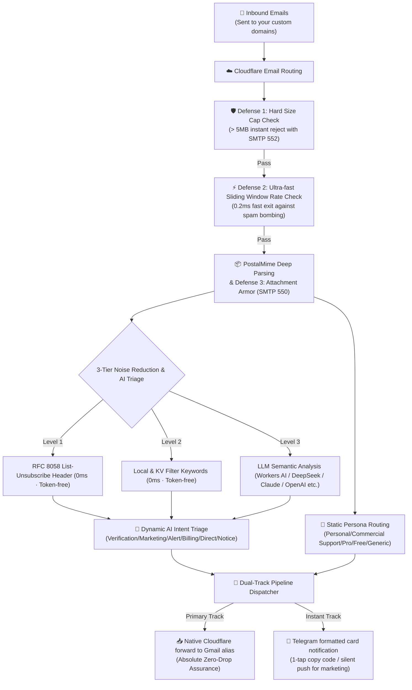

<div align="center">

# 📬 cf-mail2tg-aibot

**Production-grade, zero-cost, self-hosted Email-to-Telegram AI Bot powered by Cloudflare Workers & LLM.**  
*基于 Cloudflare Workers 的生产级、零成本、自建邮件转 Telegram AI 机器人*

[](LICENSE)
[](https://workers.cloudflare.com/)
[](https://core.telegram.org/bots/api)
[](https://www.typescriptlang.org/)
[](https://vitest.dev/)
[](#-6--10-mainstream-languages-i18n--instant-switching)
[](#-zero-cost--free-quota-guarantee)

<p align="center">
  <b>English</b> •
  <a href="./README.zh-CN.md">简体中文</a> •
  <a href="./README.zh-TW.md">繁體中文</a> •
  <a href="./README.ja-JP.md">日本語</a> •
  <a href="./README.ko-KR.md">한국어</a> •
  <a href="./README.pt-BR.md">Português</a> •
  <a href="./README.ru-RU.md">Русский</a> •
  <a href="./README.es-ES.md">Español</a> •
  <a href="./README.fr-FR.md">Français</a> •
  <a href="./README.de-DE.md">Deutsch</a>
</p>

<p align="center">
  <a href="#-screenshots">Screenshots</a> •
  <a href="#-quick-start-3-steps">Quick Start</a> •
  <a href="#-why-cf-mail2tg-aibot-comparison-matrix">Comparison Matrix</a> •
  <a href="#️-system-architecture">Architecture</a> •
  <a href="#-key-features">Key Features</a> •
  <a href="#-telegram-interactive-commands">Bot Commands</a> •
  <a href="#-faq">FAQ</a>
</p>

</div>

---

## 📖 Project Overview

**`cf-mail2tg-aibot`** is a self-hosted email gateway engineered specifically for **Indie Hackers, global development teams, and multi-domain webmasters**.

Leveraging Cloudflare Workers edge computing and free Email Routing, it **deep-parses incoming emails, filters spam/noise, performs LLM semantic triage, and delivers beautifully formatted cards to Telegram in seconds**. Simultaneously, its Zero-Drop dual-track pipeline forwards uncompressed raw emails directly to your personal backup mailbox (e.g., Gmail aliases). Say goodbye to expensive business email subscriptions ($6–$18/user/mo across multiple domains) and embrace a lightweight, cost-free, real-time email receiving workflow.

---

## 📸 Screenshots

Real screenshots from a running instance. All sensitive fields (email addresses, verification codes, invoice numbers) are replaced with placeholders.

### 🎛️ Bot Control Panel

| | |
| :---: | :---: |
| <br><sub>Gateway home — online status, AI engine and backup forwarding at a glance</sub> | <br><sub>Settings — AI providers, routing personas, anti-spam and language in one panel</sub> |

### 📬 Email Notifications in Action

| | |
| :---: | :---: |
| <br><sub>Verification codes — extracted and pinned to the top, tap to copy</sub> | <br><sub>Security alerts — phishing flagged with SPF/DKIM failure</sub> |
| <br><sub>Billing — invoices parsed with attachment details</sub> | <br><sub>Business inquiries — prioritized by AI triage</sub> |

<p align="center">
  <br>
  <sub>Marketing — promotions auto-muted by spam rules</sub>
</p>

---

## 🚀 Quick Start (3 Steps)

**Prerequisites:**
- A free Cloudflare account and a domain added to Cloudflare (Email Routing is enabled per domain — Step 3 turns it on for yours).
- Node.js 22 or later and Git installed on your computer (the first `wrangler` command in Step 3 opens a browser to log in to Cloudflare).

### 1. Get Telegram Credentials
- Message [@BotFather](https://t.me/BotFather) ➔ `/newbot` ➔ copy `TELEGRAM_BOT_TOKEN`.
- Message [@userinfobot](https://t.me/userinfobot) ➔ copy your user ID as `TELEGRAM_ADMIN_CHAT_ID`.
- Run `openssl rand -hex 32` ➔ copy the output as `TELEGRAM_WEBHOOK_SECRET` (optional but recommended — Windows users: run it in Git Bash).

### 2. Verify Cloudflare Destination Address
- In Cloudflare Dashboard: **Email** ➔ **Email Routing** ➔ **Destination addresses** ➔ Add and verify your personal email (e.g. `you@gmail.com`).

### 3. Deploy & Activate
```bash
# Clone & install dependencies
git clone https://github.com/Sacilave/cf-mail2tg-aibot.git && cd cf-mail2tg-aibot
npm install

# Create KV and paste returned ID into wrangler.jsonc (kv_namespaces[0].id)
npx wrangler kv namespace create MAIL_ROUTES_KV

# Set required credentials
npx wrangler secret put TELEGRAM_BOT_TOKEN
npx wrangler secret put TELEGRAM_ADMIN_CHAT_ID
npx wrangler secret put TELEGRAM_WEBHOOK_SECRET  # Strongly recommended (the value from Step 1)

# Deploy to Cloudflare edge
npm run deploy
```

- **Activate Webhook**: Open `https://<your-worker>.<subdomain>.workers.dev/setup-webhook?secret=<YOUR_SECRET>` in browser (returns `{"ok":true}`; `<YOUR_SECRET>` must be exactly the `TELEGRAM_WEBHOOK_SECRET` from Step 1, and the Worker URL is shown in the `npm run deploy` output).
- **Route Emails**: In Cloudflare Dashboard, select your domain ➔ **Email** ➔ **Email Routing** ➔ Enable it (the required MX records are added automatically) ➔ **Routing rules** ➔ Add Catch-all: **Send to Worker** ➔ Select `cf-mail2tg-aibot`.
- **Finish on Mobile**: In Telegram, send `/setup` to Bot to bind your backup Gmail (it must be the destination address verified in Step 2) and LLM Key in 1 minute—no terminal required!

#### 🤖 Optional: Continuous Deployment (Vibe Coding / GitHub Actions)
If you fork or clone this repository for customized development (vibe coding) and want pushes to `main` to automatically deploy to Cloudflare:
1. Rename [`.github/workflows/deploy.yml.example`](.github/workflows/deploy.yml.example) to `.github/workflows/deploy.yml`.
2. In your GitHub repository: **Settings** ➔ **Secrets and variables** ➔ **Actions** ➔ Add repository secret `CLOUDFLARE_API_TOKEN` (to get one: Cloudflare Dashboard ➔ My Profile ➔ API Tokens ➔ Create Token using the “Edit Cloudflare Workers” template).
3. Every push to `main` (or manual trigger in the Actions tab) will run automated tests and deploy to Cloudflare Workers automatically!
*(Note: As an open template, automatic deployment is intentionally disabled by default to prevent failed CI checks before Cloudflare secrets are configured.)*

---

## ⚡ Why cf-mail2tg-aibot? (Comparison Matrix)

| Dimension | Generic Open-Source Scripts | Paid Business Inboxes (Google / Feishu) | **cf-mail2tg-aibot (This Project)** |
| :--- | :--- | :--- | :--- |
| **Monthly Cost** | Free | $6 ~ $18 / user / mo (exponentially pricey across domains) | **$0 (Runs permanently on Cloudflare Free Tier)** |
| **Zero-Drop Delivery** | ❌ Lost during Telegram API throttling or network jitters | ✅ Reliable | **✅ Zero-Drop Dual-Track (Unconditional native forwarding fallback)** |
| **Attachment Defense** | ❌ Easy crash on 128MB Worker memory limit or disk quota | Costly storage expansion packs | **✅ 5MB Hard Cap + SMTP 550 Zero-Attachment Armor** |
| **Anti-Flooding Protection** | ❌ Vulnerable to spam bombing leading to TG 429 bans | Requires custom enterprise WAF rules | **✅ 0.2ms Pre-parse sliding-window rate limit, saving 98% CPU** |
| **Intent Classification** | ❌ None, spam barrages fire constant notifications | Basic heuristics, prone to false positives | **✅ LLM triage for 6 intents + silent push for marketing** |
| **Code Extraction** | ❌ Manual search & copy from bloated email bodies | ❌ No native extraction | **✅ Pinned `<code>` block, 1-tap copy on mobile devices** |
| **Ops & Configuration** | ❌ Re-build & re-deploy code on every rule change | Manual web dashboard configuration | **✅ Direct Telegram message replies for instant hot updates** |

---

## 🏗️ System Architecture



---

## 🌟 Key Features

### 1. 🔄 Zero-Drop Dual-Track Pipeline
- **Primary Track (Lossless Backup)**: The moment an email hits the Worker, Cloudflare's native forward engine delivers it directly to your designated inbox. Supports domain persona routing to dedicated Gmail aliases (e.g., `yourname+support@gmail.com`). Even during Telegram outages, **your raw emails are never lost**.
- **Instant Track (Push Notification)**: Automatically cleans HTML formatting, fixes Quoted-Printable encoding, and renders an elegant markdown card on Telegram.
- **Single-Track Mode**: When no backup email is configured, the gateway gracefully degrades to pure Telegram push mode with zero errors.

### 2. 🤖 Multi-Provider LLM Semantic Triage & 1-Tap Verification Code Extraction
- **Zero-Cost Out-of-the-Box Edge AI**: Pre-configured with **Cloudflare Workers AI** (running `@cf/meta/llama-3.1-8b-instruct`, 100% Free · Zero API Key · Edge Native); seamlessly supports **DeepSeek** (Ultra-low cost · High intelligence), **Groq** (Blazing fast LPU inference), **OpenAI**, **Google Gemini**, **Anthropic Claude**, **OpenRouter**, and custom OpenAI-compatible proxies.
- **6 Standardized Intent Categories**: `🔐 Verification`, `📢 Marketing`, `🚨 Security Alert`, `💰 Billing`, `💬 Business`, `🔔 Notification`.
- **1-Tap Code Copy**: Built-in high-precision regex sniffing engine alongside LLM parsing extracts authentication codes and displays them in a top-level `<code>` block—**tap once on your phone to copy**.
- **Multi-Language Native Spam Dictionaries & Silent Push**:
  - Initializes with a clean English baseline keyword dictionary;
  - Switching to any of the 8 supported languages automatically and non-destructively appends **authentic, professionally crafted native spam keywords** into KV (tailored to regional marketing patterns, not literal translations);
  - RFC 8058 unsubscribe headers and keyword matches trigger with `disable_notification: true` for **silent delivery (no sound, no vibration)**.
- **Cloudflare Free Tier Quota Defense**:
  - **Pre-AI Short-Circuiting**: Emails matching unsubscribe headers or spam dictionaries bypass AI invocation entirely, consuming 0 tokens and 0 CPU time;
  - **Smart Snippet Capping**: Email snippets sent to LLMs are capped at 800 characters, minimizing token usage and latency;
  - **Memory Cache & Write Deduplication**: 60-second in-memory KV cache and hash comparison skip redundant writes, preserving your Cloudflare KV free quotas.
- **Fail-Safe Circuit Breaker**: If LLM quotas expire or time out, the system defaults to loud notifications marked `⚠️ LLM API Offline (Alert Sound Preserved)`, ensuring critical messages are never missed.

### 3. 🏷️ Two-Tier Tagging Architecture: Dynamic AI Intent + Manual Persona Routing
`cf-mail2tg-aibot` pioneers a **Two-Tier Tagging System** that cleanly separates "What the email is about" from "Which business/product it belongs to":

```
Incoming Email
├── 🤖 Dynamic AI Intent Tag (Content Semantic)
│   ├── 🔐 Verification (Extract OTP code, highlight in monospace, alert)
│   ├── 📢 Marketing (RFC unsubscribe / keywords / promo detected -> silent delivery)
│   ├── 🚨 Security (Account alerts, server monitoring, high priority)
│   ├── 💰 Billing (Invoices, payment receipts, subscription renewals)
│   ├── 💬 Direct (Human-to-human communications, business inquiries)
│   └── 🔔 Notification (System digests, GitHub updates)
│
└── 📂 Manual Persona Route Tag (Business Domain)
    ├── 个人 (Personal) -> Auto-matches admin/me/hi prefixes (Maps to Gmail alias +personal)
    ├── 客服 (Support)  -> Auto-matches support/help/service/cs prefixes (Maps to Gmail alias +support)
    ├── 商务 (Business) -> Auto-matches sales/billing/business/bd prefixes (Maps to Gmail alias +business)
    ├── 产品 (Product)  -> Auto-matches product/feedback/app prefixes (Maps to Gmail alias +product)
    ├── 通用 (General)  -> Universal fallback
    └── ➕ Custom Category Tags -> Create your own (e.g. Finance, Ops, Internal) with 1-click dynamic selection
```

- **Telegram Card Layout**:
  - Header: `💬 [New Email · Direct · help]` (Combines intent & target username);
  - Attribute: `📂 Business Persona: Customer Support` (Shows product domain);
- **Powers Zero-Drop Gmail Alias Routing**:
  When `ENABLE_GMAIL_ALIASES=true`, emails automatically route to `user+personal@gmail.com`, `user+support@gmail.com`, `user+business@gmail.com`, etc., mapping directly into Gmail label filters.
- **Minimalist Status (`/start`) & Button-First Settings (`/settings`)**:
  - `/start` - Absolute minimalist overview with 3 direct shortcuts: `[⚙️ Settings]`, `[📖 User Guide]`, and `[🌐 Language]`;
  - `/settings` (or `/menu`) - Redesigned **"⚙️ Settings"** control center with a neat 2x4 inline button grid:
    - `[🤖 AI Model]` `[📂 Routes]`
    - `[🚫 Anti-Spam]` `[📬 Forwarding]`
    - `[🌐 Language]` `[🔄 Refresh]`
    - `[⚡ Setup Wizard]` `[📖 User Guide]`
  - **Dynamic Tag Management (`m:tags`)**:
    - Manage custom tags inside Route Settings via `[🏷️ Tag Manager]`;
    - Add or delete custom tags with 1-tap confirmation;
    - Custom tags appear seamlessly as buttons when creating routing rules!
  - `/routes` - Inspect all active baseline and dynamic KV rules with inline management buttons;
  - `/add <Tag> <Prefix> [ForwardTarget]` - Add custom routing rules on the fly (e.g. `/add 客服 help` or `/add 商务 vip vip@support.com`);
  - `/del <Prefix>` - Safely remove rules with an interactive confirmation prompt or direct inline tap.

### 4. 🛡️ 4-Layer Edge Armor Defense
- **Zero-Attachment Policy**: Reject incoming emails containing binary attachments at the edge using SMTP 550, safeguarding your Gmail quota and eliminating malware risks.
- **Size Cap Hard Limit**: Emails exceeding 5MB are immediately rejected with SMTP 552 at the edge, preventing OOM crashes and CPU exhaustion.
- **Pre-Parse Rate Limiting**: Checks sender sliding windows before unpacking email bodies; rate-limited spam exits within **0.2ms**, cutting CPU consumption by 98%.
- **Telegram 429 Circuit Breaker**: Automatically engages a 30-second cooldown period when Telegram API rate limits occur to prevent request pileups.

### 5. 🎛️ Mobile Telegram Control Panel & Key Management Hub
- **Interactive Setup Wizard (`/setup`)**: A 1-minute mobile-friendly step-by-step wizard to bind your backup inbox and LLM API key; enter `skip` to bypass any step, or `/cancel` anytime.
- **Global Status (`/status` or `/config`)**: View gateway status with **security masking on sensitive keys** (e.g., `min***a8f9`).
- **Mobile Hot-Updates (`/setkey`)**: Send `/setkey minimax <NewKey>` or `/setkey forward <NewEmail>` in private chat to persist updates to Cloudflare KV in real time—no terminal needed.
- **Dynamic Config Reset (`/resetkey`)**: Clear KV dynamic overrides and effortlessly fall back to environment variable defaults.
- **Keyword Management (`/keywords`)**: Generate a clean, 1-tap copyable list of marketing filter keywords.
- **Reply-to-Update**: Simply reply to the Bot's keyword message with your modified wordlist to perform an instant full hot-reload into Cloudflare KV.
- **Routing Rules (`/routes`, `/add`, `/del`)**: Inspect domain persona rules and dynamically add/remove prefix routing with interactive confirmation buttons.

### 6. 🌐 10 Mainstream Languages i18n & Instant Switching
- **10 Supported Languages**: 🇨🇳 Simplified Chinese (`zh-CN`), 🇺🇸 English (`en-US`), 🇭🇰 Traditional Chinese (`zh-TW`), 🇯🇵 Japanese (`ja-JP`), 🇰🇷 Korean (`ko-KR`), 🇧🇷 Portuguese (`pt-BR`), 🇷🇺 Russian (`ru-RU`), 🇪🇸 Spanish (`es-ES`), 🇫🇷 French (`fr-FR`), 🇩🇪 German (`de-DE`).
- **End-to-End Localization**: Email notification cards, verification code banners, security alerts, setup wizards, control panels, and native Telegram Bot menu commands are fully localized.
- **Instant Switcher (`/lang`)**: Send `/lang` to invoke a 5x2 inline button matrix (the active language is marked with `✓`), or supply a code directly (e.g., `/lang en`, `/lang ja`, `/lang ko`, `/lang pt`).
- **4-Tier Priority Resolution**: `Cloudflare KV dynamic setting (config:sys:system_language)` > `Environment variable (DEFAULT_LANGUAGE)` > `Telegram client language (language_code)` > `Fallback default (zh-CN)`.
- **Sub-millisecond Zero Overhead**: Built on static TypeScript dictionary trees with sub-millisecond (< 0.1ms) execution and zero edge memory penalty.

---

## 📱 Telegram Interactive Commands

Tap the **[Menu]** button at the bottom-left of the Telegram chat or send any command below:

| Command | Parameter Format | Description |
| :--- | :--- | :--- |
| `/start` | - | **👋 Minimalist Overview**: View gateway status summary with shortcuts to `[⚙️ Settings]`, `[📖 User Guide]`, and `[🌐 Language]` |
| `/settings` | - | **⚙️ Settings Dashboard**: 2x4 inline button grid to manage all settings (AI, routing, anti-spam, forwarding, language; alias `/menu`) |
| `/guide` | - | **📖 Detailed User Guide**: View workflow, classification, spam filtering, prefix routing docs with direct GitHub documentation link |
| `/setup` | - | **⚡ Quick Setup Wizard**: 1-minute step-by-step interactive setup wizard (accessible via inline button in Settings) |
| `/lang` | `[code]` | Switch system language via interactive 5x2 keyboard or direct code (e.g. `/lang ko`, `/lang pt`, `/lang en`) |
| `/provider` | `[1~9\|name]` | Interactive AI provider switch (reply with 1~9 to toggle Workers AI / DeepSeek / Groq / OpenAI etc.) |
| `/model` | `[1~2\|name]` | Interactive model switch for the active provider |
| `/cancel` | - | Exit active setup wizard or session, resetting interactive state |
| `/status` | - | **📊 System Readiness & Status**: Inspect gateway readiness status and masked credentials (alias `/config`) |
| `/setkey` | `<ai\|minimax\|forward> <value>` | Hot-update Universal AI / MiniMax key or backup forwarding email directly from mobile |
| `/resetkey` | `<ai\|provider\|model\|minimax\|forward>` | Reset dynamic KV override and restore deployment defaults |
| `/keywords` | - | Display all active marketing filter keywords in copyable code block |
| `/addkeywords` | `<word1>\n<word2>` | Safely append marketing filter keywords with deduplication |
| `/resetkeywords` | - | Reset marketing keywords to default baseline |
| `/routes` | - | View system persona presets and dynamic KV routing rules, manage custom tags |
| `/add` | `<tag> <prefix> [forward]` | Dynamically add custom route (e.g. `/add Support help user@domain.com`) |
| `/del` | `<prefix>` | Delete route rule with interactive confirmation dialog |
| `/help` | - | Display operation manual and gateway status |

---

## 💰 Zero Cost & Free Quota Guarantee

This project is tailored for the **Cloudflare Workers Free Tier**:
- **CPU Time**: Average email processing consumes ~0.5ms, well below the free 10ms limit.
- **Memory Footprint**: Complete attachment defense and a 5MB size cap guarantee edge memory stays safely within the 128MB limit.
- **KV Storage**: Routine incoming emails generate lightweight cache reads. Rule updates cost 1 write. Overall usage accounts for < 0.1% of the free quota (100,000 reads, 1,000 writes daily).
- **Billing Isolation**: Cloudflare Free accounts do not require credit card attachments; anomalous traffic spikes only trigger HTTP 503 drops with **zero risk of unexpected charges**.

---

## ❓ FAQ

<details>
<summary><b>Q: Can I use this purely as a Telegram Bot without a backup forwarding email (FORWARD_TO_EMAIL)?</b></summary>
Absolutely! When <code>FORWARD_TO_EMAIL</code> is omitted, the gateway operates in single-track mode, pushing real-time cards solely to Telegram without errors.
</details>

<details>
<summary><b>Q: Why does SPF/DKIM show "Failed (Possible Spoofing Source)" on some cards?</b></summary>
This is an automated security advisory. Certain notifications or poorly configured mail servers lack proper DKIM/SPF alignment. The gateway flags these with visual indicators to warn against phishing and tightens rate-limiting thresholds on that sender.
</details>

<details>
<summary><b>Q: Can I use the bot without an LLM API Key?</b></summary>
Yes! No key is needed at all: the gateway runs on the pre-configured <b>Cloudflare Workers AI</b> by default — 100% free and zero API key. If the LLM is ever unreachable, the built-in <b>high-performance regex sniffing engine and local RFC rule library</b> still detect verification codes and common marketing emails at zero cost, and you can bind a DeepSeek / OpenAI / other provider key anytime via <code>/setup</code>.
</details>

<details>
<summary><b>Q: Can I route multiple custom domains to a single Worker gateway?</b></summary>
Yes! Cloudflare allows unlimited domains on free plans. Set the Catch-all rule for each domain to forward to the same <code>cf-mail2tg-aibot</code> Worker. The gateway automatically detects the receiving domain and manages isolated persona defense.
</details>

---

## 📄 License

This project is licensed under the [MIT License](LICENSE). Feel free to fork, modify, or host it for personal and commercial applications.
