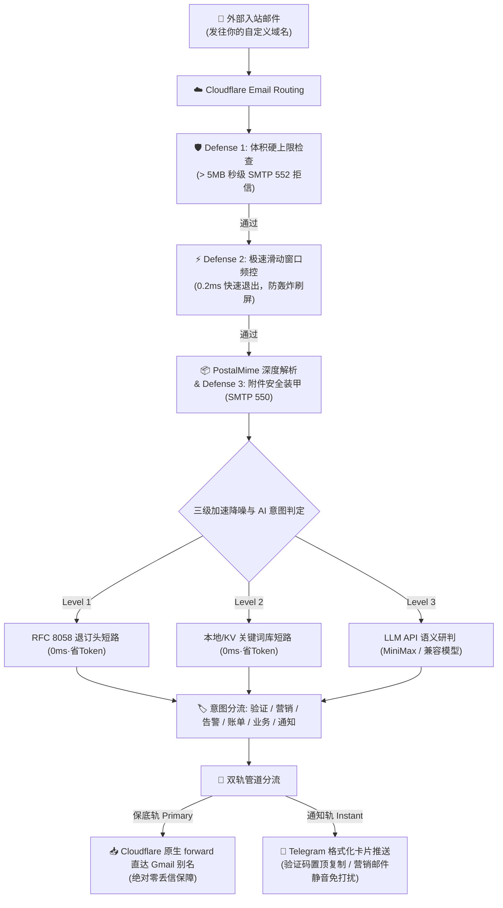

<div align="center">

# 📬 cf-mail2tg-aibot

**基于 Cloudflare Workers 的生产级、零成本、自建邮件转 Telegram AI 机器人**  
*Production-grade, zero-cost, self-hosted Email to Telegram AI Bot powered by Cloudflare Workers & LLM.*

[](LICENSE)
[](https://workers.cloudflare.com/)
[](https://core.telegram.org/bots/api)
[](https://www.typescriptlang.org/)
[](https://vitest.dev/)
[](#-零成本与免费配额保证)

<p align="center">
  <a href="#-核心特性">核心特性</a> •
  <a href="#-为什么选择-cf-mail2tg-aibot-对比矩阵">方案对比</a> •
  <a href="#-系统架构">系统架构</a> •
  <a href="#-5-分钟极速部署指南">快速开始</a> •
  <a href="#-telegram-交互指令">Bot 指令</a> •
  <a href="#-常见问答-faq">常见问答</a>
</p>

</div>

---

## 📖 项目定位

**`cf-mail2tg-aibot`** 是专为**独立开发者（Indie Hackers）、出海团队与多域名站长**打造的自建邮件网关。

利用 Cloudflare Workers 边缘计算与免费的 Email Routing，它将发往你所有域名的邮件**深度解析、经过大模型语义审信与防垃圾降噪后，秒级推送到 Telegram Bot**；同时支持双轨制（Zero-Drop）无损保底直转个人 Gmail。彻底告别每个域名每年数十美元的企业邮箱月费，享受即时通讯收信的极客体验。

---

## ⚡ 为什么选择 cf-mail2tg-aibot？ (对比矩阵)

| 核心维度 | 市面普通玩具脚本 (Toy scripts) | 商业企业邮箱 (Google Workspace / 飞书) | **cf-mail2tg-aibot (本项目)** |
| :--- | :--- | :--- | :--- |
| **月费成本** | 免费 | \$6 ~ \$18 / 用户 / 月 (域名多时极昂贵) | **\$0 (永久运行于 Cloudflare 免费配额)** |
| **丢信保障** | ❌ Telegram API 波动或限流时直接丢信 | ✅ 正常接收 | **✅ 双轨制保底 (底层无条件直转 Gmail)** |
| **大文件/附件防御** | ❌ 容易击穿 Worker 128MB 内存或爆空间 | 需付费购买额外扩容包 | **✅ 5MB 硬熔断 + SMTP 550 零附件装甲** |
| **抗轰炸频控** | ❌ 易遭遇刷信攻击导致 Bot 被 TG 429 封禁 | 需自建企业级 WAF 规则 | **✅ 0.2ms 滑动窗口短路保护，节省 98% CPU** |
| **邮件意图识别** | ❌ 无，所有垃圾推广一股脑弹窗轰炸 | 基础规则过滤，常误判 | **✅ LLM 语义识别 6 类意图 + 营销信静默推送** |
| **验证码提取** | ❌ 手动在长文本中翻找复制 | ❌ 原生无提取 | **✅ 置顶独立代码块，手机端轻触一键复制** |
| **运维管理** | ❌ 每次改规则必须重新打包代码部署 | 网页后台逐个设置 | **✅ 手机 Telegram 消息直接回复热更新** |

---

## 🏗️ 系统架构



---

## 🌟 核心特性

### 1. 🔄 双轨制“零丢失”管道 (Zero-Drop Delivery)
- **保底轨**：邮件到达 Worker 瞬间，优先调用 Cloudflare 原生通道执行直转。支持按产品画像分流至专属 Gmail 别名（如 `yourname+support@gmail.com`）。即使 Telegram 网络抖动，**原始邮件也绝无丢失风险**。
- **通知轨**：深度清洗 HTML 标签、自动规整 Quoted-Printable 与中文字符集，以优雅的 Telegram 卡片形式呈现。
- **纯通知单轨模式**：若未配置备份邮箱，系统自动优雅降级为纯 Telegram 接收模式，零报错运行。

### 2. 🤖 LLM 语义意图识别与验证码置顶提取
- **6 大标准化双字意图标签**：`🔐 验证`、`📢 营销`、`🚨 告警`、`💰 账单`、`💬 业务`、`🔔 通知`。
- **验证码一键复制**：内置高精度中英文正则嗅探引擎与大模型提取能力，在卡片顶端单独以 `<code>` 代码块置顶展示，移动端**轻触一次即可复制验证码**。
- **营销推销静音降噪**：商业广告与 SaaS 推销邮件自动使用 `disable_notification: true` 进行**静默推送（不响铃、不震动）**，彻底消除通知焦虑。
- **大模型故障熔断兜底**：若 LLM 接口欠费或超时，系统坚持“先消息提醒（响铃）”，在卡片标注 `⚠️ LLM API失效 (已保底响铃)`，绝不漏掉重要信件。

### 3. 🛡️ 四层边缘纵深防御体系 (Edge Armor)
- **零附件装甲 (Zero-Attachment Policy)**：支持在边缘直接以 SMTP 550 拒信拦截带附件邮件，从物理层面杜绝恶意木马及大文件塞爆 Gmail 15GB 空间。
- **体积容量熔断 (Size Cap)**：超过 5MB 邮件直接在边缘返回 SMTP 552 拒信，杜绝 OOM 崩溃与 CPU 超额。
- **极速短路频控 (Pre-Parse Rate Check)**：未解包前先查滑动窗口，被限流垃圾信在 **0.2ms 内退出**，节省 98% 计算算力。
- **Telegram 429 断路器**：遭遇 TG 频控时自动进入 30 秒熔断冷却期，防止请求堆积。

### 4. 🎛️ 手机端 Telegram 交互式控制面板与密钥中枢
- **交互向导 (`/setup`)**：专为移动端打造的 1 分钟交互式分步引导，按提示一步步输入备份邮箱与大模型 Key，输入 `skip` 可跳过当前项，支持随时 `/cancel` 退出；
- **发送 `/config`**：一键调出网关全局就绪状态卡片，**敏感 Key 强制脱敏掩码显示**（如 `min***a8f9`），防止窥屏泄露；
- **免电脑热更新 Key (`/setkey`)**：直接在手机私聊发送 `/setkey minimax <新Key>` 或 `/setkey forward <新邮箱>`，立刻持久化到 Cloudflare KV 并在边缘端实时生效，告别电脑敲命令行；
- **重置动态配置 (`/resetkey`)**：一键清除 KV 动态覆盖项，优雅回退至环境变量初始值；
- **发送 `/keywords`**：Bot 输出当前生效的完整拦截词清单，支持在手机端**一键复制全文**；
- **回复即改**：直接在 Telegram 里选择「回复 (Reply)」Bot 的消息，粘贴修改后的词库，网关自动全量热更新并同步至 Cloudflare KV；
- **发送 `/routes`、`/add`、`/del`**：在手机端随时添加新地址路由分流规则，删除规则自带 Inline Keyboard 二次确认。

---

## 🚀 5 分钟极速部署指南

### 前置准备
1. 一个托管在 [Cloudflare](https://dash.cloudflare.com/) 上的自有域名；
2. 一个 Telegram 账号与一个收信用的个人邮箱（如 Gmail）。

---

### Step 1: 申请 Telegram Bot 与获取 Chat ID
1. 在 Telegram 中私聊 [@BotFather](https://t.me/BotFather)，发送 `/newbot`，按提示创建一个 Bot，保存获得的 `TELEGRAM_BOT_TOKEN`；
2. 私聊 [@userinfobot](https://t.me/userinfobot)，获取你个人的数字账号 ID，记为 `TELEGRAM_ADMIN_CHAT_ID`。

---

### Step 2: 验证 Cloudflare 目标邮箱
1. 登录 Cloudflare 控制台，进入你的任一域名；
2. 导航至 **Email** ➔ **Email Routing** ➔ **Destination addresses**；
3. 点击 **Add destination address**，填入你的个人邮箱（如 `yourname@gmail.com`），点击验证并在你的收件箱中确认激活链接。

---

### Step 3: 克隆本项目并安装依赖
```bash
git clone https://github.com/your-username/cf-mail2tg-aibot.git
cd cf-mail2tg-aibot
npm install
```

---

### Step 4: 创建 KV 数据库与设置密钥
1. 创建用于持久化自定义路由与关键词的 KV 命名空间：
   ```bash
   npx wrangler kv namespace create MAIL_ROUTES_KV
   ```
2. 将控制台输出的 `id` 替换填入 `wrangler.jsonc` 中的 `id` 字段：
   ```jsonc
   "kv_namespaces": [
     {
       "binding": "MAIL_ROUTES_KV",
       "id": "替换为你的_KV_ID"
     }
   ]
   ```
3. 设置生产环境变量与保密凭证：
   ```bash
   # 设置 Telegram 凭据 (必须)
   npx wrangler secret put TELEGRAM_BOT_TOKEN
   npx wrangler secret put TELEGRAM_ADMIN_CHAT_ID

   # 设置主备份邮箱 (可选，开启双轨零丢信)
   npx wrangler secret put FORWARD_TO_EMAIL

   # 设置大模型 API 密钥 (可选，开启 AI 智能审信)
   npx wrangler secret put MINIMAX_API_KEY
   ```

---

### Step 5: 部署上线与激活 Webhook
1. 一键部署到 Cloudflare 边缘节点：
   ```bash
   npm run deploy
   ```
2. 绑定 Telegram Webhook 与官方菜单按钮：
   访问部署成功的 Worker 域名（例如浏览器打开 `https://cf-mail2tg-aibot.<你的子域>.workers.dev/setup-webhook`），看到返回 `{"ok":true}` 即代表注册完成！
3. 在 Cloudflare 域名控制台的 **Email Routing** ➔ **Routing rules** 中，添加 Catch-all 规则，动作选择 **Send to Worker** 并绑定 `cf-mail2tg-aibot`。

🎉 **大功告成！现在给你的域名发送任意邮件，Telegram 即可秒级收到格式化卡片！**

---

## 📱 Telegram 交互指令

直接在 Telegram 聊天窗口中点击左下角 **[Menu]** 按钮或输入以下指令：

| 指令 | 参数格式 | 功能描述 |
| :--- | :--- | :--- |
| `/setup` | - | 启动交互式分步极速配置向导 (1 分钟带你完成核心凭证绑定) |
| `/cancel` | - | 退出当前向导或会话，重置交互状态 |
| `/config` | - | 查看网关就绪状态与密钥绑定情况 (带安全脱敏掩码，仅管理员可阅) |
| `/setkey` | `<minimax\|forward> <值>` | 手机端热更新大模型密钥或备份转发邮箱，即刻持久化保存至 KV |
| `/resetkey` | `<minimax\|forward>` | 清除 KV 动态覆盖项，一键恢复至部署时绑定的初始环境变量 |
| `/keywords` | - | 查看并生成带 `<pre><code>` 代码块的全部营销关键词，便于手机一键复制 |
| `/addkeywords` | `<词1>\n<词2>` | 安全增量追加关键词至现有词库（自动去重，绝不覆盖已有词） |
| `/resetkeywords` | - | 一键重置清空自定义词库，恢复系统预设的标准基线关键词 |
| `/routes` | - | 查看当前生效的内置画像规则与 KV 动态路由规则 |
| `/add` | `<标签> <前缀> [目标]` | 动态添加分流规则，如 `/add 商业支持 help user@domain.com` |
| `/del` | `<前缀>` | 删除指定前缀规则（弹出带确认/取消按钮的二次确认卡片） |
| `/help` | - | 查看网关操作面板指南与当前状态 |

---

## 💰 零成本与免费配额保证

本项目专门针对 **Cloudflare Workers 免费计划 (Free Tier)** 进行了极致优化：
- **CPU 计算开销**：单封邮件均值运算仅约 0.5ms，远低于免费额度的 10ms 限制；
- **内存安全**：全量附件防御与 5MB 体积熔断，杜绝突破 128MB 边缘内存配额；
- **KV 存储**：日常收信产生极轻量缓存读取，更新规则时产生 1 次写入，使用量不足免费额度（每天 100,000 次读、1,000 次写）的 0.1%；
- **计费硬隔离**：Cloudflare 免费账户不绑定信用卡机制，任何异常超限仅触发 HTTP 503 阻断，**绝对无法产生任何账单或扣费**。

---

## ❓ 常见问答 (FAQ)

<details>
<summary><b>Q: 如果不配置备份邮箱 (FORWARD_TO_EMAIL)，可以只当纯 Telegram 机器人用吗？</b></summary>
完全可以！未配置 <code>FORWARD_TO_EMAIL</code> 时，网关自动以单轨模式工作，仅向 Telegram 实时推送通知卡片，不会产生任何错误。
</details>

<details>
<summary><b>Q: 为什么卡片上的 SPF/DKIM 显示“未通过 (疑似仿冒来源)”？</b></summary>
这是正常安全防御提示。一些自动化通知或未规范配置反垃圾解析的邮件服务器发出的信件未通过鉴真，网关会在卡片中以醒目徽标提醒防范钓鱼，并自动对该来源收紧频控配额。
</details>

<details>
<summary><b>Q: 不配置大模型 API Key 还可以使用吗？</b></summary>
可以！未配置 <code>MINIMAX_API_KEY</code> 时，网关会自动启用内置的<b>高性能正则嗅探引擎与本地 RFC 规则库</b>，依然可以精准识别验证码与大部分营销推广邮件，零成本即刻起步。
</details>

<details>
<summary><b>Q: 多个域名可以使用同一个 Worker 网关吗？</b></summary>
可以！Cloudflare 免费账户支持添加多个域名，每个域名的 Email Routing Catch-all 规则均可直接选择指向同一个 <code>cf-mail2tg-aibot</code> Worker，网关会自动识别收件域名并实现隔离防御。
</details>

---

## 📄 开源许可证

本项目采用 [MIT License](LICENSE) 许可协议，欢迎自由 Fork、修改或用于个人/团队自建服务。
