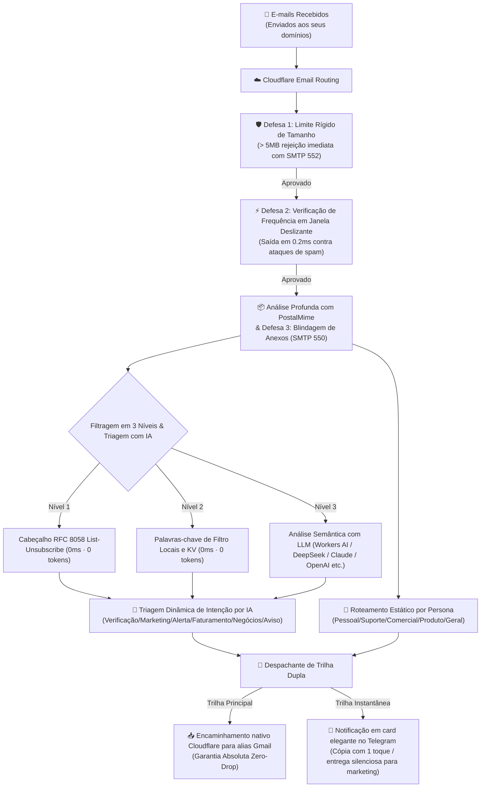

<div align="center">

# 📬 cf-mail2tg-aibot

**Bot de IA de E-mail para Telegram auto-hospedado, gratuito e de nível de produção com Cloudflare Workers e LLM.**  
*Gateway inteligente de recebimento de e-mails, triagem com IA e extração de códigos com 1 toque no Telegram.*

[](LICENSE)
[](https://workers.cloudflare.com/)
[](https://core.telegram.org/bots/api)
[](https://www.typescriptlang.org/)
[](https://vitest.dev/)
[](#-6--suporte-a-10-idiomas-principais-i18n-e-troca-instantânea)
[](#-custo-zero-e-garantia-de-cota-gratuita)

<p align="center">
  <a href="./README.md">English</a> •
  <a href="./README.zh-CN.md">简体中文</a> •
  <a href="./README.zh-TW.md">繁體中文</a> •
  <a href="./README.ja-JP.md">日本語</a> •
  <a href="./README.ko-KR.md">한국어</a> •
  <b>Português</b> •
  <a href="./README.ru-RU.md">Русский</a> •
  <a href="./README.es-ES.md">Español</a> •
  <a href="./README.fr-FR.md">Français</a> •
  <a href="./README.de-DE.md">Deutsch</a>
</p>

<p align="center">
  <a href="#-capturas-de-tela">Capturas</a> •
  <a href="#-início-rápido-em-3-etapas">Início Rápido</a> •
  <a href="#-por-que-o-cf-mail2tg-aibot-matriz-de-comparação">Comparação</a> •
  <a href="#️-arquitetura-do-sistema">Arquitetura</a> •
  <a href="#-principais-recursos">Recursos</a> •
  <a href="#-comandos-interativos-do-telegram">Comandos</a> •
  <a href="#-perguntas-frequentes-faq">FAQ</a>
</p>

</div>

---

## 📖 Visão Geral do Projeto

O **`cf-mail2tg-aibot`** é um gateway de e-mail auto-hospedado projetado especificamente para **Indie Hackers, equipes de desenvolvimento globais e administradores de múltiplos domínios**.

Aproveitando a computação de borda do Cloudflare Workers e o roteamento gratuito do Email Routing, ele **analisa profundamente os e-mails recebidos, filtra ruídos e spams, realiza triagem semântica com LLM e entrega cards elegantes no Telegram em segundos**. Ao mesmo tempo, seu pipeline de trilha dupla com entrega sem perdas (Zero-Drop) encaminha o e-mail bruto original para sua caixa postal de backup (ex: aliases do Gmail). Diga adeus às assinaturas caras de e-mail corporativo (US$ 6 a US$ 18/usuário/mês por domínio) e aproveite um fluxo de recebimento de e-mails em tempo real, sem custos e ultraleve.

---

## 📸 Capturas de tela

Todas as capturas abaixo são de uma instância real em execução. Os campos sensíveis (endereços de e-mail, códigos de verificação, números de fatura) foram substituídos por marcadores.

### 🎛️ Painel de controle do bot

| | |
| :---: | :---: |
| <br><sub>Início do gateway — status online, mecanismo de IA e encaminhamento de backup num relance</sub> | <br><sub>Configurações — provedores de IA, personas de roteamento, antispam e idioma num só painel</sub> |

### 📬 Notificações de e-mail em ação

| | |
| :---: | :---: |
| <br><sub>Códigos de verificação — extraídos e fixados no topo, toque para copiar</sub> | <br><sub>Alertas de segurança — phishing sinalizado com falha SPF/DKIM</sub> |
| <br><sub>Cobrança — faturas analisadas com detalhes do anexo</sub> | <br><sub>Consultas comerciais — priorizadas pela triagem de IA</sub> |

<p align="center">
  <br>
  <sub>Marketing — promoções silenciadas automaticamente pelas regras antispam</sub>
</p>

---

## 🚀 Início Rápido (em 3 Etapas)

**Pré-requisitos:**
- Uma conta gratuita da Cloudflare e um domínio adicionado à Cloudflare (o Email Routing é ativado por domínio; a Etapa 3 o habilitará para o seu).
- Node.js 22 ou posterior e Git instalados no seu computador (o primeiro comando wrangler da Etapa 3 abrirá o navegador para login na Cloudflare).

### 1. Obter Credenciais do Telegram
- Inicie conversa com [@BotFather](https://t.me/BotFather) ➔ envie `/newbot` ➔ copie o `TELEGRAM_BOT_TOKEN`.
- Inicie conversa com [@userinfobot](https://t.me/userinfobot) ➔ copie seu ID numérico de usuário como `TELEGRAM_ADMIN_CHAT_ID`.
- Execute `openssl rand -hex 32` ➔ copie o resultado como `TELEGRAM_WEBHOOK_SECRET` (opcional, mas recomendado; no Windows, execute no Git Bash).

### 2. Verificar Endereço de Destino na Cloudflare
- No painel da Cloudflare: **Email** ➔ **Email Routing** ➔ **Destination addresses** ➔ adicione e confirme seu e-mail pessoal (ex: `voce@gmail.com`).

### 3. Implantar e Ativar
```bash
# Clonar repositório e instalar dependências
git clone https://github.com/Sacilave/cf-mail2tg-aibot.git && cd cf-mail2tg-aibot
npm install

# Criar namespace KV e colar o ID retornado no wrangler.jsonc (kv_namespaces[0].id)
npx wrangler kv namespace create MAIL_ROUTES_KV

# Configurar segredos obrigatórios
npx wrangler secret put TELEGRAM_BOT_TOKEN
npx wrangler secret put TELEGRAM_ADMIN_CHAT_ID
npx wrangler secret put TELEGRAM_WEBHOOK_SECRET  # Altamente recomendado (o valor da Etapa 1)

# Implantar na borda da Cloudflare
npm run deploy
```

- **Ativar Webhook**: Acesse no navegador `https://<seu-worker>.<subdominio>.workers.dev/setup-webhook?secret=<SEU_SEGREDO>` (retornará `{"ok":true}`; `<SEU_SEGREDO>` deve ser exatamente o `TELEGRAM_WEBHOOK_SECRET` da Etapa 1, e a URL do Worker aparece na saída de `npm run deploy`).
- **Roteamento de E-mails**: No painel da Cloudflare, selecione seu domínio ➔ **Email** ➔ **Email Routing** ➔ ative-o (os registros MX necessários são adicionados automaticamente) ➔ **Routing rules** ➔ Adicione Catch-all: **Send to Worker** ➔ Selecione `cf-mail2tg-aibot`.
- **Concluir no Celular**: No Telegram, envie `/setup` ao Bot para vincular seu Gmail de backup (deve ser o endereço verificado na Etapa 2) e sua Chave de IA em 1 minuto — sem precisar de terminal!

#### 🤖 Opcional: Implantação Contínua (CI/CD · GitHub Actions)
Se você clonar ou fizer fork deste repositório para desenvolvimento personalizado e desejar que os pushes para `main` sejam implantados automaticamente:
1. Renomeie [`.github/workflows/deploy.yml.example`](.github/workflows/deploy.yml.example) para `.github/workflows/deploy.yml`.
2. No seu repositório GitHub: **Settings** ➔ **Secrets and variables** ➔ **Actions** ➔ adicione o segredo `CLOUDFLARE_API_TOKEN` (para obter um: painel da Cloudflare ➔ My Profile ➔ API Tokens ➔ crie um token com o modelo “Edit Cloudflare Workers”).
3. Cada push para `main` executará os testes automatizados e fará o deploy automático no Cloudflare Workers!

---

## ⚡ Por que o cf-mail2tg-aibot? (Matriz de Comparação)

| Dimensão | Scripts de Código Aberto Genéricos | Caixas Corporativas Pagas (Google / Microsoft) | **cf-mail2tg-aibot (Este Projeto)** |
| :--- | :--- | :--- | :--- |
| **Custo Mensal** | Grátis | US$ 6 ~ US$ 18 / usuário / mês (caríssimo em vários domínios) | **US$ 0 (Roda permanentemente no Plano Gratuito Cloudflare)** |
| **Entrega Zero-Drop** | ❌ Mensagens perdidas por limite da API do TG ou instabilidades | ✅ Confiável | **✅ Trilha Dupla Zero-Drop (Encaminhamento nativo incondicional)** |
| **Defesa contra Anexos** | ❌ Quedas fáceis no limite de 128MB de RAM do Worker | Pacotes de expansão caros | **✅ Limite estrito de 5MB + Blindagem Zero Anexos (SMTP 550)** |
| **Proteção Anti-Bombardeio** | ❌ Vulnerável a inundações de spam que geram ban TG 429 | Exige regras corporativas de WAF personalizadas | **✅ Verificação em janela deslizante em 0.2ms, poupando 98% de CPU** |
| **Classificação de Intenção** | ❌ Nenhuma (notificações incessantes de spam) | Heurística básica, sujeita a falsos positivos | **✅ Triagem LLM para 6 intenções + push silencioso para marketing** |
| **Extração de Códigos** | ❌ Busca manual cansativa no corpo do e-mail | ❌ Sem extração nativa | **✅ Bloco `<code>` destacado, cópia com 1 toque no celular** |
| **Operação e Configuração** | ❌ Recompilar e reimplantar a cada mudança de regra | Painéis manuais complexos na web | **✅ Resposta direta às mensagens do Telegram para recarga a quente** |

---

## 🏗️ Arquitetura do Sistema



---

## 🌟 Principais Recursos

### 1. 🔄 Pipeline de Trilha Dupla com Entrega Sem Perdas (Zero-Drop)
- **Trilha Principal (Backup sem Perdas)**: No instante em que o e-mail atinge o Worker, o motor nativo da Cloudflare o encaminha diretamente para sua caixa postal de destino. Suporta aliases do Gmail (ex: `seunome+suporte@gmail.com`). Mesmo em caso de indisponibilidade do Telegram, **seus e-mails brutos nunca serão perdidos**.
- **Trilha Instantânea (Cards Formatados)**: Limpa tags HTML, decodifica Quoted-Printable e envia um card claro e legível em Markdown diretamente no Telegram.
- **Modo Trilha Única**: Caso nenhum e-mail de backup seja fornecido, o gateway opera de forma suave e transparente apenas com notificações no Telegram.

### 2. 🤖 Suporte a Vários Provedores de IA e Cópia com 1 Toque
- **IA de Borda 100% Gratuita e Nativa**: Pré-configurado com **Cloudflare Workers AI** (`@cf/meta/llama-3.1-8b-instruct`), que funciona sem nenhuma chave de API e sem custos; compatível de fábrica com **DeepSeek** (altíssima inteligência a custo mínimo), **Groq** (inferência LPU ultrarrápida), **OpenAI**, **Google Gemini**, **Anthropic Claude**, **OpenRouter** e proxies compatíveis com OpenAI.
- **6 Categorias Padronizadas de Intenção**: `🔐 Verificação`, `📢 Marketing`, `🚨 Alerta de Segurança`, `💰 Faturamento`, `💬 Negócios`, `🔔 Notificação`.
- **Cópia de Códigos de Verificação com 1 Toque**: Motor de expressões regulares de alta precisão somado ao LLM extrai códigos OTP e os posiciona no topo em formato `<code>` monoespaçado — **basta tocar na tela do celular para copiar**.
- **Dicionários Nativos Anti-Spam e Entrega Silenciosa**:
  - Ao alternar para qualquer um dos idiomas suportados, termos de spam nativos e autênticos daquela região são incorporados com segurança ao KV;
  - Cabeçalhos RFC 8058 ou termos de marketing ativam `disable_notification: true`, garantindo **entrega silenciosa (sem som nem vibração)**.
- **Proteção da Cota Gratuita da Cloudflare**:
  - **Curto-circuito pré-IA**: Mensagens de marketing ignoram a chamada de IA, consumindo 0 tokens e 0 CPU;
  - **Limite inteligente de caracteres**: O trecho enviado ao LLM é limitado a 800 caracteres para reduzir latência e custos;
  - **Cache em memória de 60s**: Evita gravações repetidas no KV.

### 3. 🏷️ Sistema de Tags em Duas Camadas: Intenção por IA + Persona de Domínio
O `cf-mail2tg-aibot` separa com precisão "Qual é o conteúdo do e-mail" de "Para qual negócio/projeto ele foi enviado":

```
E-mail Recebido
├── 🤖 Tag Dinâmica de Intenção por IA (Semântica do Conteúdo)
│   ├── 🔐 Verificação (Extração de código OTP, destaque visual, alerta sonoro)
│   ├── 📢 Marketing (Cabeçalhos RFC / palavras-chave -> entrega silenciosa)
│   ├── 🚨 Alerta de Segurança (Avisos de conta, monitoramento de servidores)
│   ├── 💰 Faturamento (Faturas, comprovantes de pagamento, renovações)
│   ├── 💬 Negócios (Comunicações humanas diretas, parcerias, propostas)
│   └── 🔔 Notificação (Notificações do GitHub, resumos do sistema)
│
└── 📂 Tag de Roteamento por Persona (Domínio do Negócio)
    ├── Pessoal (Personal) -> Prefixos admin/me/hi (Alias Gmail +personal)
    ├── Suporte (Support)   -> Prefixos support/help/service (Alias Gmail +support)
    ├── Comercial (Business)-> Prefixos sales/billing/comercial (Alias Gmail +business)
    ├── Produto (Product)   -> Prefixos product/feedback/app (Alias Gmail +product)
    ├── Geral (General)     -> Destino universal padrão
    └── ➕ Tags Personalizadas -> Crie tags como Finanças, Dev, Ops com 1 clique
```

### 4. 🛡️ Defesa em Borda com Blindagem de 4 Camadas
- **Zero-Attachment Policy**: Rejeita e-mails com anexos binários na borda com código SMTP 550, protegendo sua cota de disco e evitando malwares.
- **Limite Rígido de Tamanho de 5MB**: E-mails maiores que 5MB são recusados com SMTP 552, impedindo travamentos de memória.
- **Taxa de Frequência em Janela Deslizante**: Avalia o remetente antes de abrir o corpo do e-mail; envios em massa são bloqueados em **0.2ms**, economizando 98% de CPU.
- **Disjuntor para Limite 429 do Telegram**: Aplica resfriamento automático de 30 segundos ao atingir limites de taxa na API do Telegram.

### 5. 🎛️ Painel de Controle e Hub de Credenciais no Telegram
- **Assistente de Configuração Interativo (`/setup`)**: Passo a passo de 1 minuto pelo celular para vincular e-mail de backup e chave de IA.
- **Status do Sistema (`/config`)**: Visualize configurações e status com credenciais sensíveis mascaradas por segurança.
- **Atualização a Quente (`/setkey`)**: Altere chaves e e-mails de backup em tempo real sem precisar de terminal.
- **Edição de Palavras-chave (`/keywords`)**: Responda diretamente à mensagem do bot para salvar alterações instantaneamente no KV.
- **Gerenciamento de Rotas (`/routes`, `/add`, `/del`)**: Adicione e exclua regras de personas de domínio com botões interativos.

### 6. 🌐 Suporte a 10 Idiomas Principais (i18n) e Troca Instantânea
- **10 Idiomas Nativamente Compatíveis**: 🇨🇳 Chinês Simplificado (`zh-CN`), 🇺🇸 Inglês (`en-US`), 🇭🇰 Chinês Tradicional (`zh-TW`), 🇯🇵 Japonês (`ja-JP`), 🇰🇷 Coreano (`ko-KR`), 🇧🇷 Português (`pt-BR`), 🇷🇺 Russo (`ru-RU`), 🇪🇸 Espanhol (`es-ES`), 🇫🇷 Francês (`fr-FR`), 🇩🇪 Alemão (`de-DE`).
- **Localização de Ponta a Ponta**: Cards de e-mail, alertas de segurança, painéis de configuração e comandos do menu do Telegram totalmente adaptados e naturais.
- **Alternador Rápido (`/lang`)**: Envie `/lang` para abrir o teclado em grade 5x2 (com `✓` no idioma ativo) ou forneça o código diretamente (ex: `/lang pt`, `/lang en`).
- **Resolução de Prioridade em 4 Níveis**: `Configuração dinâmica no KV (config:sys:system_language)` > `Variável de ambiente (DEFAULT_LANGUAGE)` > `Idioma do cliente Telegram (language_code)` > `Padrão de fallback (zh-CN)`.

---

## 📱 Comandos Interativos do Telegram

Toque no botão **[Menu]** no canto inferior esquerdo do chat ou envie qualquer um dos comandos:

| Comando | Formato de Parâmetro | Descrição |
| :--- | :--- | :--- |
| `/start` | - | **👋 Visão Geral Minimalista**: Resumo do gateway com atalhos para `[⚙️ Configurações]`, `[📖 Guia]` e `[🌐 Idioma]` |
| `/menu` | - | **⚙️ Painel de Configurações**: Grade 2x4 para gerenciar IA, rotas, anti-spam, encaminhamento, idioma e assistente |
| `/guide` | - | **📖 Guia Detalhado do Usuário**: Documentação completa sobre classificação, filtros de spam e roteamento |
| `/setup` | - | **⚡ Assistente de Configuração**: Configuração passo a passo em 2 etapas para vincular credenciais pelo celular |
| `/lang` | `[código]` | Alternar idioma do sistema pelo menu 5x2 ou via código direto (ex: `/lang pt`, `/lang en`) |
| `/provider` | `[1~9\|nome]` | Troca interativa de provedor de IA (responda de 1 a 9 para Workers AI / DeepSeek / Groq / OpenAI etc.) |
| `/model` | `[1~2\|nome]` | Troca interativa da versão do modelo do provedor ativo |
| `/cancel` | - | Cancelar assistente ou sessão interativa ativa a qualquer momento |
| `/config` | - | Visualizar status do gateway e credenciais mascaradas |
| `/setkey` | `<ai\|minimax\|forward> <valor>` | Atualizar chave de IA ou e-mail de backup a quente pelo chat |
| `/resetkey` | `<ai\|provider\|model\|minimax\|forward>` | Redefinir sobreposição do KV e restaurar padrões do ambiente |
| `/keywords` | - | Exibir todas as palavras-chave ativas de marketing em bloco copiável |
| `/addkeywords` | `<palavra1>\n<palavra2>` | Adicionar palavras-chave adicionais com segurança sem sobrescrever |
| `/resetkeywords` | - | Restaurar palavras-chave padrão do sistema |
| `/routes` | - | Ver presets de personas e regras dinâmicas do KV, gerenciar tags customizadas |
| `/add` | `<tag> <prefixo> [destino]` | Adicionar regra de roteamento personalizada (ex: `/add Suporte help usuario@dominio.com`) |
| `/del` | `<prefixo>` | Excluir regra de roteamento com confirmação interativa |
| `/help` | - | Exibir manual de comandos e ajuda do gateway |

---

## 💰 Custo Zero e Garantia de Cota Gratuita

Este projeto foi milimetricamente adaptado para o **Plano Gratuito do Cloudflare Workers**:
- **Tempo de CPU**: Processamento médio de e-mail de ~0.5ms (muito abaixo do limite gratuito de 10ms).
- **Consumo de Memória**: A blindagem contra anexos e o limite de 5MB garantem consumo seguro dentro dos 128MB permitidos.
- **Armazenamento KV**: Operações normais utilizam leitura em cache e consomem menos de 0.1% das cotas diárias gratuitas (100.000 leituras e 1.000 gravações por dia).
- **Isolamento de Cobrança**: Contas gratuitas da Cloudflare não exigem cartão de crédito; picos anômalos de tráfego resultam em descarte 503 com **zero risco de cobranças inesperadas**.

---

## ❓ Perguntas Frequentes (FAQ)

<details>
<summary><b>P: Posso usar apenas como Bot no Telegram sem cadastrar um e-mail de encaminhamento (FORWARD_TO_EMAIL)?</b></summary>
Com certeza! Ao omitir <code>FORWARD_TO_EMAIL</code>, o gateway opera em modo de trilha única, enviando os cards em tempo real apenas para o Telegram sem nenhum erro.
</details>

<details>
<summary><b>P: Por que o SPF/DKIM exibe "Reprovado (Possível Falsificação)" em alguns cards?</b></summary>
Este é um aviso de segurança automatizado. Alguns servidores de disparo de baixa qualidade não possuem alinhamento DKIM/SPF adequado. O gateway sinaliza isso para alertar contra tentativas de phishing e aperta os limites de taxa para esse remetente.
</details>

<details>
<summary><b>P: Posso usar o bot sem ter uma chave paga de IA?</b></summary>
Sim! O <b>Cloudflare Workers AI</b> integrado é 100% gratuito e não exige chave; além disso, mesmo sem IA, o <b>motor de expressões regulares de alta velocidade e as regras RFC locais</b> realizam extração de códigos e triagem com custo zero.
</details>

<details>
<summary><b>P: Posso rotear vários domínios personalizados para o mesmo Worker?</b></summary>
Sim! A Cloudflare permite domínios ilimitados no plano gratuito. Basta definir a regra Catch-all de cada domínio para o mesmo Worker <code>cf-mail2tg-aibot</code>. O gateway detecta o domínio de recebimento automaticamente.
</details>

---

## 📄 Licença

Este projeto é distribuído sob os termos da [Licença MIT](LICENSE). Sinta-se livre para clonar, modificar ou hospedar para fins pessoais e comerciais.
