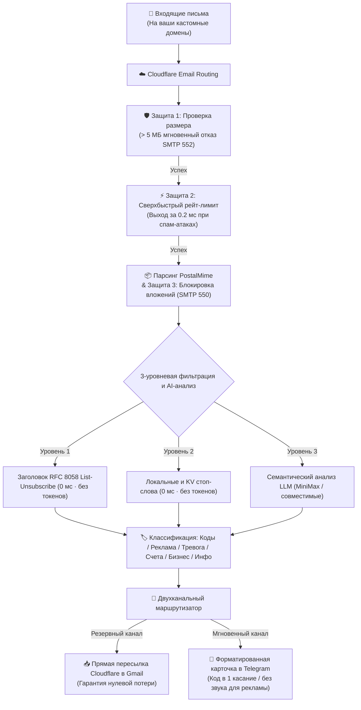

<div align="center">

# 📬 cf-mail2tg-aibot

**Бесплатный self-hosted Email-to-Telegram AI-бот на базе Cloudflare Workers и LLM**  
*Production-grade, zero-cost, self-hosted Email to Telegram AI Bot powered by Cloudflare Workers & LLM.*

[](LICENSE)
[](https://workers.cloudflare.com/)
[](https://core.telegram.org/bots/api)
[](https://www.typescriptlang.org/)
[](https://vitest.dev/)
[](#-5--интернационализация-i18n-на-8-языках-и-мгновенное-переключение)
[](#-нулевая-стоимость-и-гарантия-бесплатного-тарифа)

<p align="center">
  <a href="./README.md">English</a> •
  <a href="./README.zh-CN.md">简体中文</a> •
  <a href="./README.zh-TW.md">繁體中文</a> •
  <a href="./README.ja-JP.md">日本語</a> •
  <b>Русский</b> •
  <a href="./README.es-ES.md">Español</a> •
  <a href="./README.fr-FR.md">Français</a> •
  <a href="./README.de-DE.md">Deutsch</a>
</p>

<p align="center">
  <a href="#-быстрый-старт-за-3-шага">Быстрый старт</a> •
  <a href="#-почему-cf-mail2tg-aibot-таблица-сравнения">Сравнение</a> •
  <a href="#️-архитектура-системы">Архитектура</a> •
  <a href="#-ключевые-возможности">Возможности</a> •
  <a href="#-команды-telegram-бота">Команды бота</a> •
  <a href="#-часто-задаваемые-вопросы-faq">FAQ</a>
</p>

</div>

---

## 📖 О проекте

**`cf-mail2tg-aibot`** — это self-hosted почтовый шлюз, созданный специально для **инди-разработчиков (Indie Hackers), распределённых команд и владельцев множества доменов**.

Используя бессерверные вычисления Cloudflare Workers и бесплатный сервис Cloudflare Email Routing, бот **глубоко парсит входящие письма, фильтрует спам, выполняет семантический анализ намерений с помощью LLM и мгновенно отправляет аккуратные карточки в Telegram**. Одновременно двухканальная схема (Zero-Drop) гарантирует надежную пересылку исходных писем в ваш личный почтовый ящик (например, псевдонимы Gmail). Забудьте о ежемесячных тарифах за корпоративную почту ($6–$18 за пользователя) на каждом домене!

---

## 🚀 Быстрый старт (за 3 шага)

### 1. Получение учетных данных Telegram
- Напишите [@BotFather](https://t.me/BotFather) ➔ `/newbot` ➔ скопируйте `TELEGRAM_BOT_TOKEN`.
- Напишите [@userinfobot](https://t.me/userinfobot) ➔ скопируйте числовой ID как `TELEGRAM_ADMIN_CHAT_ID`.

### 2. Подтверждение адреса пересылки в Cloudflare
- В панели Cloudflare: **Email** ➔ **Email Routing** ➔ **Destination addresses** ➔ добавьте и подтвердите личный email (например, `you@gmail.com`).

### 3. Деплой и активация
```bash
# Клонирование и установка зависимостей
git clone https://github.com/your-username/cf-mail2tg-aibot.git && cd cf-mail2tg-aibot
npm install

# Создайте KV и укажите полученный ID в wrangler.jsonc (kv_namespaces[0].id)
npx wrangler kv namespace create MAIL_ROUTES_KV

# Настройка основных секретов
npx wrangler secret put TELEGRAM_BOT_TOKEN
npx wrangler secret put TELEGRAM_ADMIN_CHAT_ID
npx wrangler secret put TELEGRAM_WEBHOOK_SECRET  # Рекомендуется

# Деплой в Cloudflare
npm run deploy
```

- **Активация вебхука**: откройте в браузере `https://<ваш-воркер>.<поддомен>.workers.dev/setup-webhook?secret=<ВАШ_СЕКРЕТ>` (ответ `{"ok":true}` подтверждает успех).
- **Настройка маршрута**: в Cloudflare **Email Routing** ➔ **Routing rules** добавьте Catch-all: **Send to Worker** ➔ выберите `cf-mail2tg-aibot`.
- **Завершение настройки с телефона**: отправьте боту `/setup` в Telegram — мастер за 1 минуту привяжет резервную почту и ключ LLM без терминала!

---

## ⚡ Почему cf-mail2tg-aibot? (Таблица сравнения)

| Критерий | Обычные скрипты с открытым кодом | Корпоративная почта (Google / Lark) | **cf-mail2tg-aibot (Данный проект)** |
| :--- | :--- | :--- | :--- |
| **Ежемесячная стоимость** | Бесплатно | $6 ~ $18 / пользователь / месяц | **$0 (работает на бесплатном тарифе Cloudflare)** |
| **Гарантия от потери писем** | ❌ Письма теряются при лимитах Telegram API | ✅ Надежно | **✅ Двухканальная схема (прямая резервная пересылка в Gmail)** |
| **Защита от тяжелых вложений** | ❌ Падение из-за лимита памяти Worker 128 МБ | Дорогие пакеты расширения диска | **✅ Лимит 5 МБ + защита от вложений SMTP 550 Zero-Attachment** |
| **Защита от спам-атак** | ❌ Риск блокировки бота (Telegram 429) | Требуется настройка enterprise WAF | **✅ Защита скользящим окном за 0.2 мс, экономия 98% CPU** |
| **Классификация писем** | ❌ Нет, уведомления приходят на весь спам | Базовые эвристики, частые ошибки | **✅ LLM-анализ 6 категорий + тихие уведомления для рекламы** |
| **Извлечение кодов подтверждения** | ❌ Ручной поиск и копирование из тела письма | ❌ Встроенного извлечения нет | **✅ Закрепленный блок `<code>`, копирование в 1 касание** |
| **Управление и настройка** | ❌ Пересборка и деплой при любом изменении | Ручная настройка через веб-интерфейс | **✅ Прямой ответ на сообщения в Telegram для горячего обновления** |

---

## 🏗️ Архитектура системы



---

## 🌟 Ключевые возможности

### 1. 🔄 Двухканальная доставка «Zero-Drop»
- **Резервный канал**: В момент поступления письма Worker сразу запускает нативную пересылку Cloudflare в указанный ящик (с поддержкой псевдонимов, например `yourname+support@gmail.com`). Даже при сбоях в Telegram **оригинальные письма никогда не потеряются**.
- **Канал уведомлений**: Очищает HTML, нормализует кодировку Quoted-Printable и формирует аккуратную карточку в Telegram.
- **Одноканальный режим**: Если резервная почта не указана, шлюз работает исключительно как Telegram-бот без ошибок.

### 2. 🤖 LLM-классификация намерений и извлечение кодов
- **6 стандартных категорий**: `🔐 Код подтверждения`, `📢 Реклама и рассылки`, `🚨 Оповещение безопасности`, `💰 Счета и оплата`, `💬 Бизнес-переписка`, `🔔 Системные уведомления`.
- **Копирование кода в 1 клик**: Регулярные выражения и нейросеть извлекают код подтверждения в закрепленный блок `<code>` — **нажмите один раз на телефоне, чтобы скопировать**.
- **Тихие уведомления для маркетинга**: Рекламные письма доставляются с параметром `disable_notification: true` **без звука и вибрации**, избавляя от лишнего шума.
- **Отказоустойчивость**: При исчерпании лимитов LLM или таймаутах бот сохраняет звуковое оповещение с пометкой `⚠️ LLM API Offline (Alert Sound Preserved)`, чтобы вы не пропустили важное.

### 3. 🛡️ 4-уровневая защита Edge Armor
- **Политика без вложений (Zero-Attachment Policy)**: Отклонение писем с бинарными вложениями на границе сети кодом SMTP 550, защищая диск и предотвращая распространение малвари.
- **Ограничение размера (Size Cap)**: Письма свыше 5 МБ отклоняются кодом SMTP 552, предотвращая OOM-сбои памяти Worker (128 МБ).
- **Сверхбыстрый рейт-лимит**: Проверка скользящего окна до распаковки тела письма; заблокированный спам завершается за **0.2 мс**, экономя 98% процессорного времени.
- **Автопредохранитель Telegram 429**: Автоматический переход в 30-секундный режим охлаждения при лимитах Telegram.

### 4. 🎛️ Интерактивная панель управления прямо в Telegram
- **Мастер настройки (`/setup`)**: Интерактивный мобильный мастер, позволяющий за 1 минуту привязать резервную почту и ключ LLM (поддерживает `skip` и `/cancel`).
- **Просмотр статуса (`/config`)**: Проверка конфигурации с **маскированием секретных ключей** (например, `min***a8f9`).
- **Горячее обновление ключей (`/setkey`)**: Отправьте `/setkey minimax <ключ>` или `/setkey forward <email>` в чат, и данные мгновенно сохранятся в Cloudflare KV без использования консоли.
- **Сброс настроек (`/resetkey`)**: Мгновенный возврат к начальным значениям переменных окружения.
- **Управление ключевыми словами (`/keywords`)**: Вывод полного списка стоп-слов в виде готового к копированию блока.
- **Обновление ответом**: Ответьте (Reply) на сообщение бота с ключевыми словами новым списком, и шлюз обновит их в Cloudflare KV на лету.
- **Маршрутизация (`/routes`, `/add`, `/del`)**: Просмотр и редактирование правил пересылки по префиксам с интерактивными кнопками подтверждения.

### 5. 🌐 Интернационализация (i18n) на 8 языках и мгновенное переключение
- **8 поддерживаемых языков**: 🇨🇳 Упрощенный китайский (`zh-CN`), 🇺🇸 Английский (`en-US`), 🇭🇰 Традиционный китайский (`zh-TW`), 🇯🇵 Японский (`ja-JP`), 🇷🇺 Русский (`ru-RU`), 🇪🇸 Испанский (`es-ES`), 🇫🇷 Французский (`fr-FR`), 🇩🇪 Немецкий (`de-DE`).
- **Полная локализация**: Карточки писем, коды подтверждения, алерты безопасности, диалоги настройки и меню команд переведены полностью.
- **Быстрое переключение (`/lang`)**: Меню-матрица 4x2 с отметкой текущего языка `✓` или быстрая команда (например, `/lang ru`, `/lang en`).
- **4 уровня приоритета**: `Настройки в KV` > `Переменная окружения (DEFAULT_LANGUAGE)` > `Язык Telegram-клиента` > `Базовый язык (zh-CN)`.
- **Субмиллисекундная скорость**: Чистый TypeScript с нулевым потреблением дополнительной памяти и поиском быстрее 0.1 мс.

---

## 📱 Команды Telegram-бота

Нажмите кнопку **[Menu]** в нижнем левом углу чата или отправьте одну из команд:

| Команда | Параметры | Описание |
| :--- | :--- | :--- |
| `/lang` | `[код]` | Переключение языка интерфейса (меню 4x2 или параметр `/lang ru`) |
| `/setup` | - | Пошаговый интерактивный мастер быстрой настройки |
| `/cancel` | - | Отмена текущего мастера или диалога с возвратом в исходное состояние |
| `/config` | - | Просмотр статуса шлюза и привязанных ключей (с маскированием) |
| `/setkey` | `<minimax\|forward> <значение>` | Обновление ключа LLM или резервного ящика с сохранением в KV |
| `/resetkey` | `<minimax\|forward>` | Сброс динамического ключа KV и возврат к переменным окружения |
| `/keywords` | - | Список стоп-слов в блоке для копирования |
| `/addkeywords` | `<слово1>\n<слово2>` | Безопасное добавление стоп-слов с удалением дубликатов |
| `/resetkeywords` | - | Сброс стоп-слов к базовым системным значениям |
| `/routes` | - | Просмотр активных правил маршрутизации и персон |
| `/add` | `<тег> <префикс> [forward]` | Добавление правила маршрутизации (напр. `/add Коммерция help user@domain.com`) |
| `/del` | `<префикс>` | Удаление правила с диалогом подтверждения |
| `/help` | - | Справка по командам и руководство оператора |

---

## 💰 Нулевая стоимость и гарантия бесплатного тарифа

Проект максимально оптимизирован под бесплатный тариф **Cloudflare Workers Free Tier**:
- **Время процессора (CPU)**: Обработка одного письма занимает в среднем ~0.5 мс (лимит бесплатного тарифа — 10 мс);
- **Лимит памяти**: Блокировка вложений и ограничение 5 МБ исключают превышение лимита в 128 МБ;
- **Хранилище KV**: Обычное получение писем использует быстрый кеш на чтение. Расход не превышает 0.1% от бесплатной квоты (100 000 чтений и 1 000 записей в день);
- **Изоляция биллинга**: Бесплатный аккаунт Cloudflare не требует привязки карты, а любые аномальные всплески блокируются ошибкой HTTP 503 **без риска выставления счетов**.

---

## ❓ Часто задаваемые вопросы (FAQ)

<details>
<summary><b>Q: Можно ли использовать бота без резервного email (FORWARD_TO_EMAIL)?</b></summary>
Да! Если <code>FORWARD_TO_EMAIL</code> не указан, шлюз автоматически работает в одноканальном режиме, отправляя карточки только в Telegram.
</details>

<details>
<summary><b>Q: Почему в карточке пишется «Не пройдено (подозрение на подделку SPF/DKIM)»?</b></summary>
Это защитное уведомление. Некоторые автоматические сервисы не настраивают SPF/DKIM должным образом. Бот предупреждает о возможном фишинге и автоматически ужесточает лимиты для этого отправителя.
</details>

<details>
<summary><b>Q: Можно ли запускать бота без API-ключа LLM?</b></summary>
Да! Без ключа <code>MINIMAX_API_KEY</code> шлюз переключается на <b>высокопроизводительный движок регулярных выражений и базу правил RFC</b>, точно распознавая проверочные коды и рекламные рассылки.
</details>

<details>
<summary><b>Q: Можно ли привязать несколько доменов к одному воркеру?</b></summary>
Да! В бесплатном аккаунте Cloudflare можно добавить множество доменов. Направьте Catch-all каждого домена на один и тот же воркер <code>cf-mail2tg-aibot</code> — бот корректно изолирует трафик для каждого домена.
</details>

---

## 📄 Лицензия

Проект распространяется под лицензией [MIT License](LICENSE). Вы можете свободно форкать, модифицировать и использовать его для личных и коммерческих целей.
