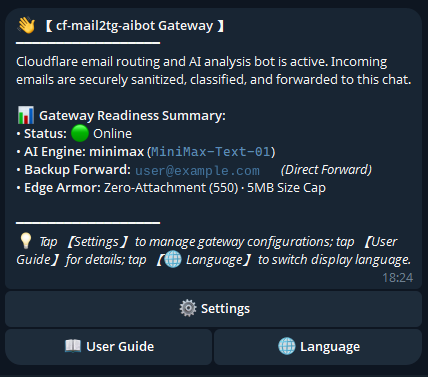
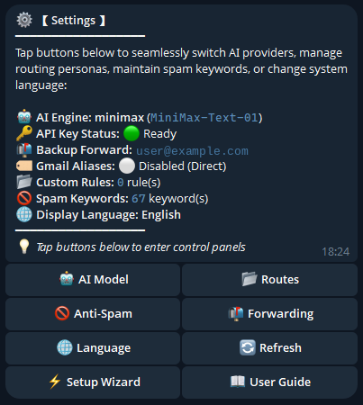
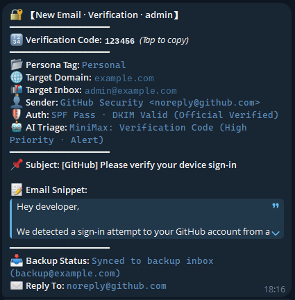
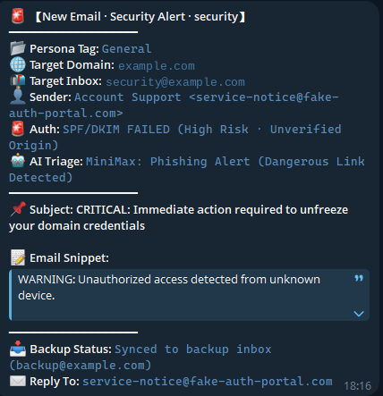
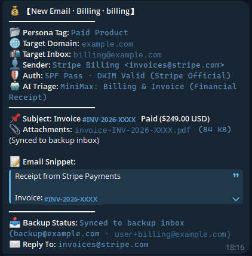
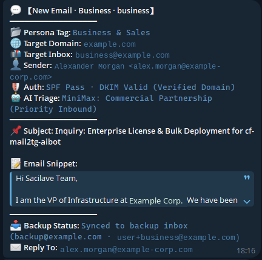
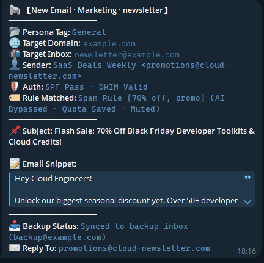
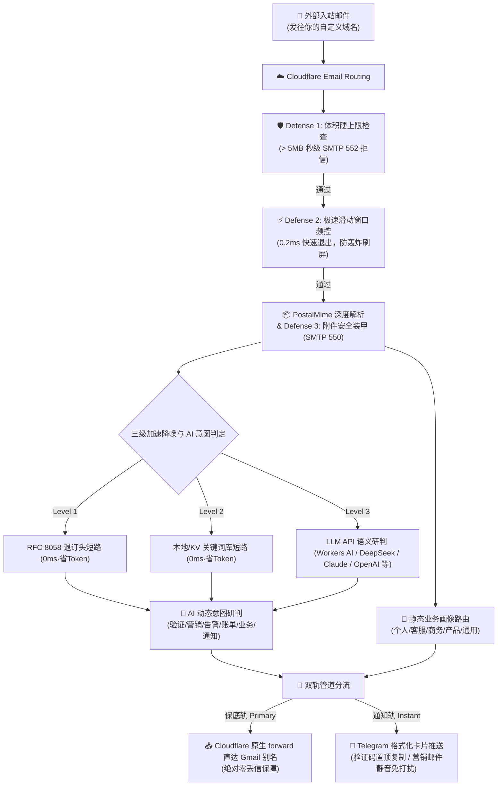

<div align="center">

# 📬 cf-mail2tg-aibot

**基于 Cloudflare Workers 的生产级、零成本、自建邮件转 Telegram AI 机器人**  
*Production-grade, zero-cost, self-hosted Email to Telegram AI Bot powered by Cloudflare Workers & LLM.*

[](LICENSE)
[](https://workers.cloudflare.com/)
[](https://core.telegram.org/bots/api)
[](https://www.typescriptlang.org/)
[](https://vitest.dev/)
[](#-6-🌐-10-种主流语言国际化与一键切换-i18n)
[](#-零成本与免费配额保证)

<p align="center">
  <a href="./README.md">English</a> •
  <b>简体中文</b> •
  <a href="./README.zh-TW.md">繁體中文</a> •
  <a href="./README.ja-JP.md">日本語</a> •
  <a href="./README.ko-KR.md">한국어</a> •
  <a href="./README.pt-BR.md">Português</a> •
  <a href="./README.ru-RU.md">Русский</a> •
  <a href="./README.es-ES.md">Español</a> •
  <a href="./README.fr-FR.md">Français</a> •
  <a href="./README.de-DE.md">Deutsch</a>
</p>

<p align="center">
  <a href="#-截图演示">截图演示</a> •
  <a href="#-极速上手-3-步搞定">快速开始</a> •
  <a href="#-核心特性">核心特性</a> •
  <a href="#-为什么选择-cf-mail2tg-aibot-对比矩阵">方案对比</a> •
  <a href="#-系统架构">系统架构</a> •
  <a href="#-telegram-交互指令">Bot 指令</a> •
  <a href="#-常见问答-faq">常见问答</a>
</p>

</div>

---

## 📖 项目定位

**`cf-mail2tg-aibot`** 是专为**独立开发者（Indie Hackers）、出海团队与多域名站长**打造的自建邮件网关。

利用 Cloudflare Workers 边缘计算与免费的 Email Routing，它将发往你所有域名的邮件**深度解析、经过大模型语义审信与防垃圾降噪后，秒级推送到 Telegram Bot**；同时支持双轨制（Zero-Drop）无损保底直转个人 Gmail。彻底告别每个域名每年数十美元的企业邮箱月费，享受即时通讯收信的极客体验。

---

## 📸 截图演示

以下均为真实运行实例的截图，其中的邮箱地址、验证码、发票号等敏感字段已全部替换为占位内容。

### 🎛️ 机器人控制面板

| | |
| :---: | :---: |
| <br><sub>网关主页——在线状态、AI 引擎与备份转发一目了然</sub> | <br><sub>设置面板——AI 供应商、路由画像、防垃圾与语言一站管理</sub> |

### 📬 邮件通知实景

| | |
| :---: | :---: |
| <br><sub>验证码邮件——验证码自动提取并置顶，点击即可复制</sub> | <br><sub>安全警报——钓鱼邮件被识别并标出 SPF/DKIM 失败</sub> |
| <br><sub>账单邮件——发票信息自动解析，附件一目了然</sub> | <br><sub>商务合作——AI 分诊自动标为优先处理</sub> |

<p align="center">
  <br>
  <sub>营销邮件——促销内容被垃圾规则自动静默</sub>
</p>

---

## 🚀 极速上手 (3 步搞定)

### 1. 获取 Telegram 凭据
- 私聊 [@BotFather](https://t.me/BotFather) ➔ `/newbot` 获取 `TELEGRAM_BOT_TOKEN`；
- 私聊 [@userinfobot](https://t.me/userinfobot) ➔ 获取数字 ID 作为 `TELEGRAM_ADMIN_CHAT_ID`。

### 2. 验证 Cloudflare 目标邮箱
- 进入 Cloudflare 控制台：**Email** ➔ **Email Routing** ➔ **Destination addresses** ➔ 添加并验证你的个人邮箱（如 `you@gmail.com`）。

### 3. 一键部署与激活
```bash
# 克隆与安装依赖
git clone https://github.com/your-username/cf-mail2tg-aibot.git && cd cf-mail2tg-aibot
npm install

# 创建 KV 并将输出的 ID 填入 wrangler.jsonc (kv_namespaces[0].id)
npx wrangler kv namespace create MAIL_ROUTES_KV

# 配置核心密钥
npx wrangler secret put TELEGRAM_BOT_TOKEN
npx wrangler secret put TELEGRAM_ADMIN_CHAT_ID
npx wrangler secret put TELEGRAM_WEBHOOK_SECRET  # 强烈推荐

# 部署上线
npm run deploy
```

- **激活 Webhook**：浏览器访问 `https://<你的Worker>.<子域>.workers.dev/setup-webhook?secret=<密钥>`（返回 `{"ok":true}` 即注册成功）；
- **绑定路由**：在 Cloudflare **Email Routing** ➔ **Routing rules** 中添加 Catch-all 规则：动作选 **Send to Worker** ➔ 绑定 `cf-mail2tg-aibot`；
- **手机完成配置**：在 Telegram 中对 Bot 发送 `/setup`，1 分钟交互式绑定备份邮箱和大模型 Key，无需回电脑打命令！

#### 🤖 可选：配置自动持续部署（Vibe Coding / GitHub Actions）
如果你 Fork 本仓库用于二次开发（Vibe Coding），并希望每次向 `main` 分支提交代码时由 GitHub 自动部署到 Cloudflare：
1. 将 [`.github/workflows/deploy.yml.example`](.github/workflows/deploy.yml.example) 重命名为 `.github/workflows/deploy.yml`；
2. 在你的 GitHub 仓库中进入 **Settings** ➔ **Secrets and variables** ➔ **Actions** ➔ 添加 Secret：`CLOUDFLARE_API_TOKEN`（获取方式：Cloudflare 控制台 ➔ 我的个人资料 ➔ API 令牌 ➔ 创建具有“编辑 Cloudflare Workers”权限的令牌）；
3. 大功告成！之后每次 push 代码或在 GitHub Actions 页面手动点击 "Run workflow"，都会自动通过单测并完成上线。
*(注：作为公开开源模板，默认不开启自动部署，以避免使用者 Fork 后因未配置 Secret 而出现红叉报错。)*

---

## ⚡ 为什么选择 cf-mail2tg-aibot？ (对比矩阵)

| 核心维度 | 市面普通玩具脚本 (Toy scripts) | 商业企业邮箱 (Google Workspace / 飞书) | **cf-mail2tg-aibot (本项目)** |
| :--- | :--- | :--- | :--- |
| **月费成本** | 免费 | $6 ~ $18 / 用户 / 月 (域名多时极昂贵) | **$0 (永久运行于 Cloudflare 免费配额)** |
| **丢信保障** | ❌ Telegram API 波动或限流时直接丢信 | ✅ 正常接收 | **✅ 双轨制保底 (底层无条件直转 Gmail)** |
| **大文件/附件防御** | ❌ 容易击穿 Worker 128MB 内存或爆空间 | 需付费购买额外扩容包 | **✅ 5MB 硬熔断 + SMTP 550 零附件装甲** |
| **抗轰炸频控** | ❌ 易遭遇刷信攻击导致 Bot 被 TG 429 封禁 | 需自建企业级 WAF 规则 | **✅ 0.2ms 滑动窗口短路保护，节省 98% CPU** |
| **邮件意图识别** | ❌ 无，所有垃圾推广一股脑弹窗轰炸 | 基础规则过滤，常误判 | **✅ LLM 语义识别 6 类意图 + 营销信静默推送** |
| **验证码提取** | ❌ 手动在长文本中翻找复制 | ❌ 原生无提取 | **✅ 置顶独立代码块，手机端轻触一键复制** |
| **运维管理** | ❌ 每次改规则必须重新打包代码部署 | 网页后台逐个设置 | **✅ 手机 Telegram 消息直接回复热更新** |

---

## 🏗️ 系统架构



---

## 🌟 核心特性

### 1. 🔄 双轨制“零丢失”管道 (Zero-Drop Delivery)
- **保底轨**：邮件到达 Worker 瞬间，优先调用 Cloudflare 原生通道执行直转。支持按产品画像分流至专属 Gmail 别名（如 `yourname+support@gmail.com`）。即使 Telegram 网络抖动，**原始邮件也绝无丢失风险**。
- **通知轨**：深度清洗 HTML 标签、自动规整 Quoted-Printable 与中文字符集，以优雅的 Telegram 卡片形式呈现。
- **纯通知单轨模式**：若未配置备份邮箱，系统自动优雅降级为纯 Telegram 接收模式，零报错运行。

### 2. 🤖 LLM 语义意图识别与验证码置顶提取
- **开箱即用零成本边缘 AI**：默认搭载 **Cloudflare Workers AI**（运行 `@cf/meta/llama-3.1-8b-instruct`，免 API Key、零成本、边缘原生调度）；同时无缝支持 **DeepSeek**（极低消耗·中文高智）、**Groq**（极速 LPU 推理）、**OpenAI**、**Google Gemini**、**Anthropic Claude**、**OpenRouter** 与通用自定义反代；
- **6 大标准化双字意图标签**：`🔐 验证`、`📢 营销`、`🚨 告警`、`💰 账单`、`💬 业务`、`🔔 通知`；
- **验证码一键复制**：内置高精度中英文正则嗅探引擎与大模型提取能力，在卡片顶端单独以 `<code>` 代码块置顶展示，移动端**轻触一次即可复制验证码**；
- **多语言地道营销词库与静默降噪**：
  - 初始仅加载纯英文通用退订词库作为极简基线；
  - 切换至任意支持语言（如中文、日语、俄语等）时，网关会自动将该语言**由母语习惯专业撰写的地道本地化词库增量追加**至 KV，绝非简单死板翻译，且绝不覆盖用户自定义词汇；
  - 命中退订标头 (RFC 8058) 或词库的邮件自动使用 `disable_notification: true` 进行**静默推送（不响铃、不震动）**，彻底消除通知焦虑；
- **Cloudflare 额度极致防卫与短路优化**：
  - **前置短路机制**：退订标头与本地词库命中时，直接归类为营销并**彻底跳过大模型调用**，0 消耗 AI 算力与网络开销；
  - **正文智能截断**：送审大模型的正文摘录严格限制在 800 字符内，避免长邮件消耗大量上下文与 Token；
  - **内存级缓存与写入去重**：路由规则与词库享有 60 秒内存防击穿缓存，写入时自动对比哈希避免无改动重复写入，最大限度保护 Cloudflare KV 免费写入额度；
- **大模型故障熔断兜底**：若 LLM 接口欠费或超时，系统坚持“先消息提醒（响铃）”，在卡片标注 `⚠️ LLM API失效 (已保底响铃)`，绝不漏掉重要信件。

### 3. 🏷️ 双层标签体系：AI 动态意图 + 手动业务画像 (Two-Tier Tagging)
系统在业内首创**「AI 动态意图 + 静态业务画像」双层标签协同架构**，彻底理清“信里说了什么”与“信件属于哪个业务”：

```
入站邮件
├── 🤖 动态意图标签 (AI Intent) -> 识别「内容性质」
│   ├── 🔐 验证 (提取验证码、置顶代码块、正常响铃)
│   ├── 📢 营销 (命中退订头/关键词/推广语义，静默免打扰)
│   ├── 🚨 告警 (系统报警、异地登录、高优响铃)
│   ├── 💰 账单 (发票凭证、扣款通知、续费提醒)
│   ├── 💬 业务 (日常商务通信、合作洽谈、私人来信)
│   └── 🔔 通知 (GitHub 关注、系统简讯、常规日程)
│
└── 📂 静态画像标签 (Persona / Route Tag) -> 归属「业务领域」
    ├── 个人 (Personal) -> 自动匹配 admin / me / hi / hello 等前缀 (对应 Gmail 别名 +personal)
    ├── 客服 (Support)  -> 自动匹配 support / help / service / cs 等前缀 (对应 Gmail 别名 +support)
    ├── 商务 (Business) -> 自动匹配 sales / billing / business / bd 等前缀 (对应 Gmail 别名 +business)
    ├── 产品 (Product)  -> 自动匹配 product / feedback / app / dev 等前缀 (对应 Gmail 别名 +product)
    ├── 通用 (General)  -> 未定义前缀时的保底归类
    └── ➕ 自定义业务标签 -> 支持自主创建（如 财务、监控、内部 等），全界面动态选择与分流
```

- **Telegram 卡片双重呈现**：
  - 顶部标题协同：`💬 【新邮件 · 业务 · help】`（结合意图与目标账号）；
  - 核心属性栏目：`📂 业务分类: 客服`（直观展示归属业务线）；
- **驱动零丢信 Gmail 别名分流**：
  若开启 `ENABLE_GMAIL_ALIASES=true`，网关会自动将邮件分流至 `user+personal@gmail.com`、`user+support@gmail.com` 或 `user+business@gmail.com`，在 Gmail 端自动分类入盒；
- **极简欢迎卡片 (`/start`) 与全按键设置中心 (`/menu`)**：
  - `/start`：绝对精简的实用主义状态欢迎卡片，直观呈现网关就绪状态，并提供 `[⚙️ 设置]`、`[📖 使用指南]`、`[🌐 切换语言]` 3 大核心快捷入口；
  - `/menu`：重新设计的**「⚙️ 设置」**交互面板，以整洁的 2x4 按钮矩阵一触即达所有配置：
    - `[🤖 AI 模型]` `[📂 业务路由]`
    - `[🚫 垃圾拦截]` `[📬 邮箱转发]`
    - `[🌐 切换语言]` `[🔄 刷新状态]`
    - `[⚡ 配置向导]` `[📖 使用指南]`
  - **自定义分类标签管理 (`m:tags`)**：
    - 在业务路由中提供 `[🏷️ 标签管理]`，支持一键查看、添加或删除自定义分类标签；
    - 点击 `[➕ 添加分流规则]` 时，系统会自动将所有默认标签与自定义标签整齐排列为按钮，轻触即可完成选择绑定；
  - `/routes`：随时查看当前所有生效的内置基线与自定义规则；
  - `/add <标签> <前缀> [目标]`：动态添加新规则，例如 `/add 客服 help` 或 `/add 商务 vip vip@support.com`；
  - `/del <前缀>`：删除指定规则，自带防手滑 Inline Keyboard 二次确认弹窗，或在 `/routes` 面板中直接一键点按删除。

### 4. 🛡️ 四层边缘纵深防御体系 (Edge Armor)
- **零附件装甲 (Zero-Attachment Policy)**：支持在边缘直接以 SMTP 550 拒信拦截带附件邮件，从物理层面杜绝恶意木马及大文件塞爆 Gmail 15GB 空间。
- **体积容量熔断 (Size Cap)**：超过 5MB 邮件直接在边缘返回 SMTP 552 拒信，杜绝 OOM 崩溃与 CPU 超额。
- **极速短路频控 (Pre-Parse Rate Check)**：未解包前先查滑动窗口，被限流垃圾信在 **0.2ms 内退出**，节省 98% 计算算力。
- **Telegram 429 断路器**：遭遇 TG 频控时自动进入 30 秒熔断冷却期，防止请求堆积。

### 5. 🎛️ 手机端 Telegram 交互式控制面板与密钥中枢
- **交互向导 (`/setup`)**：专为移动端打造的 1 分钟交互式分步引导，按提示一步步输入备份邮箱与大模型 Key，输入 `skip` 可跳过当前项，支持随时 `/cancel` 退出；
- **发送 `/config`**：一键调出网关全局就绪状态卡片，**敏感 Key 强制脱敏掩码显示**（如 `min***a8f9`），防止窥屏泄露；
- **免电脑热更新 Key (`/setkey`)**：直接在手机私聊发送 `/setkey minimax <新Key>` 或 `/setkey forward <新邮箱>`，立刻持久化到 Cloudflare KV 并在边缘端实时生效，告别电脑敲命令行；
- **重置动态配置 (`/resetkey`)**：一键清除 KV 动态覆盖项，优雅回退至环境变量初始值；
- **发送 `/keywords`**：Bot 输出当前生效的完整拦截词清单，支持在手机端**一键复制全文**；
- **回复即改**：直接在 Telegram 里选择「回复 (Reply)」Bot 的消息，粘贴修改后的词库，网关自动全量热更新并同步至 Cloudflare KV；
- **发送 `/routes`、`/add`、`/del`**：在手机端随时添加新地址路由分流规则，删除规则自带 Inline Keyboard 二次确认。

### 6. 🌐 10 种主流语言国际化与一键切换 (i18n)
- **支持 10 种主流语言**：🇨🇳 简体中文 (`zh-CN`)、🇺🇸 English (`en-US`)、🇭🇰 繁體中文 (`zh-TW`)、🇯🇵 日本語 (`ja-JP`)、🇰🇷 한국어 (`ko-KR`)、🇧🇷 Português (`pt-BR`)、🇷🇺 Русский (`ru-RU`)、🇪🇸 Español (`es-ES`)、🇫🇷 Français (`fr-FR`)、🇩🇪 Deutsch (`de-DE`)；
- **全链路本地化覆盖**：包括入站邮件卡片推播、验证码提取模块、安全与熔断警报、交互式配置向导、控制面板与 Telegram 原生 Bot 菜单指令；
- **即时交互切换 (`/lang`)**：在 Telegram 中发送 `/lang` 即可呼出 5x2 紧凑内联键盘一键切换（当前语言附带 `✓` 标记），或直接传参快捷设置（如 `/lang ko`、`/lang pt`、`/lang en`）；
- **四级无缝优先级解析**：`Cloudflare KV 动态配置 (config:sys:system_language)` > `环境变量 (DEFAULT_LANGUAGE)` > `Telegram 客户端语言上报 (language_code)` > `保底 (zh-CN)`；
- **零外部依赖与极致性能**：基于纯 TypeScript 静态类型字典树构建，亚毫秒级（< 0.1ms）边缘零内存开销查找。

---

## 📱 Telegram 交互指令

直接在 Telegram 聊天窗口中点击左下角 **[Menu]** 按钮或输入以下指令：

| 指令 | 参数格式 | 功能描述 |
| :--- | :--- | :--- |
| `/start` | - | **👋 极简状态总览**：查看网关运行摘要，直达 `[⚙️ 设置]`、`[📖 使用指南]` 与 `[🌐 切换语言]` |
| `/menu` | - | **⚙️ 设置中心仪表盘**：以 2x4 内联按键面板层级化管理所有设置（AI、路由、拦截词、转发、语言、配置向导、使用指南） |
| `/guide` | - | **📖 详细使用指南**：查看工作流程、邮件分类、垃圾拦截、前缀路由说明与 GitHub 文档直达按钮 |
| `/setup` | - | **⚡ 极速配置向导**：启动交互式分步引导（1 分钟带你完成核心凭证绑定，面板中亦有专属按钮） |
| `/lang` | `[语言代号]` | 切换系统显示语言，支持 5x2 交互式内联键盘切换或直接传参 (如 `/lang ko`、`/lang pt`、`/lang en`) |
| `/provider` | `[1~9\|厂商名]` | 交互式切换大模型厂商 (回复数字 1~9 秒切 Workers AI / DeepSeek / Groq / OpenAI 等) |
| `/model` | `[1~2\|模型名]` | 交互式切换当前厂商的运行模型版本 |
| `/cancel` | - | 退出当前向导或会话，重置交互状态 |
| `/config` | - | 查看网关就绪状态与密钥绑定情况 (带安全脱敏掩码，仅管理员可阅) |
| `/setkey` | `<ai\|minimax\|forward> <值>` | 手机端热更新通用 AI / MiniMax 密钥或备份转发邮箱，即刻持久化保存至 KV |
| `/resetkey` | `<ai\|provider\|model\|minimax\|forward>` | 清除 KV 动态覆盖项，一键恢复至部署时绑定的初始环境变量 |
| `/keywords` | - | 查看并生成带 `<pre><code>` 代码块的全部营销关键词，便于手机一键复制 |
| `/addkeywords` | `<词1>\n<词2>` | 安全增量追加关键词至现有词库（自动去重，绝不覆盖已有词） |
| `/resetkeywords` | - | 一键重置清空自定义词库，恢复系统预设的标准基线关键词 |
| `/routes` | - | 查看当前生效的内置画像规则与 KV 动态路由规则，管理自定义标签 |
| `/add` | `<标签> <前缀> [目标]` | 动态添加分流规则，如 `/add 商务 help user@domain.com` |
| `/del` | `<前缀>` | 删除指定前缀规则（弹出带确认/取消按钮的二次确认卡片） |
| `/help` | - | 查看网关操作面板指南与当前状态 |

---

## 💰 零成本与免费配额保证

本项目专门针对 **Cloudflare Workers 免费计划 (Free Tier)** 进行了极致优化：
- **CPU 计算开销**：单封邮件均值运算仅约 0.5ms，远低于免费额度的 10ms 限制；
- **内存安全**：全量附件防御与 5MB 体积熔断，杜绝突破 128MB 边缘内存配额；
- **KV 存储**：日常收信产生极轻量缓存读取，更新规则时产生 1 次写入，使用量不足免费额度（每天 100,000 次读、1,000 次写）的 0.1%；
- **计费硬隔离**：Cloudflare 免费账户不绑定信用卡机制，任何异常超限仅触发 HTTP 503 阻断，**绝对无法产生任何账单或扣费**。

---

## ❓ 常见问答 (FAQ)

<details>
<summary><b>Q: 如果不配置备份邮箱 (FORWARD_TO_EMAIL)，可以只当纯 Telegram 机器人用吗？</b></summary>
完全可以！未配置 <code>FORWARD_TO_EMAIL</code> 时，网关自动以单轨模式工作，仅向 Telegram 实时推送通知卡片，不会产生任何错误。
</details>

<details>
<summary><b>Q: 为什么卡片上的 SPF/DKIM 显示“未通过 (疑似仿冒来源)”？</b></summary>
这是正常安全防御提示。一些自动化通知或未规范配置反垃圾解析的邮件服务器发出的信件未通过鉴真，网关会在卡片中以醒目徽标提醒防范钓鱼，并自动对该来源收紧频控配额。
</details>

<details>
<summary><b>Q: 不配置大模型 API Key 还可以使用吗？</b></summary>
可以！未配置 <code>MINIMAX_API_KEY</code> 时，网关会自动启用内置的<b>高性能正则嗅探引擎与本地 RFC 规则库</b>，依然可以精准识别验证码与大部分营销推广邮件，零成本即刻起步。
</details>

<details>
<summary><b>Q: 多个域名可以使用同一个 Worker 网关吗？</b></summary>
可以！Cloudflare 免费账户支持添加多个域名，每个域名的 Email Routing Catch-all 规则均可直接选择指向同一个 <code>cf-mail2tg-aibot</code> Worker，网关会自动识别收件域名并实现隔离防御。
</details>

---

## 📄 开源许可证

本项目采用 [MIT License](LICENSE) 许可协议，欢迎自由 Fork、修改或用于个人/团队自建服务。
