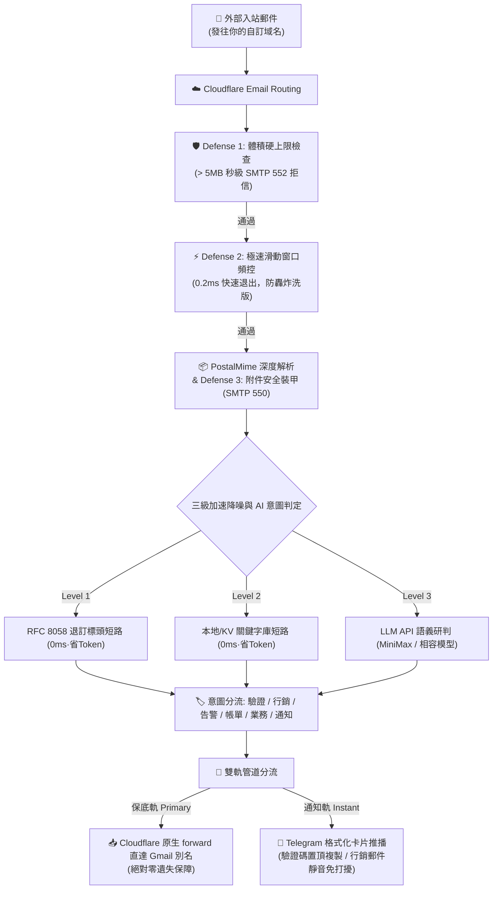

<div align="center">

# 📬 cf-mail2tg-aibot

**基於 Cloudflare Workers 的生產級、零成本、自建郵件轉 Telegram AI 機器人**  
*Production-grade, zero-cost, self-hosted Email to Telegram AI Bot powered by Cloudflare Workers & LLM.*

[](LICENSE)
[](https://workers.cloudflare.com/)
[](https://core.telegram.org/bots/api)
[](https://www.typescriptlang.org/)
[](https://vitest.dev/)
[](#-5-🌐-10-種主流語言國際化-i18n)
[](#-零成本與免費配額保證)

<p align="center">
  <a href="./README.md">English</a> •
  <a href="./README.zh-CN.md">简体中文</a> •
  <b>繁體中文</b> •
  <a href="./README.ja-JP.md">日本語</a> •
  <a href="./README.ko-KR.md">한국어</a> •
  <a href="./README.pt-BR.md">Português</a> •
  <a href="./README.ru-RU.md">Русский</a> •
  <a href="./README.es-ES.md">Español</a> •
  <a href="./README.fr-FR.md">Français</a> •
  <a href="./README.de-DE.md">Deutsch</a>
</p>

<p align="center">
  <a href="#-截圖演示">截圖演示</a> •
  <a href="#-極速上手-3-步搞定">快速開始</a> •
  <a href="#-核心特性">核心特性</a> •
  <a href="#-為什麼選擇-cf-mail2tg-aibot-對比矩陣">方案對比</a> •
  <a href="#-系統架構">系統架構</a> •
  <a href="#-telegram-互動指令">Bot 指令</a> •
  <a href="#-常見問答-faq">常見問答</a>
</p>

</div>

---

## 📖 專案定位

**`cf-mail2tg-aibot`** 是專為**獨立開發者（Indie Hackers）、出海團隊與多域名站長**打造的自建郵件網關。

利用 Cloudflare Workers 邊緣運算與免費的 Email Routing，它將發往你所有域名的郵件**深度解析、經過大模型語義審信與防垃圾降噪後，秒級推播到 Telegram Bot**；同時支援雙軌制（Zero-Drop）無損保底直轉個人 Gmail。徹底告別每個域名每年數十美元的企業信箱月費，享受即時通訊收信的極客體驗。

---

## 📸 截圖演示

以下均為真實運行實例的截圖，其中的郵箱地址、驗證碼、發票號等敏感欄位已全部替換為佔位內容。

### 🎛️ 機器人控制面板

| | |
| :---: | :---: |
| <br><sub>網關主頁——在線狀態、AI 引擎與備份轉發一目了然</sub> | <br><sub>設定面板——AI 供應商、路由画像、防垃圾與語言一站管理</sub> |

### 📬 郵件通知實景

| | |
| :---: | :---: |
| <br><sub>驗證碼郵件——驗證碼自動擷取並置頂，點擊即可複製</sub> | <br><sub>安全警報——釣魚郵件被識別並標出 SPF/DKIM 失敗</sub> |
| <br><sub>賬單郵件——發票資訊自動解析，附件一目了然</sub> | <br><sub>商務合作——AI 分診自動標為優先處理</sub> |

<p align="center">
  <br>
  <sub>行銷郵件——促銷內容被垃圾規則自動靜默</sub>
</p>

---

## 🚀 極速上手 (3 步搞定)

### 1. 獲取 Telegram 憑證
- 私聊 [@BotFather](https://t.me/BotFather) ➔ `/newbot` 獲取 `TELEGRAM_BOT_TOKEN`；
- 私聊 [@userinfobot](https://t.me/userinfobot) ➔ 獲取數字 ID 作為 `TELEGRAM_ADMIN_CHAT_ID`。

### 2. 驗證 Cloudflare 目標信箱
- 進入 Cloudflare 控制台：**Email** ➔ **Email Routing** ➔ **Destination addresses** ➔ 添加並驗證你的個人信箱（如 `you@gmail.com`）。

### 3. 一鍵部署與啟用
```bash
# 複製專案與安裝依賴
git clone https://github.com/your-username/cf-mail2tg-aibot.git && cd cf-mail2tg-aibot
npm install

# 建立 KV 並將輸出的 ID 填入 wrangler.jsonc (kv_namespaces[0].id)
npx wrangler kv namespace create MAIL_ROUTES_KV

# 設定核心金鑰
npx wrangler secret put TELEGRAM_BOT_TOKEN
npx wrangler secret put TELEGRAM_ADMIN_CHAT_ID
npx wrangler secret put TELEGRAM_WEBHOOK_SECRET  # 強烈推薦

# 部署上線
npm run deploy
```

- **啟用 Webhook**：瀏覽器造訪 `https://<你的Worker>.<子域>.workers.dev/setup-webhook?secret=<金鑰>`（返回 `{"ok":true}` 即註冊成功）；
- **綁定路由**：在 Cloudflare **Email Routing** ➔ **Routing rules** 中添加 Catch-all 規則：動作選 **Send to Worker** ➔ 綁定 `cf-mail2tg-aibot`；
- **手機完成配置**：在 Telegram 中對 Bot 發送 `/setup`，1 分鐘互動式綁定備份信箱與大模型 Key，無需回電腦打指令！

#### 🤖 可選：配置自動持續部署（Vibe Coding / GitHub Actions）
如果你 Fork 本專案用於二次開發（Vibe Coding），並希望每次向 `main` 分支提交程式碼時由 GitHub 自動部署到 Cloudflare：
1. 將 [`.github/workflows/deploy.yml.example`](.github/workflows/deploy.yml.example) 重新命名為 `.github/workflows/deploy.yml`；
2. 在你的 GitHub 倉庫中進入 **Settings** ➔ **Secrets and variables** ➔ **Actions** ➔ 添加 Secret：`CLOUDFLARE_API_TOKEN`（取得方式：Cloudflare 控制台 ➔ 我的個人資料 ➔ API 權杖 ➔ 建立具有「編輯 Cloudflare Workers」權限的權杖）；
3. 大功告成！之後每次 push 程式碼或在 GitHub Actions 頁面手動點選 "Run workflow"，都會自動通過單元測試並完成上線。
*(註：作為公開開源範本，預設不啟用自動部署，以避免使用者 Fork 後因未配置 Secret 而出現紅叉報錯。)*

---

## ⚡ 為什麼選擇 cf-mail2tg-aibot？ (對比矩陣)

| 核心維度 | 市面普通腳本 (Toy scripts) | 商業企業信箱 (Google Workspace / 飛書) | **cf-mail2tg-aibot (本專案)** |
| :--- | :--- | :--- | :--- |
| **月費成本** | 免費 | $6 ~ $18 / 使用者 / 月 (多域名時極其昂貴) | **$0 (永久運行於 Cloudflare 免費配額)** |
| **遺失信件保障** | ❌ Telegram API 波動或限流時直接丟信 | ✅ 正常接收 | **✅ 雙軌制保底 (底層無條件直轉 Gmail)** |
| **大檔案/附件防禦** | ❌ 容易擊穿 Worker 128MB 記憶體或爆容量 | 需付費購買額外擴容包 | **✅ 5MB 硬熔斷 + SMTP 550 零附件裝甲** |
| **抗轟炸頻控** | ❌ 易遭遇刷信攻擊導致 Bot 被 TG 429 封禁 | 需自建企業級 WAF 規則 | **✅ 0.2ms 滑動窗口短路保護，節省 98% CPU** |
| **郵件意圖識別** | ❌ 無，所有垃圾推廣一股腦彈窗轟炸 | 基礎規則過濾，常誤判 | **✅ LLM 語義識別 6 類意圖 + 行銷信靜音推播** |
| **驗證碼擷取** | ❌ 手動在長文本中翻找複製 | ❌ 原生無擷取 | **✅ 置頂獨立代碼區塊，手機端輕觸一鍵複製** |
| **維運管理** | ❌ 每次改規則必須重新打包代碼部署 | 網頁後台逐個設定 | **✅ 手機 Telegram 訊息直接回覆熱更新** |

---

## 🏗️ 系統架構



---

## 🌟 核心特性

### 1. 🔄 雙軌制「零遺失」管道 (Zero-Drop Delivery)
- **保底軌**：郵件到達 Worker 瞬間，優先調用 Cloudflare 原生通道執行直轉。支援按產品輪廓分流至專屬 Gmail 別名（如 `yourname+support@gmail.com`）。即使 Telegram 網路抖動，**原始郵件也絕無遺失風險**。
- **通知軌**：深度清洗 HTML 標籤、自動規整 Quoted-Printable 與字元集，以優雅的 Telegram 卡片形式呈現。
- **純通知單軌模式**：若未配置備份信箱，系統自動優雅降級為純 Telegram 接收模式，零報錯運行。

### 2. 🤖 LLM 語義意圖識別與驗證碼置頂擷取
- **6 大標準化雙字意圖標籤**：`🔐 驗證`、`📢 行銷`、`🚨 告警`、`💰 帳單`、`💬 業務`、`🔔 通知`。
- **驗證碼一鍵複製**：內建高精度中英文正則嗅探引擎與大模型擷取能力，在卡片頂端單獨以 `<code>` 代碼區塊置頂展示，行動端**輕觸一次即可複製驗證碼**。
- **行銷推銷靜音降噪**：商業廣告與 SaaS 推銷郵件自動使用 `disable_notification: true` 進行**靜默推播（不響鈴、不震動）**，徹底消除通知焦慮。
- **大模型故障熔斷兜底**：若 LLM 介面欠費或逾時，系統堅持「先訊息提醒（響鈴）」，在卡片標註 `⚠️ LLM API失效 (已保底響鈴)`，絕不漏掉重要信件。

### 3. 🛡️ 四層邊緣縱深防禦體系 (Edge Armor)
- **零附件裝甲 (Zero-Attachment Policy)**：支援在邊緣直接以 SMTP 550 拒信攔截帶附件郵件，從物理層面杜絕惡意木馬及大檔案塞爆 Gmail 15GB 空間。
- **體積容量熔斷 (Size Cap)**：超過 5MB 郵件直接在邊緣返回 SMTP 552 拒信，杜絕 OOM 當機與 CPU 超額。
- **極速短路頻控 (Pre-Parse Rate Check)**：未解包前先查滑動窗口，被限流垃圾信在 **0.2ms 內退出**，節省 98% 運算算力。
- **Telegram 429 斷路器**：遭遇 TG 頻控時自動進入 30 秒熔斷冷卻期，防止請求堆積。

### 4. 🎛️ 手機端 Telegram 互動式控制面板與金鑰中樞
- **互動引導 (`/setup`)**：專為行動端打造的 1 分鐘互動式分步引導，按提示一步步輸入備份信箱與大模型 Key，輸入 `skip` 可跳過當前項，支援隨時 `/cancel` 退出；
- **發送 `/config`**：一鍵調出網關全局就緒狀態卡片，**敏感 Key 強制脫敏遮罩顯示**（如 `min***a8f9`），防止窺屏洩漏；
- **免電腦熱更新 Key (`/setkey`)**：直接在手機私聊發送 `/setkey minimax <新Key>` 或 `/setkey forward <新信箱>`，立刻持久化到 Cloudflare KV 並在邊緣端即時生效，告別電腦敲命令列；
- **重設動態配置 (`/resetkey`)**：一鍵清除 KV 動態覆蓋項，優雅回退至環境變數初始值；
- **發送 `/keywords`**：Bot 輸出當前生效的完整攔截詞清單，支援在手機端**一鍵複製全文**；
- **回覆即改**：直接在 Telegram 裡選擇「回覆 (Reply)」Bot 的訊息，貼上修改後的詞庫，網關自動全量熱更新並同步至 Cloudflare KV；
- **發送 `/routes`、`/add`、`/del`**：在手機端隨時添加新地址路由分流規則，刪除規則自帶 Inline Keyboard 二次確認。

### 5. 🌐 10 種主流語言國際化與一鍵切換 (i18n)
- **支援 10 種主流語言**：🇨🇳 簡體中文 (`zh-CN`)、🇺🇸 English (`en-US`)、🇭🇰 繁體中文 (`zh-TW`)、🇯🇵 日本語 (`ja-JP`)、🇰🇷 한국어 (`ko-KR`)、🇧🇷 Português (`pt-BR`)、🇷🇺 Русский (`ru-RU`)、🇪🇸 Español (`es-ES`)、🇫🇷 Français (`fr-FR`)、🇩🇪 Deutsch (`de-DE`)；
- **全鏈路本地化覆蓋**：包括入站郵件卡片推播、驗證碼擷取模組、安全與熔斷警報、互動式配置引導、控制面板與 Telegram 原生 Bot 選單指令；
- **即時互動切換 (`/lang`)**：在 Telegram 中發送 `/lang` 即可呼出 5x2 緊湊內聯鍵盤一鍵切換（當前語言附帶 `✓` 標記），或直接傳參快捷設定（如 `/lang ko`、`/lang pt`、`/lang en`）；
- **四級無縫優先級解析**：`Cloudflare KV 動態配置 (config:sys:system_language)` > `環境變數 (DEFAULT_LANGUAGE)` > `Telegram 客戶端語言上報 (language_code)` > `保底 (zh-CN)`；
- **零外部依賴與極致效能**：基於純 TypeScript 靜態型別字典樹構建，亞毫秒級（< 0.1ms）邊緣零記憶體開銷查找。

---

## 📱 Telegram 互動指令

直接在 Telegram 聊天視窗中點擊左下角 **[Menu]** 按鈕或輸入以下指令：

| 指令 | 參數格式 | 功能描述 |
| :--- | :--- | :--- |
| `/lang` | `[語言代號]` | 切換系統顯示語言，支援 5x2 互動式內嵌鍵盤切換或直接傳參 (如 `/lang ko`、`/lang pt`、`/lang en`) |
| `/setup` | - | 啟動互動式分步極速配置引導 (1 分鐘帶你完成核心憑證綁定) |
| `/cancel` | - | 退出當前引導或對話，重設互動狀態 |
| `/config` | - | 查看網關就緒狀態與金鑰綁定情況 (帶安全脫敏遮罩，僅管理員可閱) |
| `/setkey` | `<minimax\|forward> <值>` | 手機端熱更新大模型金鑰或備份轉發信箱，即刻持久化保存至 KV |
| `/resetkey` | `<minimax\|forward>` | 清除 KV 動態覆蓋項，一鍵恢復至部署時綁定的初始環境變數 |
| `/keywords` | - | 查看並生成帶 `<pre><code>` 代碼區塊的全部行銷關鍵字，便於手機一鍵複製 |
| `/addkeywords` | `<詞1>\n<詞2>` | 安全增量追加關鍵字至現有詞庫（自動去重，絕不覆蓋已有詞） |
| `/resetkeywords` | - | 一鍵重設清空自訂詞庫，恢復系統預設的標準基線關鍵字 |
| `/routes` | - | 查看當前生效的內建輪廓規則與 KV 動態路由規則 |
| `/add` | `<標籤> <前綴> [目標]` | 動態添加分流規則，如 `/add 商業支持 help user@domain.com` |
| `/del` | `<前綴>` | 刪除指定前綴規則（彈出帶確認/取消按鈕的二次確認卡片） |
| `/help` | - | 查看網關操作面板指南與當前狀態 |

---

## 💰 零成本與免費配額保證

本專案專門針對 **Cloudflare Workers 免費計劃 (Free Tier)** 進行了極致優化：
- **CPU 運算開銷**：單封郵件均值運算僅約 0.5ms，遠低於免費額度的 10ms 限制；
- **記憶體安全**：全量附件防禦與 5MB 體積熔斷，杜絕突破 128MB 邊緣記憶體配額；
- **KV 儲存**：日常收信產生極輕量快取讀取，更新規則時產生 1 次寫入，使用量不足免費額度（每天 100,000 次讀、1,000 次寫）的 0.1%；
- **計費硬隔離**：Cloudflare 免費帳戶不綁定信用卡機制，任何異常超限僅觸發 HTTP 503 阻斷，**絕對無法產生任何帳單或扣費**。

---

## ❓ 常見問答 (FAQ)

<details>
<summary><b>Q: 如果不配置備份信箱 (FORWARD_TO_EMAIL)，可以只當純 Telegram 機器人用嗎？</b></summary>
完全可以！未配置 <code>FORWARD_TO_EMAIL</code> 時，網關自動以單軌模式運作，僅向 Telegram 即時推播通知卡片，不會產生任何錯誤。
</details>

<details>
<summary><b>Q: 為什麼卡片上的 SPF/DKIM 顯示「未通過 (疑似仿冒來源)」？</b></summary>
這是正常安全防禦提示。一些自動化通知或未規範配置反垃圾解析的郵件伺服器發出的信件未通過鑑真，網關會在卡片中以醒目標誌提醒防範釣魚，並自動對該來源收緊頻控配額。
</details>

<details>
<summary><b>Q: 不配置大模型 API Key 還可以使用嗎？</b></summary>
可以！未配置 <code>MINIMAX_API_KEY</code> 時，網關會自動啟用內建的<b>高效能正則嗅探引擎與本地 RFC 規則庫</b>，依然可以精準識別驗證碼與大部分行銷推廣郵件，零成本即刻起步。
</details>

<details>
<summary><b>Q: 多個域名可以使用同一個 Worker 網關嗎？</b></summary>
可以！Cloudflare 免費帳戶支援添加多個域名，每個域名的 Email Routing Catch-all 規則均可直接選擇指向同一個 <code>cf-mail2tg-aibot</code> Worker，網关會自動識別收件域名並實現隔離防禦。
</details>

---

## 📄 開源授權條款

本專案採用 [MIT License](LICENSE) 授權條款，歡迎自由 Fork、修改或用於個人/團隊自建服務。
