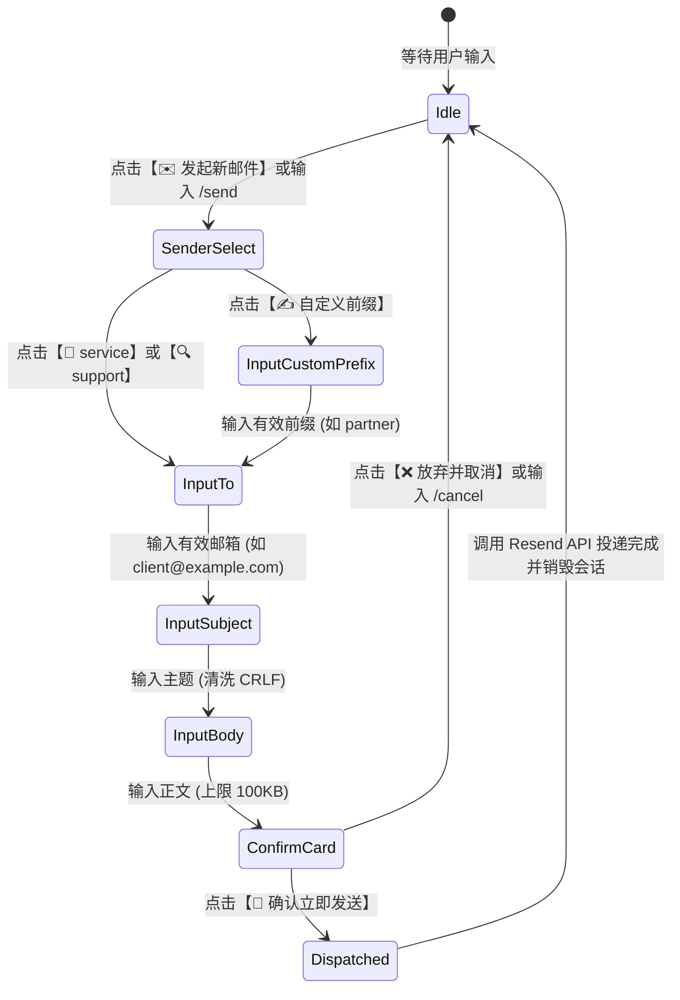

# cf-mail2tg-aibot 主动外发邮件与多步向导系统架构设计方案 (EMAIL COMPOSE & SEND ARCHITECTURE)

> **版本**: 1.0.0  
> **适用环境**: Cloudflare Workers + Cloudflare KV + Resend REST API + Telegram Bot  
> **核心目标**: 支持 Telegram 内通过按钮菜单或 `/send` 指令主动发起邮件，置顶展示核心路由身份 (`service@example.com` 与 `support@example.com`)，并通过多步引导（收件人 ➔ 主题 ➔ 正文 ➔ 二次确认）实现安全、低额度消耗、体验极佳的主动外发邮件系统。

---

## 一、 系统架构与交互状态机设计 (Architecture & State Machine)



### 1.1 状态定义与生命周期

| 阶段 / 状态 | 触发入口 | 交互呈现 | 安全与校验逻辑 |
| :--- | :--- | :--- | :--- |
| **0. 路由选择 (`SenderSelect`)** | `/send` 或 `comp:start` | 呈现发件路由卡片与专属按键矩阵 | 检查 `RESEND_API_KEY`；提取核心与动态路由 |
| **1. 收件人 (`input_to`)** | `comp:from:<addr>` | 提示输入目标完整邮箱 | 严格邮箱正则校验 (`isValidEmail`)；不合规即时告警重输 |
| **2. 邮件主题 (`input_subject`)** | 发送有效收件邮箱 | 提示输入主题 (支持 `skip` 跳过) | `cleanHeaderValue()` 彻底清洗 `\r\n` 及控制字符防注入 |
| **3. 邮件正文 (`input_body`)** | 发送主题文本 | 提示输入正文内容（支持多行） | 长度熔断截断 (最大 100KB)；非空校验 |
| **4. 核验确认 (`confirm`)** | 发送正文文本 | 呈现完整要素核验卡片与折叠预览 | 仅支持【🚀 确认立即发送】与【❌ 放弃并取消】按键 |
| **5. 极速投递 (`comp:send`)** | 点击立即发送按键 | 调用 Resend API 并回执 Message-ID | 立即销毁 KV Session，杜绝重放与并发重复提交 |

---

## 二、 核心路由身份策略 (Sender Identities)

按用户专属业务要求，发件路由选择卡片中采用**分级展示策略**：

1. **第一行置顶核心身份 (Primary Core Identities)**:
   - `[ 🥥 service@example.com ]`
   - `[ 🔍 support@example.com ]`
   用户最核心的两个收发路由固定位于第一排突出呈现，轻触即刻绑定发信身份。
2. **第二及后续行 (Dynamic & Baseline Routes)**:
   - 自动聚合读取并去重 KV 动态配置的自定义分流路由（如 `custom-dev@example.com`）；
   - 保底预设业务路由（`support@example.com`、`sales@example.com`、`admin@example.com`）；
   - 每行 2 个按键排布，整洁规范。
3. **底部操作栏 (Action Buttons)**:
   - `[ ✍️ 自定义前缀 ]` (`comp:custom`): 点击后可任意指定新的发件人前缀（如 `vip@example.com`）；
   - `[ ❌ 取消发信 ]` (`m:cancel`): 随时退出会话并返回主菜单。

---

## 三、 Cloudflare 免费额度保护机制 (KV & CPU Hardening)

针对 Cloudflare Workers 免费计划的额度限制（100,000 请求/天、1,000 KV 写/天、10ms CPU），本方案采取了以下深度优化：

1. **单一会话键复用 (`session:interactive_action`)**:
   - 不为每次发信创建独立 KV Key，全局仅维护管理员当前专属的会话状态；
   - 自动配置 `expirationTtl: 300`（5 分钟自毁），即使异常中断也不会残留垃圾数据；
   - 全链路完成发信仅产生 4 次 KV 写入，投递完成后立即彻底清除。
2. **RAM 内存层路由与关键词缓存 (`ROUTER_MEM_CACHE`)**:
   - `getAvailableSenderList` 读取动态规则时复用内存缓存，避免向导每次展开时向 KV 发起高频读请求；
3. **Resend REST API 直连外发**:
   - 直接调用 `https://api.resend.com/emails`，不使用 Cloudflare Email Routing 的转发出站额度，不受每日发信配额限制。

---

## 四、 零信任安全防御矩阵 (Zero-Trust Security Hardening)

1. **Telegram 管理员鉴权熔断**:
   - 所有 `/send` 指令、文本消息、回调按键均强制执行 `update.from.id === TELEGRAM_ADMIN_CHAT_ID` 鉴权校验；
   - 非管理员用户触发一律静默返回 200，杜绝信息探测与机器人滥用。
2. **CRLF Header Injection 彻底防御**:
   - 针对邮件主题、发件人、收件人全面调用 `cleanHeaderValue()`；
   - 正则剔除 `[\r\n\x00-\x1F\x7F]+`，杜绝攻击者通过在主题注入回车换行伪造 `Bcc:`、`Cc:` 或篡改 MIME 标头。
3. **地址格式与防回环机制**:
   - 发件地址必须符合有效邮箱格式；
   - 禁止发件地址与收件地址完全相同（防止引起无限自循环投递）。

---

## 五、 用户所需配置清单与操作指南 (User Action Checklist)

整个方案代码层已全部开发并验证通过。**您只需要进行以下一步极简配置即可立即开始使用：**

### 1. 配置 Resend 发信密钥 (二选一)

* **方式 A（最推荐·电报内一秒热更新）**:
  在 Telegram 机器人聊天框直接发送：
  ```text
  /setresend re_你的Resend密钥
  ```
  *(注：亦可使用 `/setkey resend re_你的Resend密钥`)*

* **方式 B（Worker 环境变量）**:
  在项目根目录 `.dev.vars` 或 Cloudflare Workers 控制台环境变量中添加：
  ```bash
  RESEND_API_KEY="re_123456789abcdef..."
  ```

> 💡 **发信域名要求**:
> 请确保您在 [Resend Console](https://resend.com/domains) 中已将 `example.com` 域名完成 DNS 校验（DKIM、SPF 状态显示为 Verified 即可畅通发信，避免落入垃圾箱）。

---

### 2. 日常使用方式

* **使用方式 1：指令直达**
  向机器人发送 `/send` 即可立即弹出路由选择按键面板。

* **使用方式 2：菜单按键**
  发送 `/start` 或 `/menu`，点击主菜单中的 `[ ✉️ 发起新邮件 ]` 按钮。
