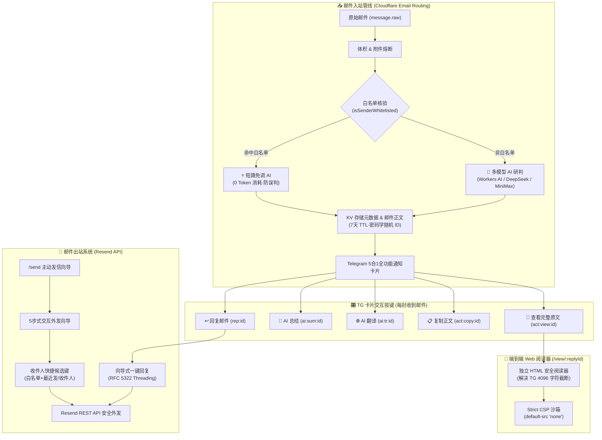

# cf-mail2tg-aibot 全量更新归档与开源同步清单

> **归档时间**: 2026-10-29  
> **分支与基线**: `main` (commit `130ae55`)  
> **测试状态**: 13 套件 / 206 测试用例全部 100% 通过  
> **隐私合规性**: 零私有凭证、零硬编码密钥、零私有域名泄漏

---

## 一、 核心架构演进全景

---

## 二、 全量功能新增与优化详情

### 1. 邮件外发核心与 RFC 5322 线程回复 (`src/email-sender.ts`)
- **协议合规性**：严格适配 RFC 5322 与 RFC 2822 标准，外发回复时自动组装 `In-Reply-To` 与 `References` 标头，保证邮件客户端（Gmail、Outlook、Apple Mail 等）完美折叠为单条会话流。
- **标头注入防御**：引入 `cleanHeaderValue()` 过滤器，清洗剔除所有 `\r\n` 及 ASCII 控制字符，杜绝 SMTP/MIME 邮件标头注入劫持。
- **主题规范化**：自动添加 `Re: ` 前缀，且幂等处理避免产生 `Re: Re:` 重复。
- **Resend 集成**：通过官方 REST API 进行出站投递，不消耗 Cloudflare 邮件出站额度。

### 2. 主动式外发邮件交互向导 (`/send` 与 `comp:start`)
- **多步向导流程**：
  - **第 0 步 · 发件身份选择**：聚合预设身份、已配置自定义规则以及 `[ ✍️ 自定义前缀 ]`。
  - **第 1 步 · 目标收件人**：带严格邮箱格式校验，并展示动态快捷候选按键。
  - **第 2 步 · 邮件主题**：支持直接输入主题，或发送 `skip` 默认无主题。
  - **第 3 步 · 邮件正文**：支持多行排版，100KB 长度熔断截断。
  - **第 4 步 · 最终确认核验**：展示完整发信要素核验卡片，确认后立即投递。
- **生命周期优化**：KV 交互会话设置 300 秒自毁，发信完成后立即销毁会话。
- **动态密钥配置**：支持在 TG 内直接发送 `/setkey resend re_xxxxxx`，免重新部署。

### 3. 白名单系统 (`/whitelist` 体系)
- **管理指令集**：`/whitelist`, `/addwhitelist`, `/delwhitelist`, `/clearwhitelist`, `/resetwhitelist`。
- **额度短路机制**：命中白名单的发件人直接标定为 `业务`，完全跳过大模型研判，**0 Token 消耗，防误判为营销邮件**。
- **存储与缓存**：KV 存储配合进程内 RAM Cache（`ROUTER_MEM_CACHE`），写操作带内容幂等比对，节省 KV 写入额度。
- **精准匹配**：支持完整邮箱地址与域名级匹配（`@domain.com` 或 `domain.com`），并对单字通配做了防误伤防御。

### 4. 动态收件人快捷候选键 (Dynamic Quick-Pick)
- 自动提取并聚合成按键，展示在发信第 1 步面板中：
  - 白名单中的全部邮箱地址；
  - 最近 2 次别人发给我的发件人地址（最近入站）；
  - 最近 2 次我外发邮件的收件人地址（最近出站）。
- 随着邮件收发实时动态更新。

### 5. 收信通知卡片 4 大增强按键 (收信后即刻可用)
- **`[ 🤖 AI 总结 ]`**：
  - 基于 Humanizer 实用主义风格设计 Prompt，彻底去除“AI 套话”，输出高信息密度的要点、金额、节点与行动事项（Action Items）。
  - 多语言自适应：无论原邮件为何种语言，均自动提炼为用户 Telegram 目标语言（如中文）。
  - KV 缓存：首次提炼后自动缓存至 KV，后续点击秒级响应，0 Token 消耗。
- **`[ 🌐 AI 翻译 ]`**：
  - 全文自然去机械感翻译，双语主题对照呈现，带长度保护与 KV 缓存。
- **`[ 📋 复制正文 ]`**：
  - 发送带有 `<pre><code>...</code></pre>` 语法的单触即拷卡片，手机轻点一键复制。
- **`[ 📖 查看完整原文 ]`**：
  - 提供轻量安全 Web 阅读器 `GET /view/:replyId`，彻底解决 Telegram 4096 字符截断问题。
  - 自动渲染富文本，自适应暗黑模式，并提供一键复制全文按钮。

### 6. 全量安全性与零信任沙箱加固
- **Web 阅读器 CSP 沙箱**：响应头强制开启 `default-src 'none'; style-src 'unsafe-inline'; img-src https: data: cid:; font-src https: data:;`，并在 HTML 层彻底过滤 `<script>`, `<meta>`, `<base>`, `<iframe>`, `<object>`, `<embed>`, `javascript:` 链接以及无引号 `on*` 事件。
- **密码学凭据安全**：`replyId` 升级为 64 位密码学高熵安全伪随机字符（`crypto.getRandomValues(8)`），杜绝 URL 遍历扫描。
- **Telegram HTML 容灾器**：封装 `formatTelegramSafeHtml()`，白名单保留合法格式标签，对其余非法生僻标签与未转义字符安全编码，并设 3000/2800 字符硬性熔断。
- **提示词防注入 (Prompt Injection)**：为摘要与翻译 Prompt 配置强制安全护栏。

---

## 三、 开源版本同步隐私与安全基线规范

为了确保 `C:\_Tech\cf-mail2tg-aibot` 作为开源公共仓库的安全与合规，必须严格执行以下红线规则：

| 检查项 | 私有仓库现状 (`cf-mail2tg-aibot`) | 开源版本规范 (`cf-mail2tg-aibot`) | 检验标准 |
| :--- | :--- | :--- | :--- |
| **Resend API Key** | 私有测试配置 `re_xxxxxxxxxxxxxx` | 仅在 `.dev.vars.example` 提供空模板 `RESEND_API_KEY=""` | 源码中严禁包含任何 `re_` 前缀真实密钥 |
| **Telegram Bot Token** | 私有测试 Token `1234567890:ABCdefGHIjklMNOpqrsTUVwxyz | 示例 Token `1234567890:ABCdefGHIjkl...` | 源码中严禁包含实际机器人的 Token |
| **Telegram Admin ID** | 私有用户 ID `123456789` | 示例 ID `123456789` | 源码中严禁硬编码实际 Chat ID |
| **默认发信人与域名** | 私有域名 `service@example.com` 等 | 动态使用 `env.EMAIL_DOMAIN`，默认兜底 `example.com` | 彻底移除所有 `example.com`、`service`、`support`、`sacilave` 私有标识 |
| **备份邮箱** | 私有邮箱 `backup@example.com` | 示例邮箱 `your-backup-email@gmail.com` | 严禁泄露个人主邮箱 |
